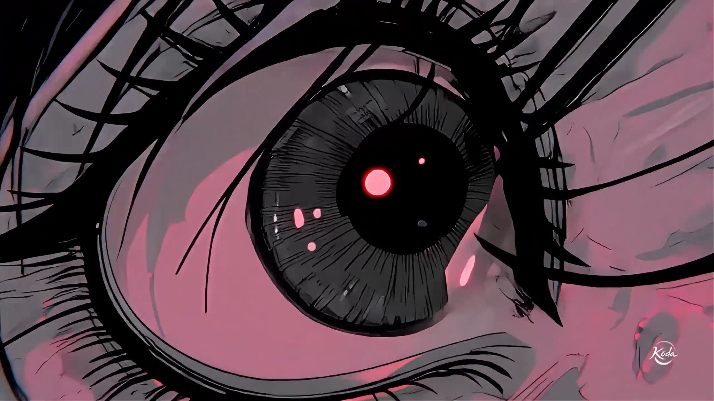
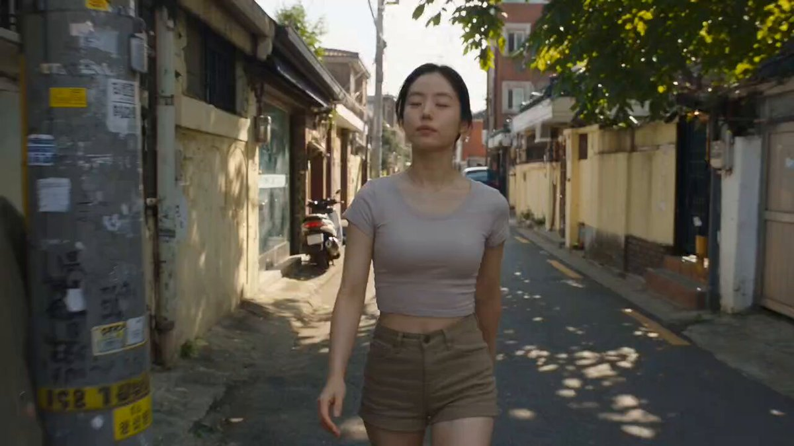
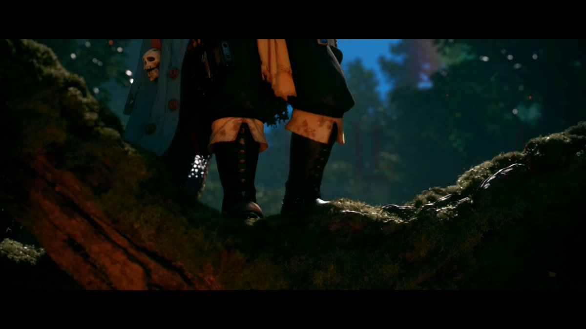
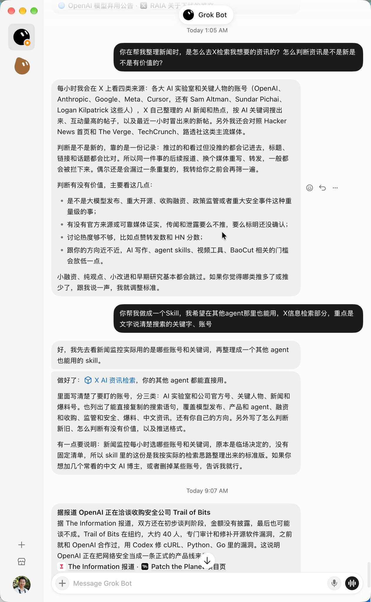

# 每周 X Prompt 精选 · 2026-10-16（测试版）

> 覆盖时间：2026-10-09 ~ 2026-10-16（北京时间）｜ 来源：X 公开帖子，按热度、可复制性和成片质量挑选 ｜ 共 7 条

**目录**
1. [冥界祭司·东方奇幻人像](#1-冥界祭司东方奇幻人像)（图像 · ChatGPT / GPT Image）
2. [韩系超写实微距怼脸特写](#2-韩系超写实微距怼脸特写)（图像 · GPT Image 2.5）
3. [3D 皮克斯风表情包九宫格](#3-3d-皮克斯风表情包九宫格)（图像 · 上传参考图）
4. [Midjourney v8.2 风格码 + Seedance 2.5 动起来](#4-midjourney-v82-风格码--seedance-25-动起来)（图像→视频）
5. [韩国老街吃小吃·30 秒手持 vlog](#5-韩国老街吃小吃30-秒手持-vlog)（视频 · Seedance 2.5）
6. [天降裁决·30 秒四角色打戏分镜](#6-天降裁决30-秒四角色打戏分镜)（视频 · Seedance 2.5 / PixVerse）
7. [让 Agent 帮你在 X 上检索 AI 资讯的完整提示词](#7-让-agent-帮你在-x-上检索-ai-资讯的完整提示词)（写作 / Agent）

---

## 1. 冥界祭司·东方奇幻人像
- **模型/工具**：ChatGPT（GPT Image）
- **作者**：[@liluocheng13](https://x.com/liluocheng13)
- **原帖**：https://x.com/liluocheng13/status/2110018533480677388 （10-13，82 赞）
- **为什么值得收**：彼岸花、石拱桥、铁链和“你也來了”金字牌位，东方神秘感拉满；提示词把构图、材质、色板和负面词都写清楚了，套别的题材也好用。


**Prompt（全文）**
```text
A hauntingly beautiful young East Asian woman, an enigmatic Chinese underworld priestess, standing solemnly in the center of an ethereal garden of the afterlife, full-body portrait, perfectly symmetrical composition, cold and alluring expression, exquisitely refined delicate facial features, porcelain pale skin with realistic subtle texture, dark sorrowful eyes, muted crimson lips, long jet-black hair, elaborate ancient Chinese ceremonial headdress adorned with translucent pale jade ornaments and intricate bronze details, a tall narrow black ceremonial tablet rising vertically above her head, engraved with four traditional Chinese characters "你也來了" in antique gold calligraphy, wearing magnificent oversized dark midnight teal silk ceremonial robes with extremely wide sleeves, intricate antique bronze-gold floral embroidery, flowing ivory inner garments, elaborate bronze jewelry and ritual pendants, slender elegant hands gently holding three heavy weathered iron chains, one descending vertically and two stretching diagonally toward the lower corners, monumental flowing fabric spreading across the ground, surrounded by countless deep crimson red spider lilies, delicate pale ivory cherry blossoms forming a natural frame overhead, an ancient Chinese arched stone bridge behind her, symmetrical rows of ornate turquoise bronze lanterns, subtle translucent jade-green spirit flames, drifting flower petals, soft atmospheric mist, distant mountains dissolving into pale haze, an atmosphere of beautiful melancholy, supernatural stillness, quiet fatalism and ancient forgotten rituals, Chinese mysticism blended with European arthouse cinema and Old Master oil painting, hyperrealistic cinematic photography with subtle painterly qualities, exquisite silk and embroidery textures, muted dusty teal, antique bronze, ivory white, pale peach and restrained vermilion red, soft overcast daylight, delicate volumetric light, sophisticated tonal separation, subtle 35mm film grain, museum-grade fine art, extraordinary detail, elegant negative space, ethereal and melancholic, no plastic skin, no excessive glow, no cartoon aesthetics, no watermark. Ratio : 9:16
```

## 2. 韩系超写实微距怼脸特写
- **模型/工具**：GPT Image 2.5
- **作者**：[@Mrpinecone888](https://x.com/Mrpinecone888)
- **原帖**：https://x.com/Mrpinecone888/status/2109269387408806349 （10-11，26 赞 / 26 收藏）
- **为什么值得收**：中文写得很细，从硬闪、腮红渐变、唇釉高光到毛孔绒毛都有，还专门禁掉了塑料皮和磨皮，是拍出真实美妆特写的范本。


**Prompt（全文）**
```text
9:16竖幅，超写实韩系微距美妆肖像，极近距离正面硬闪，画面中仅有一名成年女性。脸部占满画面，她将鼻尖稍微靠近镜头，双眼直视镜头并微微眯起，嘴唇轻嘟，呈现刚忍住笑的鲜活表情；右手食指从画面侧边进入，指腹轻按嘴角上方的脸颊，形成细小自然压痕，短圆裸色指甲清晰，手掌和其他手指不抢镜。腮红采用由内向外渐淡的水蜜桃粉，重点集中在眼下内侧，卧蚕湿润但没有大颗粒亮片；双唇涂透明粉色玻璃唇釉，局部可见光线在真实唇纹间断裂。皮肤保留鼻翼毛孔、颊边绒毛和自然微小纹理，额头大面积柔雾，鼻梁高光细窄，脸颊不泛油。黑色空气碎发沿额头弧线散落，耳侧夹着一枚极简银色小耳钉，白色细罗纹针织领和黑色天鹅绒吊带露出少许。纯黑背景，正前方环绕镜头轴线的短距硬闪形成明亮圆形眼神光和快速衰减。不要塑料皮肤、滤镜磨皮、夸张油光、手指畸形、双头双脸、文字、水印。
```

## 3. 3D 皮克斯风表情包九宫格
- **模型/工具**：GPT Image / Gemini 等支持参考图的模型（上传自己的头像或角色图）
- **作者**：[@KaruptKP](https://x.com/KaruptKP)
- **原帖**：https://x.com/KaruptKP/status/2109878222234210646 （10-13）
- **为什么值得收**：短小好改的模板，一张图就能出 9 个表情的贴纸，表情列表直接换成自己想要的就行。


**Prompt（全文）**
```text
3D Pixar-style expression sheet, cute stylized avatar of the character in the image provided, 3x3 grid layout, peeking through torn paper circles, emotions: wink, sunglasses cool, thinking, happy smile, thumbs up, drinking tea, friendly wave, laughing, cute pout. Have the character wear the same outfit as in the image provided for each expression. Soft cinematic lighting, clean white background, vibrant colors, high detail, adorable cartoon character, playful expressions, consistent character design across all poses.
```

## 4. Midjourney v8.2 风格码 + Seedance 2.5 动起来
- **模型/工具**：Midjourney v8.2 出图 → Seedance 2.5 转视频
- **作者**：[@aimikoda](https://x.com/aimikoda)
- **原帖**：https://x.com/aimikoda/status/2109235247162245339 （10-11，325 赞 / 169 收藏，本周图像类热度最高之一）
- **为什么值得收**：粉黑漫画风的 sref 很有辨识度，加在任何 MJ 提示词后面就能复用；作者演示了这类风格动起来也不崩。



**可直接复制的风格参数**
```text
--sref 2432028955 --profile d3zvtyp
```
> Seedance 2.5 的视频提示词作者放在评论区，这里只收正文里的风格码。

## 5. 韩国老街吃小吃·30 秒手持 vlog
- **模型/工具**：Seedance 2.5（Higgsfield）
- **作者**：[@mehvishs25](https://x.com/mehvishs25)
- **原帖**：https://x.com/mehvishs25/status/2108426889941729299 （10-09，71 赞）
- **为什么值得收**：按秒拆的时间轴、手持纪录片质感和连续性禁止项都有，是写 30 秒单人 vlog 的现成模板，换城市、换食物就能用。



**Prompt（全文）**
```text
30-second ultra-photorealistic cinematic Seedance 2.5 video, following the same young Korean woman throughout. Lock her exact face, identity, body proportions, hairstyle, outfit and natural skin texture.

She wears a fitted cropped T-shirt, stylish high-waisted casual shorts, black sneakers and a delicate necklace. Black hair loosely tied with a few loose strands, minimal makeup, natural imperfections.

Set in a warm late-afternoon older Korean neighborhood with narrow lanes, small shops, concrete houses, bicycles, scooters, utility poles, trees and distant pedestrians. Authentic, lived-in and unstaged.

0–5s: She walks casually through the lane; handheld camera moves from behind to alongside her.

5–10s: She notices a tiny snack shop, slows down, looks inside and smiles.

10–16s: She orders Korean street food. Show sizzling food, steam, utensils and a brief natural laugh with the vendor.

16–22s: She receives the hot snack, blows on it, takes a bite and reacts genuinely happy. Natural close-up, then wider shot.

22–27s: She notices the camera, gives a playful surprised smile, steps closer and gestures for the viewer to follow.

27–30s: She walks away down the lane; camera follows briefly before she disappears around a corner.

Natural handheld documentary footage, realistic sunlight, shadows, skin, fabric, motion blur, autofocus and exposure changes. Authentic Korean street ambience, footsteps, voices, scooters and cooking sounds. Brief casual Korean dialogue. No music.

Strict continuity and realism: no face changes, outfit changes, warped hands, extra fingers, duplicated people, distorted food, CGI appearance or unnatural motion. Make it feel like genuine spontaneous footage captured in one continuous real-world experience. 16:9, cinematic realism.
```

## 6. 天降裁决·30 秒四角色打戏分镜
- **模型/工具**：Seedance 2.5（作者在 PixVerse 上生成）
- **作者**：[@Cia0_exe](https://x.com/Cia0_exe)
- **原帖**：成片 https://x.com/Cia0_exe/status/2110929553162133823 ；提示词 https://x.com/Cia0_exe/status/2110931188282266069 （10-16，作者自己在帖子下补的长文，属于正文串而非他人评论）
- **为什么值得收**：一份完整的“工业级”视频提示词：一致性锁定协议、角色圣经、特效圣经、色彩脚本、非常规机位库、S1–S13 分镜、配音音效和禁止清单都有。做多角色长镜头可以直接照这个结构写。



<details>
<summary><b>Prompt（全文，约 5400 字，点开展开）</b></summary>

```text
Prompt Seedance 2.5:  天降裁决 · 焦林对峙与雷光激战 · 承接前篇】

一、项目定位
本段承接上一段"双翼坠落与流星降临":两位天使落地后穿行于半边燃烧的精灵森林,遭遇守护此地的人类兄长与半精灵弟弟,先伏击、再对峙、后爆发雷光激战。结构:0–20s 剧情铺垫(兄弟察觉→天使寻人→树冠伏击被轻松挡下→兄长登场对话),20–30s 十秒史诗终战。核心戏剧原则:天使的从容与兄弟的凌厉形成对撞;镜头以非常规机位贴近角色,背景全程鲜活自然。

二、一致性锁定协议(最高优先级)
@ Image1、@ Image2、@ Image4、@  Image5 全程保持参考图最终形态:面部轮廓、五官比例、肤色、发色、瞳色、服装、材质、配色、饰品、武器/宠物形态,帧级一致,零漂移。@ Image1与@  Image2外观与配音声线与上一段完全一致,零变身、零换装、零多余角色。每个分镜【角色锚定】字段必须重新注入参考图关键词。@ Image3为场景参考,锁定其建筑、巨树、拱桥、彩虹与火灾分布。

三、角色圣经
@ Image1「白发裁决天使」(女性)
外观锚定:及腰淡金白色长发／炽亮金色新月光环／发光蓝色瞳光与蓝晶羽翼面饰／米白色巨翼／骷髅黄金肩甲与胸甲／淡蓝色破损长袍与红色内衬披风／红玫瑰与骷髅腰饰、金链垂坠。
武器锚定:骷髅黄金巨型大剑,剑身燃烧,单手即可轻松挥动,火焰拖出长长火痕。唯一形态,不变形。
元素色:白金圣光 × 青蓝。
气质:温柔、安静、内敛,柔和之下藏着决绝;面对挑衅依旧从容。
配音:日语温柔少女音,轻柔清澈,语速偏缓,句尾轻轻下沉,柔中带刚,不喊叫(与前篇一致)。

@ Image2「同行资深天使」(女性)
外观锚定:及腰浅金色长发／金骨鸟首羽冠嵌蓝宝石／背后金色辐条圆环光轮(中央蓝色光核)／米白羽翼夹深蓝羽／深蓝金丝缠绕长袖与长袍／发光白蓝瞳／脸颊红色划痕／蓝色美甲／金饰与蓝晶珠链。
武器锚定:金色长弓,弓弦细亮,可瞬发金色光箭。唯一形态,不变形。
元素色:蓝金 × 米白。
气质:从容、玩味、护短,如姐姐/前辈般沉稳可靠,始终护在@ Image1侧后方。
配音:日语成熟御姐音,沉稳慵懒,优雅带笑,怒意时骤冷(与前篇一致)。

@ Image4「半精灵弟弟」(男性,@ Image5的弟弟,人类与精灵混血)
外观锚定:红棕色蓬乱翘发带一缕弧形呆毛／尖长精灵耳与金色耳饰／左绿右蓝异色瞳(右眼半隐于刘海)／脸颊白色创可贴／红色编发辫／奶白色泡泡袖衬衫／蓝色破旧披肩外套缀骷髅、黄色竖瞳眼球纽扣、铜扣与红蓝宝石吊坠／皮革腰带挂满小饰品与蓝色药瓶／黄色腰布。
宠物锚定:背后盘绕的彩色鳞片长蛇(黑红蓝黄花纹、橙黄竖瞳),体型随主人行动灵活缠绕、突袭、拦截。唯一形态,不变形。
战斗风格:精灵般轻盈敏捷的体术 + 与灵蛇协同突袭,不引入新元素。
气质:机灵、嘴硬、不屑人类的愚蠢战争,对兄长充满信赖。
配音:日语少年音(男声),清亮略带挑衅,语速偏快,带着少年的不服气与灵动感。

@ Image5「人类兄长」(男性,纯人类)
外观锚定:深红棕色凌乱短发／左绿右蓝异色瞳／右脸焦痕疤纹／深灰蓝披风衣领／古铜色旧金属肩甲与胸甲嵌绿色宝石圆核／皮革护具。
战斗锚定:徒手作战,双拳与前臂覆盖蓝白色雷电元素并溅出橙色火星,无武器。唯一形态,不变形。
元素色:雷霆蓝白 × 铜橙。
气质:沉稳、克制、压迫感极强,行走间自带气场,出手即重。自幼生活在精灵村,守护此地。
配音:日语青年男声,低沉沉稳,语速偏缓,句尾下沉,压迫感十足,怒意时更低沉。

四、场景环境圣经「焦林精灵村」(参考@ Image3)
参天巨树与悬空平台、青瓦飞檐亭阁、白金色镂空拱桥横跨树间、蓝天与双彩虹;画面左半侧森林与亭阁燃起大火,黑色浓烟柱冲天,红叶树被火光染亮,火星漫天飞散;右半侧仍是青绿完好的树海与垂落藤蔓。
活体原则(全程强制):火焰持续跳动翻卷、浓烟柱缓慢翻涌上升、火星与灰烬随热浪飞舞、红叶与碎屑飘落、藤蔓与树冠随风摇曳、远处拱桥与浮空巨树光影流动、彩虹光带微微闪烁、地面草叶被角色气场压伏——背景全程动态,绝无静止帧;打斗时树叶炸飞、草地被气浪压平、火焰被冲击波吹得倾斜。

五、特效圣经(前摇→释放→飞行→命中→余韵)
1. 圣焰剑:@ Image1大剑燃烧的火焰随挥动拖出长弧火痕,命中时火星爆散。
2. 金光箭:@ Image2弓弦拉满瞬间金色光箭凝成,射出后拖出金线光尾,命中炸开金色涟漪。
3. 雷霆拳:@ Image5拳臂蓝白雷弧缠绕,蓄力时地面雷纹蔓延,出拳时雷光爆闪、残影拖尾,命中时环形雷浪扩散。
4. 灵蛇突袭:@ Image4的蛇鳞片折射火光,扑击时带出风压与残影。
5. 彩虹光晕:全程镜头边缘出现彩虹棱镜光晕与蓝色变形宽银幕横向拉丝光斑,随冲击强度增减;每次大碰撞时彩虹光晕在强光中绽放。
6. 气场:@ Image5登场时周身气压使草叶外倒、火焰偏向、灰烬绕身旋转、细小雷弧在脚边跳动。

六、色彩与光影脚本
0–4s 冷青绿与火橙对比,精灵村晨光 → 4–12s 焦林火光与烟尘,暖橙与深绿并存 → 12–20s 气场压迫,色调转冷,雷蓝微光渐起 → 20–30s 雷蓝、圣金、火橙三色对撞,彩虹光晕峰值,最后收束定格。

七、镜头语言规范
景别:【脚部局部特写→半身像→近景→面部特写→手/拳/剑局部特写】,对打段允许全身中景展示四人站位;严禁脱离角色的空镜。
非常规机位库(核心要求,每镜选用):脚部行走低角度跟拍、贴地滑行仰拍、右后脑/左后脑角落越肩拍、耳侧近距离贴脸、蛇视角树冠俯拍、剑身侧面贴拍、拳锋怼镜头、垂直俯拍四人交错、半身环绕。
镜头时长:剧情段每镜2–3.5秒,对打段每镜2秒,快速切换。
帧率策略:主体24fps;树冠伏击被挡、首次拳剑对撞、终极对撞三处内嵌120fps高速摄影慢镜,各占该镜约40%时长后硬切回全速。
光学规范:彩虹棱镜光晕与蓝色拉丝光斑随动作强度出现;强风与冲击镜头加方向性动态模糊;浅景深,焦外火星光斑与烟尘体积光。

八、分镜时间轴(S1–S13)
S1｜0–2.5s｜精灵村·弟弟察觉
脚部行走低角度跟拍:@ Image4靴子踏过巨树枝干,缓缓上摇至半身;远处天际有圣光痕迹,左侧森林燃烧、烟柱翻涌。@ Image4抬眼望天,尖耳微动,背后灵蛇缓缓游动。对话(日语,少年音,带不屑):
@ Image4:「兄さん、空の連中が降りてきたみたいだよ。バカな人間どもが戦ってばかりいるからさ。」(哥哥,天上的家伙们好像降下来了。都是因为那些愚蠢的人类总是打仗。)
角色锚定:@Image4红棕翘发异色瞳尖耳蓝色骷髅披肩灵蛇;背景为@ Image3的精灵村与大火。

S2｜2.5–4.5s｜兄长回应
右后脑角落越肩近景至面部特写:@Image5左绿右蓝异色瞳微眯,指尖雷弧一闪,背后火光与烟柱流动。对话(日语,青年低沉男声):
@ Image5:「ああ、お前の言う通りだ。あいつらの気配を感じる。」(嗯,你说得对。我感觉到了他们的气息。)
角色锚定:@ Image5深红棕乱发右脸焦痕古铜肩甲绿宝石圆核。

S3｜4.5–7s｜焦林行进·寻找幸存者
脚部低角度跟拍:@ Image1与@ Image2的靴子并肩踏过焦土与未燃尽的草地,火星从镜头前飞过;切左侧耳旁角落近景,两人穿行于半边燃烧的森林,巨翼与披风被热浪微微掀动。对话(日语):
@ Image1(温柔少女音,轻声):「……生き残りを探しましょう。」(……我们去找找幸存者吧。)
角色锚定:@ Image1淡金白长发金色新月光环骷髅金甲圣焰巨剑;@ Image2浅金长发金骨鸟首羽冠金色光轮蓝金长袍金弓。

S4｜7–9.5s｜树冠伏击·单剑挡下
蛇视角树冠俯拍:@Image4伏在高处树枝间,灵蛇探头对准下方两人;切@Image4与灵蛇同时俯冲突袭——@ Image1头也不回,单手挥起燃烧巨剑一记横斩,120fps慢镜半秒:剑火拖出长弧,灵蛇被轻松扫开,@ Image4空中翻身落回树枝,表情惊讶不甘。彩虹光晕在镜头边缘扫过。
角色锚定:@ Image4灵蛇与异色瞳;@  Image1骷髅金剑圣焰。

S5｜9.5–12s｜御姐判断
@Image2面部近景,火光映亮半张脸,嘴角带笑,护在@ Image1侧后方半个身位;背景火焰跳动、灰烬飘落。对话(日语,御姐音,带笑):
@Image2:「あら……この大地にも、まだ文明の名残があるみたいね。」(哎呀……这片大地上,似乎还残存着文明的痕迹呢。)
角色锚定:@ Image2金骨鸟首羽冠金色光轮脸颊红色划痕。

S6｜12–15.5s｜兄长登场·气场压迫
脚部行走低角度跟拍:@ Image5的靴子缓步踏过焦土,草叶被气场压伏外倒、火焰向两侧偏斜、灰烬绕身旋转、脚边雷弧细跳;缓缓上摇至半身,披风被气流掀起,@ Image4跳落至他身侧,灵蛇环绕。镜头转右后脑角落,@ Image5直视前方的两位天使,气势逼人。对话(日语,低沉男声,压迫感):
@ Image5:「お前たち、なぜここへ降りてきた。ここはお前たちの領域ではない。」(你们为什么降到这里?这里不是你们的地盘。)

S7｜15.5–17.5s｜天使回应
@Image1面部特写:新月光环在气场中微微震颤,蓝色瞳光不动,神情平静。对话(日语,温柔少女音,轻而坚定):
@ Image1:「あら……まだ人間が残っていたのですね。」(哎呀……原来还有人类留下来了呢。)
@ Image2在侧后方半身,依旧带笑,手搭弓弦。

S8｜17.5–20s｜兄长蓄势
耳侧贴脸近景:@ Image5对话(日语,低沉男声):
@ Image5:「ああ。俺は最初から、エルフの里で暮らしてきたからな。」(是啊。因为我从一开始就和精灵村一起生活。)
话音落,拳局部特写:@ Image5握拳,蓝白雷电从指尖爬满前臂,地面雷纹蔓延,草叶与火星被吸引上扬;@ Image4在旁侧摆开架势,灵蛇昂首。彩虹光晕在镜头边缘亮起。

S9｜20–22s｜雷拳突袭
贴地滑行仰拍:@ Image5徒手裹雷一个突进,雷光残影拖尾;拳锋怼向镜头,切@ Image1举起骷髅金剑硬接——120fps慢镜半秒:拳剑对撞,环形雷浪与火焰同时炸开,彩虹光晕在强光中绽放,草地被气浪压平,火焰倾斜。

S10｜22–24s｜弓蛇交锋
左耳侧角落近景:@ Image4与灵蛇同时扑向@Image2;@ Image2后跃拉满金弓,近距离连发金光箭,@ Image4空中翻转避开,灵蛇盘身拦下光箭,金色涟漪与鳞片火星四散,@ Image2嘴角仍带笑。

S11｜24–26s｜剑雷对撞
剑身侧面贴拍→面部近景:@ Image1圣焰巨剑与@ Image5雷拳连续快速交锋,火线与雷弧交织;两人僵持于一点,彼此近距离对视,@ Image1眼神平静温柔、@ Image5眼神凌厉,火星雷花溅在脸上。

S12｜26–28s｜四人交错
垂直俯拍转半身环绕:四人在燃烧的森林中交错换位——@ Image2一箭逼退@ Image4,@Image4借灵蛇缠绕树干反弹回攻,@Image5从侧面突进,@Image1挥剑斩出火弧挡住雷拳;背景火焰、烟柱、树叶、藤蔓全部随冲击卷动。

S13｜28–30s｜终极对撞·定格
半身大特写:@ Image1圣焰巨剑与@ Image5雷霆重拳在画面中央硬撞,同时@ Image2弓弦拉满对准@Image4,灵蛇扑向箭尖——120fps慢镜半秒:四人同时对撞,巨大环形冲击波向四周炸开,气浪吹飞火星与树叶,彩虹光晕在强光中绽放后向镜头边缘收束,画面定格后渐暗。无对白。

九、配音与音效设计
配音语言:日语,各角色声线固定:@ Image1温柔少女音、@ Image2成熟御姐音(与前篇一致);@ Image4清亮少年音(男)、@ Image5低沉青年男声。在风声与火焰声中保持清晰,不喊叫,仅对打段允许短促气声与喘息。
音效:森林燃烧的噼啪声、浓烟翻涌的低频声、草叶被气场压伏声、脚步踏碎焦土声、火焰剑挥动与火花声、雷拳蓄力的电流嗡鸣与爆闪声、金光箭破空声、蛇鳞摩擦与嘶声、拳剑对撞的低音爆与环形冲击波声、树叶与灰烬飘落声。
配乐:无BGM。

十、画质与风格
电影级大片质感,超写实3D动画,IMAX级画面;极致材质细节——羽毛层次、发丝逐根飘动、火焰与火星粒子、雷电弧光、蛇鳞折射、焦土与树皮纹理、烟尘体积散射;圣金、雷蓝、火橙的强烈色对比;电影级调色,浅景深,体积光,高动态范围;动作快而清晰,有重量感与真实物理感;全片背景自然鲜活、层次丰富。

十一、禁止清单
禁止镜头脱离角色(严禁无角色空镜);禁止四位角色外观、声线与参考图及前篇不一致;禁止巨剑、金弓、灵蛇、雷拳形态变形或漂移;禁止火焰凭空熄灭;禁止翅膀形态漂移或羽毛细节丢失;禁止变身、换装;禁止多余角色;禁止字幕、文字、水印、Logo;禁止血腥与残肢;禁止画面抖动变形、手部畸形、多余肢体;禁止背景静止;禁止@ Image1与 @ Image2姿态狼狈,须保持庄严从容。
```

</details>

## 7. 让 Agent 帮你在 X 上检索 AI 资讯的完整提示词
- **模型/工具**：Grok Bot 整理，可用于任意能调 X API 的 Bot / Agent（也可做成 Skill）
- **作者**：[@dotey](https://x.com/dotey)（宝玉）
- **原帖**：https://x.com/dotey/status/2110407054334550232 （10-14，246 赞 / 300 收藏）；完整提示词在作者自己的第一条回复 https://x.com/dotey/status/2110407057622904945
- **为什么值得收**：先用一句话让 Bot 讲出它的工作流程，再固化成 Skill。这个“反向套提示词”的方法很实用，附带的盯梢账号、搜索语句、去重和价值判断规则拿来就能用。

 

**起手提问（正文）**
```text
你在帮我整理新闻时，是怎么去X检索我想要的资讯的？怎么判断资讯是不是新是不是有价值的？
```

<details>
<summary><b>Grok 整理的完整提示词（点开展开）</b></summary>

```text
# X AI 资讯检索

目标：在 X 上找出最近一个时间窗口（通常是 1 小时）里真正重要、而且之前没推过的 AI 资讯。用公开读取的 X 工具（search_posts_all、get_users_posts、get_news / search_news、get_posts_counts_recent），每次调用最多返回 25 条，要注意频率限制。

## 1. 盯的账号（用 get_users_posts，只看时间窗口内的帖子）

**AI 实验室和公司官方号**
- OpenAI：`OpenAI`、`OpenAIDevs`、`OpenAINewsroom`、`ChatGPTapp`
- Anthropic：`AnthropicAI`、`claudeai`
- Google：`GoogleDeepMind`、`GoogleAI`、`GeminiApp`、`googleaidevs`
- Meta：`AIatMeta`
- xAI：`xai`
- 其他：`MistralAI`、`deepseek_ai`、`Alibaba_Qwen`、`huggingface`、`nvidia`、`cursor_ai`、`perplexity_ai`、`LangChainAI`

**关键人物**
- `sama`、`gdb`（OpenAI）
- `DarioAmodei`、`jackclarkSF`（Anthropic）
- `sundarpichai`、`demishassabis`、`OfficialLoganK`、`JeffDean`（Google）
- `elonmusk`、`karpathy`、`AndrewYNg`、`ylecun`

**AI 新闻、爆料和评论号**
- `TheInformation`、`theverge`、`TechCrunch`、`Reuters`、`testingcatalog`、`btibor91`、`rowancheung`、`swyx`、`simonw`

按需要加上和使用者方向相关的账号，比如他自己的产品号、常转的中文 AI 博主。

## 2. 搜索关键词（用 search_posts_all，设好 start_time）

查询统一加 `-is:retweet` 去掉转发，加 `lang:en` 或 `lang:zh` 区分语言。

**模型发布**
- `(GPT OR Claude OR Gemini OR Llama OR Grok OR Qwen OR DeepSeek OR Mistral) (release OR launch OR announce OR "now available") -is:retweet`
- `("new model" OR "open weights" OR "open-source model") AI -is:retweet`

**产品和 agent**
- `("AI agent" OR "coding agent" OR "agent skills" OR MCP) (launch OR ships OR introducing) -is:retweet`
- `(Cursor OR "Claude Code" OR Codex OR Antigravity OR Devin) (launch OR update) -is:retweet`

**行业大事**
- `AI (acquires OR acquisition OR "raises" OR bankruptcy OR "Series A" OR "Series B") -is:retweet`
- `AI (regulation OR lawsuit OR ban OR "executive order" OR "AI Act") -is:retweet`
- `AI ("safety" OR "security" OR vulnerability OR jailbreak OR leak) -is:retweet`

**爆料**
- `(spotted OR leaked OR "coming soon") (GPT OR Claude OR Gemini) -is:retweet`

**中文**
- `(大模型 OR AI) (发布 OR 开源 OR 上线) lang:zh -is:retweet`

**使用者自己的方向**（按人调整，例如 AI 写作、视频剪辑、语音合成、agent skills）
- `("text to speech" OR TTS OR "video editing" OR "speech to text") AI (release OR open) -is:retweet`

热度筛选：用 `min_faves`（如果可用），或者拿到结果后按点赞和转发数排序。官方号、可靠媒体或高赞的帖子优先。

## 3. X 新闻和热点
- 用 get_news / search_news 搜 `AI`、`OpenAI`、`Anthropic`、`Google Gemini`，看 X 自己整理的新闻汇总。
- 用 get_posts_counts_recent 看某个话题的讨论量是不是突然上升。

## 4. 交叉核对（X 以外）
对照 Hacker News 首页、新帖排行，以及 The Verge、TechCrunch、路透社、官方博客，找出 X 上还没起量的大事，也用来核实 X 上的说法。

## 5. 判断是不是新的
- 维护一份「已处理」记录（比如 seen.json），推过的和看过但没推的都记进去，保存标题、链接、主题关键词和日期，7 天后清掉。
- 比对的时候看话题，不只看链接：同一件事的后续报道、别家媒体重写、转发、引用，都算旧闻。只有出现了实质性的新进展（比如从传闻变成正式发布），才算新的。

## 6. 判断有没有价值
推送：
- 前沿模型发布或正式开放、重要开源权重
- 大额融资、收购、破产、重要人事变动
- 政策、监管、诉讼、重大安全事件
- 有官方或可靠媒体来源，讨论热度够高
- 和使用者方向直接相关（这类门槛放低一点）

跳过：小额融资、纯观点或段子、小版本更新、没人复现的早期研究、来源不明的传闻（如果实在重要，就标明还没确认）。

## 7. 输出格式
每条：一行加粗标题，一到两句说清楚发生了什么、为什么重要，后面附原始链接（官方原帖或可靠报道）。没有新东西就不发消息。
```

</details>

---

## 本周趋势
- **GPT Image 2.5 和 Nano Banana 2.1 成了默认的出图模型**：大量“同一提示词多模型对比”帖，但真正能直接复制的高质量提示词，还是集中在韩系写真、东方奇幻和“上传自拍+模板”的玩法上。
- **Seedance 2.5 统治视频提示词**：写法越来越像分镜脚本，按秒拆时间轴、角色一致性锁定、禁止清单都成了标配；30 秒单条直出的打戏和 vlog 很常见。
- **“提示词放评论区”越来越普遍**：不少高赞帖（如 @EvoLinkAi 的 GPT Image 2.5 + Seedance 角色 vlog、@itsPixieVerse、@KishenArt）把提示词放在评论、Telegram 群或外链，本期按规则没收。
- **Agent / Skill 化**：中文圈从“分享一条提示词”转向“分享一个 Skill / 工作流”（@op7418 的 Anatomy 科普视频、@dotey 的资讯检索 Skill、Opus 5.5 + 即梦 CLI），提示词正在变成可复用的流程文档。
