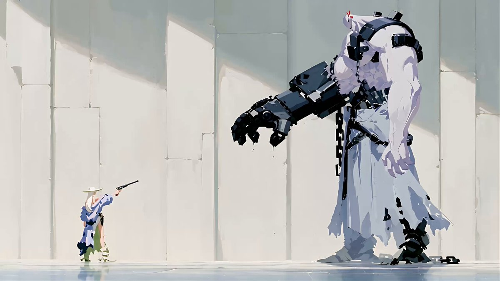
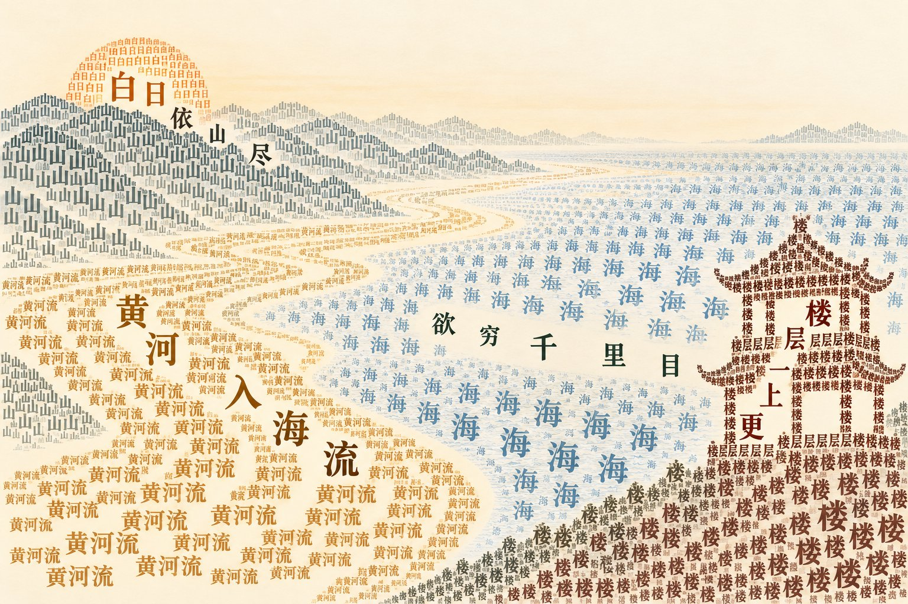
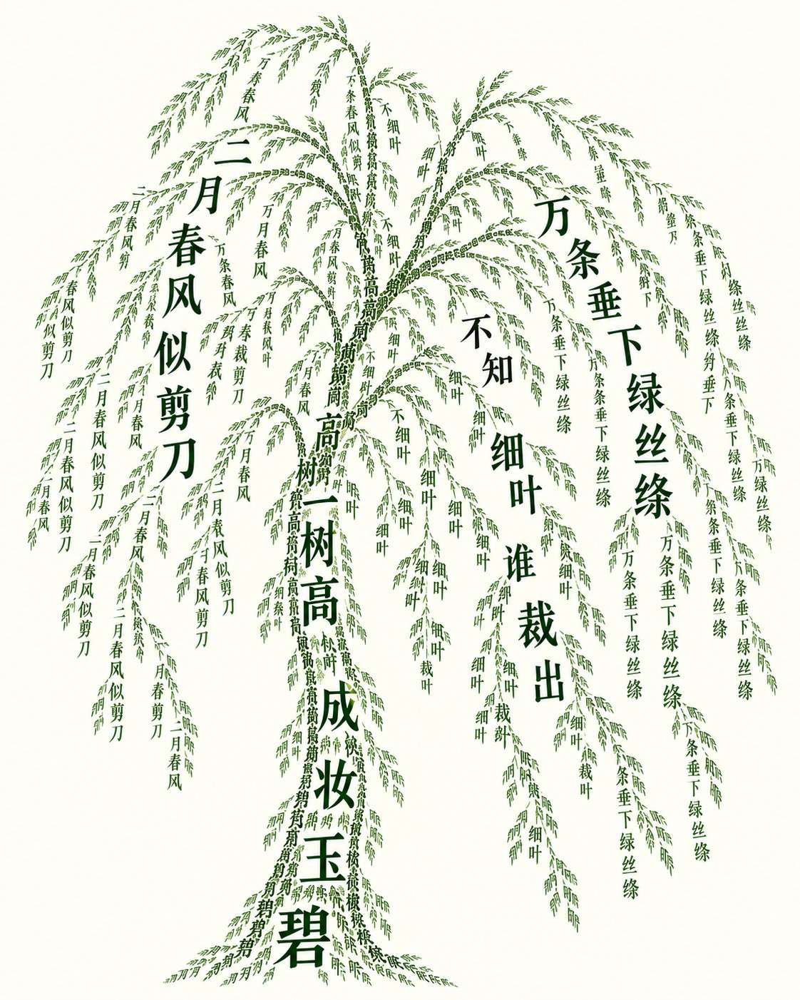
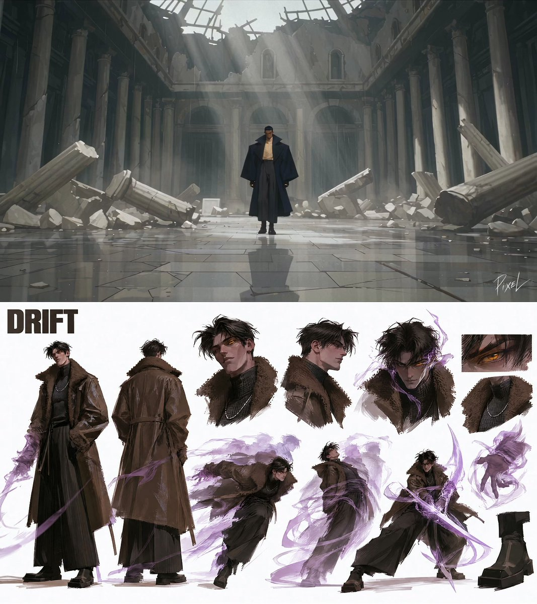
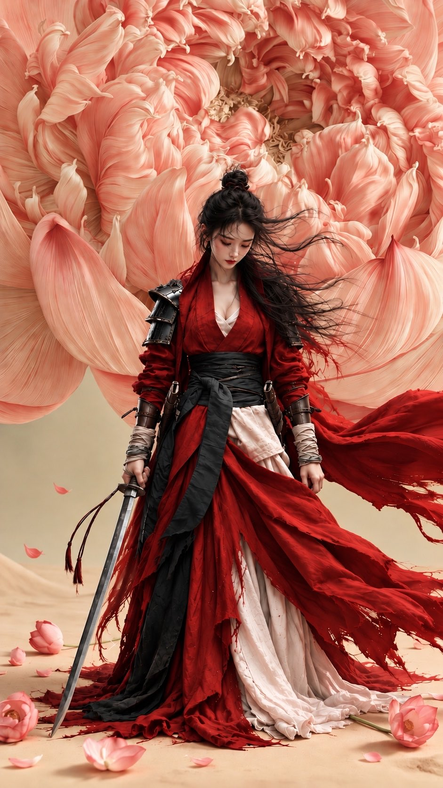
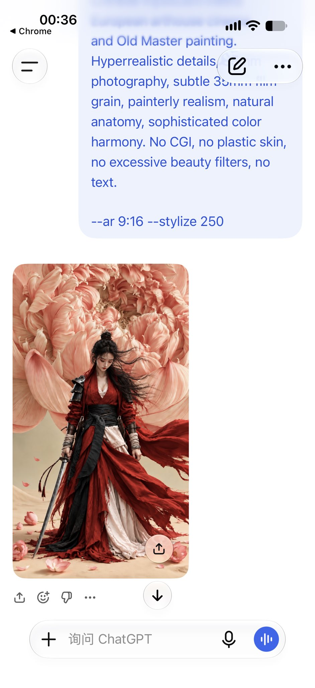
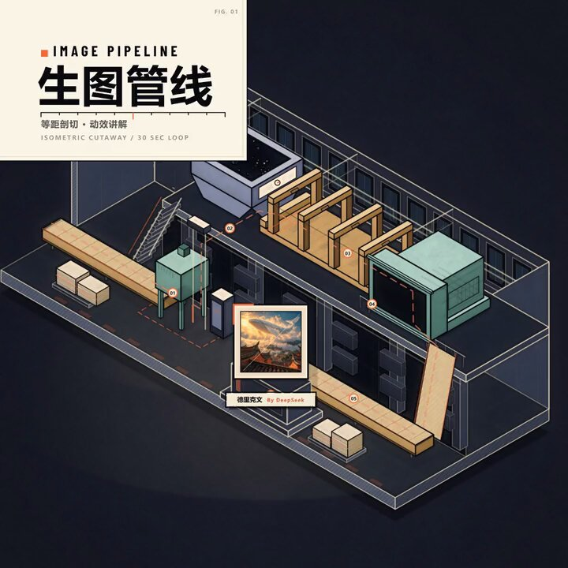

# 每周 X Prompt 精选 · 2026-10-26

> 覆盖时间：2026-10-19 ~ 2026-10-25（北京时间，周一至周日）｜ 来源：X 公开帖子，按热度、可复制性和成片质量挑选 ｜ 共 7 条

**目录**
1. [枪手 vs 巨人·Sandevistan 残影慢动作](#1-枪手-vs-巨人sandevistan-残影慢动作)（视频 · Seedance 2.5 + Claude Opus 5.5）
2. [诗变成画·只用诗里的字排出画面](#2-诗变成画只用诗里的字排出画面)（图像/教育 · ChatGPT 6.1 Sol）
3. [火焰与回声·两段 30 秒超能力对决](#3-火焰与回声两段-30-秒超能力对决)（视频 · Seedance 2.5 × Midjourney v8.2 × GPT Image 2.5）
4. [牡丹下的红衣女侠](#4-牡丹下的红衣女侠)（图像 · ChatGPT / Midjourney 参数）
5. [金箔威尼斯·从清晨到日落的延时](#5-金箔威尼斯从清晨到日落的延时)（视频 · GPT Image 2.5 Flare → Seedance 2.5）
6. [用代码做“AI 生图工厂”动效讲解片](#6-用代码做ai-生图工厂动效讲解片)（代码动画 · DeepSeek V4.1 Flash）
7. [文风渐变长文提示词](#7-文风渐变长文提示词)（写作 · DeepSeek / 任意 LLM）

---

## 1. 枪手 vs 巨人·Sandevistan 残影慢动作
- **模型/工具**：Seedance 2.5（视频），Claude Opus 5.5（后期剪辑慢动作段）
- **作者**：[@aimikoda](https://x.com/aimikoda)
- **原帖**：https://x.com/aimikoda/status/2114007429146964169 （10-24，463 赞 / 242 收藏）；完整提示词在作者自己的回复 https://x.com/aimikoda/status/2114008203398697176
- **为什么值得收**：一条提示词里写完“慢动作 → 倒带 → 原速重演”三段结构，10 个镜头逐秒标好机位和左右站位，还把残影写成“五六个分开的半透明身体副本，不是速度线”，是写动作镜头时控制特效的好范本。



<details>
<summary><b>Seedance 2.5 Prompt（点开展开）</b></summary>

```text
References:
@[gunslinger ref]: the gunslinger. White hair, wide white hat with a green underbrim, pink halter top, periwinkle-blue off-shoulder jacket, ragged white skirt, green-and-white cowboy boots. Her only gun is one long black revolver, always in her right hand; her hip holster stays empty.
@[giant ref]: the brute. A towering pale lavender giant, small bald head with two red horns, right arm in a black mechanical gauntlet trailing a heavy iron chain, bare massive left arm, ragged pale skirt.

Visual style: Stylized painterly anime matching the reference images: loose flat gouache strokes, blocky color shapes, minimal linework, black ink accents, airy pale off-white light; lavender, periwinkle, sage green and ink black.

Avoid: No subtitles. No BGM. No realistic gore, no blood.

The gunslinger kills the brute with one shot to the back of his head in a pale stone dungeon hall: in slow motion, a rewind, then the same action at full speed. In side views she is at screen left facing screen right and the brute, three times her height, at screen right facing screen left. Sound: dripping water, chain clinks, stone echo. Shot list: 10 shots, about 30 seconds.

Scene 1: Continuous, the dungeon hall.
Shot 1 (0-3s): Wide side shot, low angle, locked-off camera. The gunslinger stands small at screen left, revolver raised; the brute looms at screen right. Cut as he leans forward.
Shot 2 (3-6s): Medium shot on the brute from a low angle at her side; the camera slowly pushes in from his chest to his grinning face.
The brute's line (hungry, amused): "Oh... a crunchy little morsel."
Cut as the line ends.
Shot 3 (6-9s): Close-up under the gunslinger's hat brim, eye level, locked-off camera. One corner of her mouth slowly lifts into a smile. Cut as she drops her weight forward.

Scene 2: Continuous, extreme slow motion. The image turns cooler and desaturated with a soft dark vignette; dust, pebbles and water drops hang almost still in the air; hair and cloth ripple slowly as if underwater; sound sinks to a muffled drone and slow heartbeats. She leaves afterimages: five or six separate see-through copies of her whole body, each frozen in an earlier pose, spaced along her path, edged with a faint cyan and pink fringe; distinct copies, not speed lines.
Shot 4 (9-12s): Low tracking shot at floor level from the side; the camera slowly travels left to right with her. The gunslinger slides feet-first on her hip toward the brute, pebbles kicked up and floating beside her, a row of afterimage copies behind her. His fist slowly descends toward where she stood. Cut as she slides between his planted legs.
Shot 5 (12-15s): Low angle from behind the brute, his face hidden; the camera slowly tilts up his back. The gunslinger slides out from between his legs toward the lens, springs up and turns to face his back, afterimages stacked along her rising path, until she floats level with the back of his head, her back to the camera, revolver aimed at his nape. Cut as the muzzle lines up.
Shot 6 (15-18s): Medium shot from behind and above both, same side as Shot 5; the camera slowly pushes in past her shoulder toward the back of his head. Both face away from the camera; his face stays hidden. She pulls the trigger: the muzzle flash opens like a slow white flower, a ring of rippling air spreads from the barrel, and the back of his head bursts into pale lavender paint and black ink that hangs in the air, his horns spinning away, his body jolting. A deep stretched boom. Cut on the burst.

Scene 3: Rewind.
Shot 7 (18-20s): Wide side shot, low angle, locked-off camera, framed as Shot 1. The picture rewinds fast with a whirring sound and a flicker: the paint flies back into his whole head, the gunslinger flies backward to her starting spot at screen left, his fist rises, full color returns. Cut once all is back at the start.

Scene 4: The same action at full speed, no afterimages.
Shot 8 (20-24s): Wide side shot, low angle; the camera quickly pans with her from left to right. Back at the start, the brute's head whole, the gunslinger at screen left: fast and sharp, she dashes forward, slides under his legs, springs up behind his back and fires; a sharp crack, and the back of his head bursts. She drops beyond his back at screen right and lands facing away from him while his headless body tips forward and crashes face-down. Cut on the crash.

Scene 5: Continuous, the aftermath.
Shot 9 (24-27s): Medium shot from a low angle in front of the gunslinger; the camera slowly pulls back. Her back to the fallen brute, she faces the lens as dust rolls past, holster empty; she lifts the single revolver in her right hand to her lips and blows the smoke from the barrel. Cut as the smoke curls up.
Shot 10 (27-30s): Close-up on her face, eye level; the camera slowly pushes in, smoke drifting across her face.
The gunslinger's line (calm, teasing): "Bit off more than you could chew, big guy."
She tips her hat brim down with the barrel tip and turns away; the clip cuts mid-turn.
```

</details>

## 2. 诗变成画·只用诗里的字排出画面
- **模型/工具**：ChatGPT 6.1 Sol Extra High（作者在回复里说明“一次性生成”）
- **作者**：[@lijigang](https://x.com/lijigang)
- **原帖**：https://x.com/lijigang/status/2114206178939146352 （10-25，385 赞 / 379 收藏，本周中文提示词类收藏第一）
- **为什么值得收**：不是描述画面，而是给模型一套“找事实 → 定投影 → 排版 → 自检”的四步方法，把诗里的意象和关系翻译成文字的位置与走向，辅导孩子背诗、做语文海报都能直接用，换一首诗就行。





```text
你要把一首诗变成一幅只由诗中文字组成的图。字的位置和走向就是画面本身：读者既能看出画面，也能顺着一条路径把整首诗读下来。

第一步，找事实。读诗，写出画面里有哪些东西，以及它们之间的关系：谁在上，谁垂下，谁在动，往哪个方向动。只写诗里有的，不添加。

第二步，定投影。

- 每个东西由诗里指称它、或者描写它的那些字构成。
- 关系换成空间关系：垂下就让字沿弧线往下排，高就让字竖着往上叠，风就让字斜着横穿画面。
- 表示疑问、否定、比喻的字（如"不知""谁""似"）不对应任何东西，放在空白处或两个意象的交界处，用位置显示它们的作用。

第三步，排出来。输出一张图片，元素是文字，呈现这个意向

第四步，对照检查。逐条核对，有一条不满足就改，直到全部满足：

1. 图中所有字都出自原诗。为了让画面饱满，可以重复使用诗里的字。
2. 不看原诗的人能认出这是什么画面。
3. 按阅读路径能把原诗一字不差读下来。
4. 每个意象都由指称它的字构成，不拿别的字凑。

诗：{在这里放诗}
```

## 3. 火焰与回声·两段 30 秒超能力对决
- **模型/工具**：Midjourney v8.2 + GPT Image 2.5（角色与画面）→ Seedance 2.5（视频），在 ImagineArt 上制作
- **作者**：[@itsPixieVerse](https://x.com/itsPixieVerse)
- **原帖**：https://x.com/itsPixieVerse/status/2113186044665528534 （10-22，192 赞 / 141 收藏）；两段提示词在作者自己的回复 https://x.com/itsPixieVerse/status/2113186056229281938
- **为什么值得收**：开头一段风格锁定写得很狠（水粉概念画质感，明确排除描边、赛璐璐、CGI 和写实），后面 22 个镜头分两段 30 秒，第二段用“从上一段定格继续”接戏，适合做超过单次时长的长打戏。



<details>
<summary><b>Part 1 · The Convergence（点开展开）</b></summary>

```text
#1 : The convergence
Cinematic 2.5D animation in the style of fully painterly rendering, characters and environments look like gouache concept-art paintings in motion, visible brush texture on skin, cloth and stone, flat posterized color blocks with hard-edged light shapes, matte finish, soft filmic volumetric lighting, shallow depth of field. NOT flat 2D cartoon, NO bold black outlines, NO cel-shading, NOT glossy CGI, NOT Unreal Engine, NO photorealism, no plastic skin.

CHARACTERS:
- DRIFT: 8.5 heads tall athletic build, tousled dark fringe, glowing amber eye, high-neck charcoal top, oversized tobacco-brown shearling coat with wide standing collar, wide pleated black trousers, square-toe platform boots. Emits translucent violet afterimages and temporal ghost trails.
- AZAR: 8.5 heads tall statuesque build, slicked raven hair, molten-gold eyes, arrogant smirk, cream high-collar shirt, oversized structured midnight-navy overcoat with peaked lapels, charcoal trousers, black buckle boots, black gloves with gold rings. Commands black fire laced with golden embers.

30-SECOND MULTI-SHOT ANIMATION (PART 1):

[00:00–03:00 | Shot 01 | The Ruined Hall]: Wide establishing tracking shot. Rain falls through the shattered roof of a neoclassical marble hall. Azar strides forward in his midnight-navy coat, gloved hands at his sides.

[03:00–05:50 | Shot 02 | Black Flame Ignition]: Close-up on Azar. Molten-gold eyes flare; his black-gloved hand rises as spiraling black flames laced with brilliant gold embers ignite around his fingers.

[05:50–08:50 | Shot 03 | The Unbothered Drifter]: Reverse-angle tracking. Thirty feet away, Drift stands beside a broken statue, tobacco shearling coat collar turned up, one hand in his pocket, lips curved in a calm smirk.

[08:50–11:50 | Shot 04 | The Fire Surge]: Azar thrusts his arm forward; an explosive wave of black fire rips through the marble flagstones, leaving molten golden scorch marks in its wake.

[11:50–14:00 | Shot 05 | Temporal Phase]: Low tracking shot. Drift doesn't dodge—the black fire washes straight through him, but his body dissolves into a translucent violet afterimage as the real Drift phases out of existence.

[14:00–16:50 | Shot 06 | The Flank]: Azar's eyes widen in shock as Drift remanifests three feet to his left, amber eye gleaming through trailing violet smoke.

[16:50–19:50 | Shot 07 | Point-Blank Swipe]: Medium cut. Azar sweeps a ferocious arc of black flames; Drift executes a graceful backward lean, leaving three staggered violet ghost echoes that absorb the heat.

[19:50–22:50 | Shot 08 | Aerial Vault]: Dynamic tracking profile. Drift vaults off a crumbling marble pillar on platform boots, translucent violet energy ribbons fanning wide from his silhouette.

[22:50–25:50 | Shot 09 | Courtyard Inferno]: Wide tracking shot. Enraged, Azar plants his boots and raises both arms; towering geysers of black fire erupt in a circular ring, melting the surrounding pillars into slag.

[25:50–28:00 | Shot 10 | The Vortex Dome]: Low-angle tilt-up on Azar. Black flames surge upward to form a massive enclosing dome of fire, trapping the courtyard in darkness and swirling gold sparks.

[28:00–30:00 | Shot 11 | The Standoff Freeze]: Mid-air climax cut. Drift splits into three airborne violet temporal afterimages surrounding Azar from above, while Azar unleashes an upward 360-degree pillar of black fire. [FREEZE FRAME on the mid-air clash at apex].
```

</details>

<details>
<summary><b>Part 2 · The Temporal Shatter（点开展开）</b></summary>

```text
#2 : The Temporal Shatter
Cinematic 2.5D animation in the style of fully painterly rendering, characters and environments look like gouache concept-art paintings in motion, visible brush texture on skin, cloth and stone, flat posterized color blocks with hard-edged light shapes, matte finish, soft filmic volumetric lighting, shallow depth of field. NOT flat 2D cartoon, NO bold black outlines, NO cel-shading, NOT glossy CGI, NOT Unreal Engine, NO photorealism, no plastic skin.

CONTINUITY:
Continue directly from Part 1's final freeze-frame of Drift’s three violet afterimages surrounding Azar’s erupting black fire pillar.
- DRIFT: Tobacco-brown shearling coat, charcoal top, wide black trousers, square-toe boots, violet temporal powers.
- AZAR: Midnight-navy peaked overcoat, cream shirt, black buckle boots, black fire and molten-gold embers.

30-SECOND MULTI-SHOT ANIMATION (PART 2):

[00:00–02:50 | Shot 12 | Temporal Rewind]: Directly from freeze-frame. Azar's black fire dome detonates outward, but Drift’s three afterimages collapse backward in time; Drift’s true body vanishes in a flash of violet static.

[02:50–05:00 | Shot 13 | Azar’s Alarm]: Close-up on Azar. The inferno clears; his molten-gold eyes dart upward as the air pressure drops and ice-cold violet light replaces the heat.

[05:00–07:50 | Shot 14 | The Blade Descends]: Plunging high-angle tracking cut. Drift drops silently from the cathedral ceiling, his right hand manifesting an eight-foot broadsword of pure violet temporal energy.

[07:50–10:50 | Shot 15 | Clash of Elements]: Impact cut with an inverted black-and-white impact frame. Azar crosses his gloved forearms overhead, projecting a black fire shield that blocks the descending violet blade with an explosive shockwave.

[10:50–13:00 | Shot 16 | The Eye Lock]: Tight split-screen close-up. Azar’s teeth are bared in furious strain vs. Drift’s calm, unblinking amber gaze behind tousled fringe.

[13:00–15:50 | Shot 17 | Time-Dilation Pulse]: Macro insert. Drift snaps the fingers of his free hand; a circular shockwave of violet chronos-energy ripples across the courtyard.

[15:50–18:50 | Shot 18 | Frozen Fire]: Medium wide shot. Time freezes completely. Azar’s roaring black fire instantly locks into solid, motionless dark glass crystals mid-burst; golden embers hang static in mid-air like suspended dust.

[18:50–21:50 | Shot 19 | The Walk-Past]: Ground-level tracking shot. Drift lands weightlessly on his square-toe platform boots, casually walks right past the frozen pyromancer, and slides his hand back into his coat pocket.

[21:50–24:50 | Shot 20 | Time Resumes]: Macro cut. Drift taps the air; time snaps back with a concussive sonic boom. The frozen black fire shatters into harmless dark smoke; Azar stumbles forward onto one knee, his flames extinguished.

[24:50–27:00 | Shot 21 | Defeat Acknowledged]: Low-angle two-shot. Azar glances back from the ground, breathing heavily in shock, his empty gloved hand trembling as cold rain hits his face.

[27:00–30:00 | Shot 22 | Final Hero Poster Frame]: Wide pull-back hero shot. Drift strides calmly through the ruined cathedral archway into the twilight rain, his tobacco shearling coat billowing as violet temporal afterimages dissolve behind him into the night.
```

</details>

## 4. 牡丹下的红衣女侠
- **模型/工具**：ChatGPT 出图（提示词末尾带 Midjourney 参数 `--ar 9:16 --stylize 250`）
- **作者**：[@liluocheng13](https://x.com/liluocheng13)
- **原帖**：https://x.com/liluocheng13/status/2112947661221585004 （10-21，114 赞，作者说这套提示词“精炼了几个小时”，请大家一字不改先出一张做对比）
- **为什么值得收**：巨型牡丹做背景、红绸向右翻飞、低饱和珊瑚粉与朱砂红配色，人物、服装、背景、光色、风格五段分得很清楚，是东方古风人像的稳定模板。




```text
The Crimson Warrior Beneath the Giant Peony

An exquisitely beautiful young Chinese female warrior standing solemnly beneath an enormous blooming peach-pink peony, her head gently bowed, eyes filled with quiet melancholy. Delicate and refined East Asian features, exquisitely sculpted oval face, graceful eyebrows, almond-shaped eyes, slender nose, soft crimson lips, porcelain skin with natural texture. Long raven-black hair partially tied in an ancient topknot, loose strands swept dramatically by the wind.

She wears a magnificent weathered crimson silk warrior robe with black leather and metal shoulder armor, a wide black waist sash, flowing ivory inner garments, wrapped forearms, and enormous tattered red silk ribbons billowing violently to the right. One delicate hand naturally holds a long ancient Chinese sword pointing downward, anatomically accurate fingers.

Behind her, a colossal blooming peony fills the entire background, its monumental layered petals unfolding in intricate sculptural formations of pale coral, blush pink, warm ivory and soft peach. Scattered pink blossoms and fallen petals rest upon pale golden sand.

Muted coral pink, deep cinnabar red, warm ivory and charcoal-black palette. Soft diffused cinematic lighting, subtle atmospheric depth, poetic solitude, restrained melancholy, exquisite silk textures, elegant full-body composition.

Chinese mysticism meets European arthouse cinema and Old Master painting. Hyperrealistic details, 85mm photography, subtle 35mm film grain, painterly realism, natural anatomy, sophisticated color harmony. No CGI, no plastic skin, no excessive beauty filters, no text.

--ar 9:16 --stylize 250
```

> 同一作者本周热度最高的是 [雨中宫殿的忧郁美人](https://x.com/liluocheng13/status/2113457491841564949)（140 赞），写法相同，多了雨雾、湿石板反光和“老大师油画”质感的段落，可以对照着看。

## 5. 金箔威尼斯·从清晨到日落的延时
- **模型/工具**：GPT Image 2.5 Flare（首帧）→ Seedance 2.5（视频），在 ImagineArt 上制作
- **作者**：[@churvikv](https://x.com/churvikv)
- **原帖**：https://x.com/churvikv/status/2112230364508827925 （10-19，144 赞），视频提示词在正文
- **为什么值得收**：短短一段就写清了时间推移的每个可见变化：天色从金到古铜、影子拉长、窗户一盏盏亮起、船夫远去变小、倒影变成琥珀色。想做“一张图动起来”的延时镜头，可以直接套这个写法。


```text
Textured golden art style, gold foil texture preserved. The golden sky gradually transitions from bright morning gold to deep sunset bronze. Shadows lengthen across the water. Windows light up one by one as evening approaches. Gondolier rows at a normal steady pace, moving from the center toward the distant horizon, gradually becoming smaller and eventually disappearing into the darkening background as night falls. Seagulls return to roost. The clock tower silhouette becomes more pronounced against the darkening sky. Water reflections shift from bright to warm amber. Peaceful time progression, 10 seconds.
```

## 6. 用代码做“AI 生图工厂”动效讲解片
- **模型/工具**：DeepSeek V4.1 Flash（1017），输出单文件 HTML（Canvas/SVG），再用 Playwright 逐帧截图 + ffmpeg 渲染；鲸鱼成图用 GPT Image
- **作者**：[@derek_wall90176](https://x.com/derek_wall90176)
- **原帖**：https://x.com/derek_wall90176/status/2112174492986532000 （10-19，13 赞），完整提示词在正文
- **为什么值得收**：热度不高，但结构很值得抄：用 `<input>` 先要素材、`<direction>` 定画风和禁忌、`<structure>` 给节拍表、`<build>` 规定“先交静帧再写代码、每帧都是 seek(t) 的纯函数”，换个主题就能做任意流程讲解动画。




<details>
<summary><b>完整提示词（点开展开）</b></summary>

```text
<input>
先问我要这些，再动手，不要自己编品牌素材：
(1) 6–10 个短词条（可中英混用），会沿传送带滑入，例如：主体／光影／风格／构图／材质／氛围；
(2) 一张成品 AI 图，用作「解码输出」和超分皮带上的画面；
(3) 一个强调色 hex；
(4) 片尾卡固定署名：「德里克文 By DeepSeek」（可再加 handle，不要就算了）；
(5) 一首免版税、约 100–120 BPM、脉冲清晰的配乐（Mixkit 即可）。
</input>

<direction>
做一段约 28–30 秒、可循环的动效讲解片：等距剖开的「AI 生图工厂」，展示静帧如何从 Prompt → 噪声 → 去噪 → VAE 解码 → 超分。高级技术插画感：暖米白底、近黑结构线、四阶纯色阴影、弹簧偏稳、标签可读。镜头沿一条连续轨道缓慢推近，禁止硬切。每一帧必须是时间的纯函数 seek(t)，单文件 HTML（Canvas 和／或 SVG）。画幅 1080×1080 方图。
画面关键节点必须出现中文标签（可与英文小写并排）：「提示词入口」「噪声仓」「去噪楼层」「VAE 解码」「超分传送带」「成片」。主标题可用「IMAGE PIPELINE／生图管线」。
禁止：无意义粒子、居中大字渐变、四角 AI 水印、现成 Lottie 模板、交叉淡化、乱闪光、像 Manim 数理课的样子。
</direction>

<structure>
节拍表（每个大节拍都要有可读中文信息）：
1) 等距厂房剪影 + 标题「IMAGE PIPELINE／生图管线」
2) 带标签的词条卡（主体、光影、风格…）经传送带进入「提示词入口／Token Gate」
3) 「噪声仓」翻滚；「去噪楼层」按步数逐级点亮，并显示实时步数（如 步 12/30）
4) 「VAE 解码」出口把我提供的成品图倒进画框
5) 「超分传送带」拉近细节裁切，再落到裱框「成片」+ 轻片尾卡写「德里克文 By DeepSeek」；末帧对齐首帧以便循环
</structure>

<build>
1. 先交节拍表和 3–4 张静帧，不要先写全片代码。
2. 我点头后再写一个 HTML；全部动效来自 seek(t)——禁止 CSS transition、setInterval、跨帧状态。
3. 用 Playwright 逐帧截图 + ffmpeg 渲；30 或 60 fps；可用子帧 + tmix 做轻运动模糊。
4. 片尾烧进署名：「德里克文 By DeepSeek」。回复里可另注参考：prompt-motion 的 parkerrex-1a54fe 与 emollick-8661a8；等距工艺参考 Anatomy 式剖切。
</build>
```

</details>

## 7. 文风渐变长文提示词
- **模型/工具**：作者推荐 DeepSeek，任意长文 LLM 都可用
- **作者**：[@HunziDaily](https://x.com/HunziDaily)
- **原帖**：https://x.com/HunziDaily/status/2114361337530691993 （10-25，新帖，互动还很少；无配图成片）
- **为什么值得收**：解决“万字长文从头到尾一个调调”的问题：按章节指定四种文风（学术严谨 → 知乎通俗比喻 → 商业特稿 → 朋友聊天大白话），复制后改主题即可。

```text
“请帮我撰写一篇关于 [如：大模型长文本技术] 的万字深度科普文章。
为了保证极佳的阅读节奏，请严格按照以下‘文风渐变曲线’分段创作：
1. 【引言与背景】：采用学术论文级别的严谨冷峻风格，准确定义技术术语，列出权威数据；
2. 【核心原理拆解】：切换为知乎高赞回答的通俗口吻，多用生活化比喻（如把 Token 比作拼图、把上下文比作办公桌），让外行一眼看懂；
3. 【行业冲击与未来】：切换为商业深度特稿的叙事笔触，带有激荡人心的情绪张力与行业洞察；
4. 【普通人行动指南】：切换为接地气的朋友聊天大白话，短句为主，给出毫无门槛的 3 条实操建议。”
```

---

## 本周趋势
- **Seedance 2.5 的长镜头写法成熟了**：热门视频帖几乎都是“逐秒镜头表 + 角色锁定描述 + 风格排除清单”，而且开始用“从上一段定格继续”把多段 30 秒拼成长片（第 1、3 条）。
- **Opus 5.5 当导演和剪辑**：越来越多作者让 Claude Opus 5.5 写镜头脚本、加后期剪辑，再交给视频模型执行；@TechieBySA 的憨豆系列本周继续刷屏（F1、约翰·塞纳、IShowSpeed 等），结构与上周收录的那条相同，就不重复收了。
- **方法型提示词更受收藏**：@lijigang 的诗词图给的是“四步方法 + 自检清单”而非画面描述，收藏数和点赞几乎一样高；DeepSeek V4.1 Flash 发布后，中文圈出现不少用 XML 分段写“代码出动画”的提示词。
- **同一提示词多模型对比**：大量帖子拿 GPT Image 2.5、Nano Banana 2.1、Seedream 5.0、Krea 3 做同词测试；@GrilliotTodd 的 [像素画尺寸测试](https://x.com/GrilliotTodd/status/2112267299378090314)（510 赞）指出，前沿模型仍很难精确输出“16×16 像素”这类硬性尺寸。
