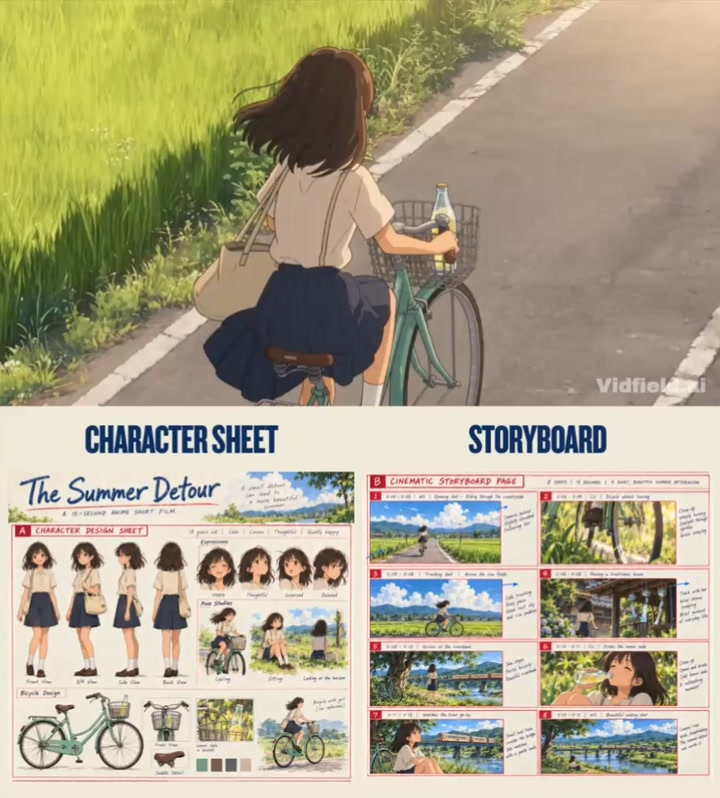
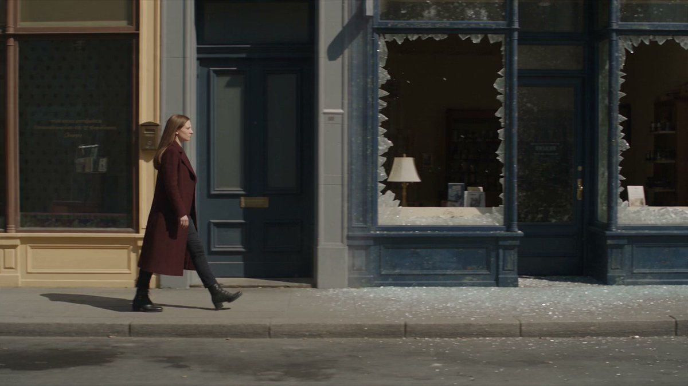
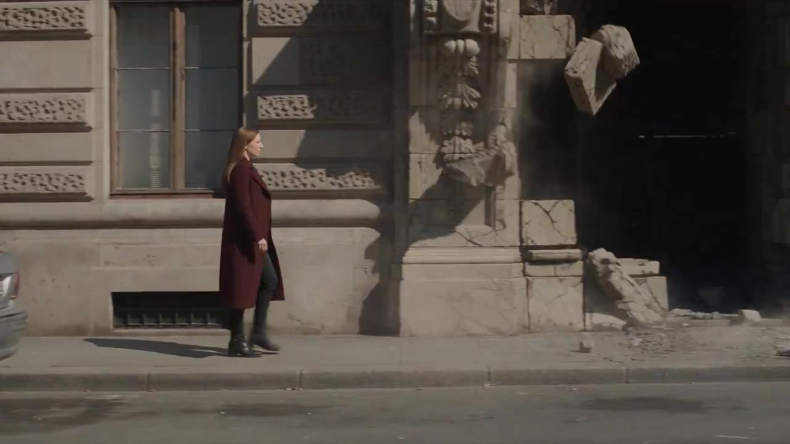
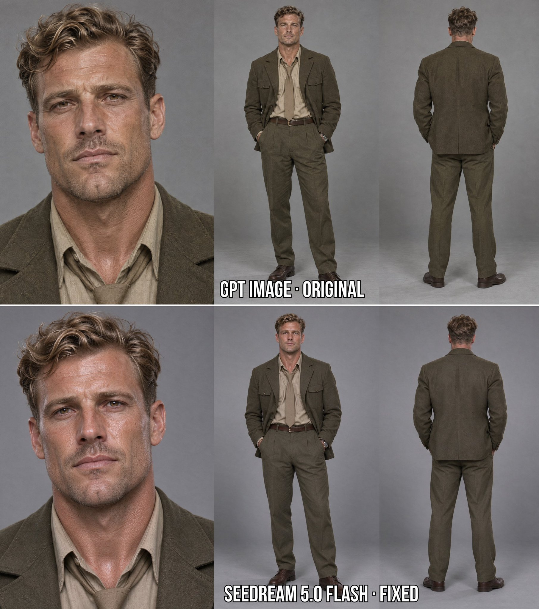
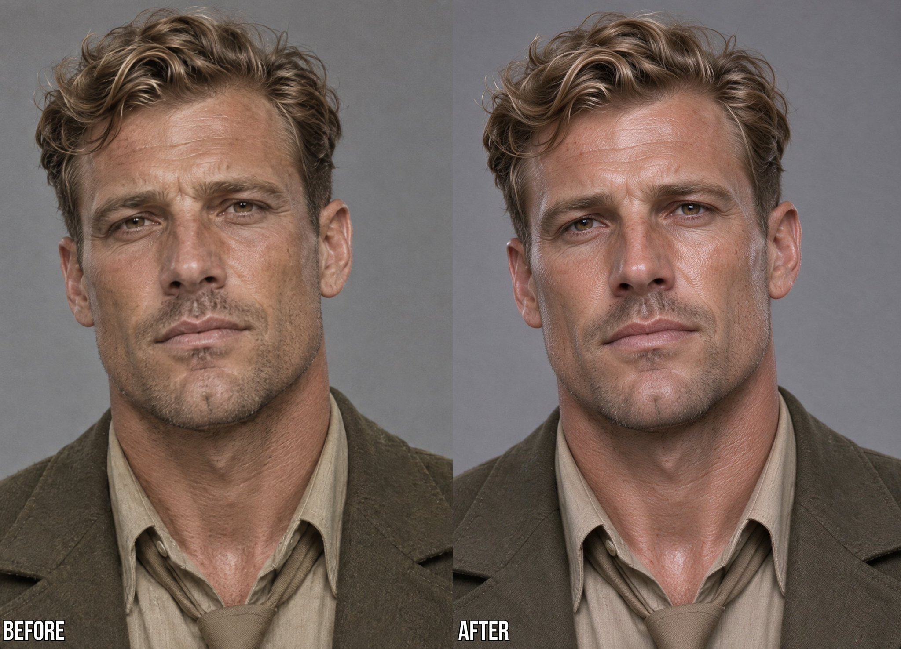
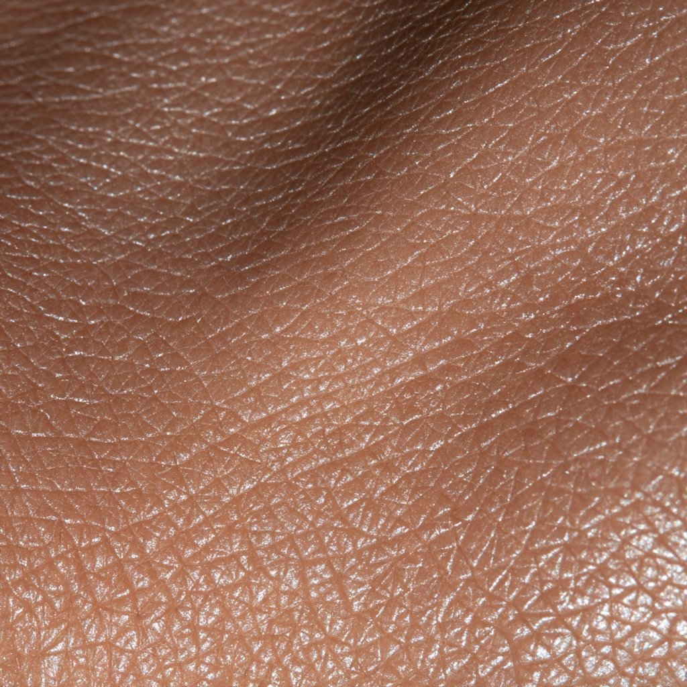

# 每周 X Prompt 精选 · 2026-11-02

> 覆盖时间：2026-10-26 ~ 2026-11-01（北京时间，周一至周日）｜ 来源：X 公开帖子，按热度、可复制性和成片质量挑选 ｜ 共 6 条

**目录**
1. [《夏日绕路》·一张分镜板直出动画短片](#1-夏日绕路一张分镜板直出动画短片)（视频 · GPT Image 2.5 → Seedance 2.5）
2. [她向前走，废墟向后倒放复原](#2-她向前走废墟向后倒放复原)（视频 · Dreamina）
3. [给角色脸补上真实皮肤和发丝质感](#3-给角色脸补上真实皮肤和发丝质感)（图像编辑 · Seedream 5.0 Flash）
4. [金翼瓷蝶·东方仙后机械蝶翼](#4-金翼瓷蝶东方仙后机械蝶翼)（图像 · ChatGPT）
5. [批量做白模姿势参考库](#5-批量做白模姿势参考库)（图像/线稿 · Muse）
6. [去 AI 味改写指令 + 自检表](#6-去-ai-味改写指令--自检表)（写作 · 任意 LLM）

---

## 1. 《夏日绕路》·一张分镜板直出动画短片
- **模型/工具**：GPT Image 2.5（在 ChatGPT 里出角色设定 + 8 格分镜板），Seedance 2.5（按分镜生成 15 秒动画）
- **作者**：[@HeyAbhishek](https://x.com/HeyAbhishek)
- **原帖**：https://x.com/HeyAbhishek/status/2115429393967550598 （10-28，328 赞 / 346 收藏）；两段提示词在作者自己的回复 https://x.com/HeyAbhishek/status/2115429427790450969 和 https://x.com/HeyAbhishek/status/2115429480793874676
- **为什么值得收**：先用一张“角色设定 + 分镜”合成图锁住人物、单车、场景和光线，再让视频模型逐格照着拍，8 个镜头精确到 0.5 秒，还写了能量曲线和声音设计，是很稳的“图生分镜 → 视频”两步法模板。




<details>
<summary><b>第一步：GPT Image 2.5 分镜板 Prompt（点开展开）</b></summary>

```text
Create one vertical anime development board for an original 15-second short film titled "The Summer Detour".

The output must be one combined image with 2 sections:

Character design sheet

Cinematic storyboard page

STYLE:

Beautiful nostalgic 2D anime, hand-painted countryside backgrounds, clean anime linework, soft cel shading, lush green scenery, warm summer afternoon sunlight, gentle shadows, and bright blue skies with fluffy clouds.

Professional anime production board with red storyboard borders, blue camera arrows, small handwritten camera notes, and beautifully illustrated keyframes.

SECTION A: CHARACTER DESIGN

Main girl: An original 13-year-old Japanese girl with shoulder-length dark brown hair, soft brown eyes, and a gentle, cheerful expression.

Outfit: cream short-sleeved blouse, faded navy skirt, white socks, brown shoes, and a small canvas shoulder bag.

Personality: calm, curious, thoughtful, and quietly happy.

Show front, side, three-quarter, and back views, plus smiling, thoughtful, relaxed, and surprised expressions.

Include cycling, sitting, and looking toward the horizon poses.

BICYCLE:

Vintage mint-green city bicycle with a silver handlebar, brown saddle, small front wire basket, and simple black tires. A clear glass bottle of lemon soda sits securely inside the basket.

Keep the bicycle's design consistent in every frame.

SECTION B: STORYBOARD

Create 8 storyboard frames in a clean grid, each using 16:9 cinematic framing.

Keep the girl, bicycle, countryside, and lighting consistent.

Story beats:

Wide opening shot of the girl cycling along a peaceful countryside road surrounded by green rice fields.

Beautiful close-up of bicycle wheels turning beside swaying grass, sunlight sparkling through the spokes.

Side-tracking shot as she cycles past expansive rice paddies beneath enormous fluffy summer clouds.

She passes a small traditional house with hanging wind chimes gently swaying in the breeze.

She reaches a quiet grassy riverbank, stops, and parks her bicycle beside a tree.

Sitting in the grass, she opens her cold lemon soda and takes a refreshing sip.

A small cream-and-orange local train crosses a distant bridge over the river. She watches it with a gentle smile.

Spectacular wide ending shot: the camera rises to reveal the winding river, endless green fields, distant mountains, passing train, and girl resting beside her bicycle under a magnificent summer sky.

ENVIRONMENT:

Peaceful rural Japanese countryside, vibrant rice paddies, narrow asphalt roads, traditional wooden houses, wind chimes, wildflowers, a clear river, an old railway bridge, distant green mountains, and beautiful summer clouds.

Bright late-afternoon sunlight throughout.

FINAL GOAL:

Create a beautiful nostalgic anime film development board with soothing countryside scenery, authentic everyday moments, natural cinematic movement, consistent character design, and a breathtaking peaceful ending.
```

</details>

<details>
<summary><b>第二步：Seedance 2.5 视频 Prompt（点开展开）</b></summary>

```text
TITLE

THE SUMMER DETOUR

Create a 15-second cinematic nostalgic anime animation in 16:9 landscape format.

REFERENCE

Use the uploaded storyboard as the main visual reference. Follow its 8 shots in order.

Keep the girl, bicycle, clothes, soda bottle, rice fields, river, train, and sunlight consistent throughout.

Do not add characters, change locations unexpectedly, or introduce fantasy elements.

SUBJECTS

Girl: Original 13-year-old Japanese girl with shoulder-length dark brown hair, brown eyes, cream blouse, faded navy skirt, white socks, brown shoes, and canvas shoulder bag.

Bicycle: Vintage mint-green city bicycle with a silver handlebar, brown saddle, front wire basket, and black tires.

Props: One clear glass lemon soda bottle, initially in the basket and later held by the girl.

Train: Small cream-and-orange two-car local passenger train.

ENVIRONMENT

Peaceful Japanese countryside in late summer. Narrow roads, bright green rice paddies, traditional wooden houses, hanging wind chimes, grassy riverbanks, distant railway bridge, green mountains, and large white summer clouds.

Warm late-afternoon sunlight with gentle natural shadows. No sunset or dramatic lighting changes.

STYLE

Premium cinematic 2D anime with beautiful hand-painted backgrounds, soft cel shading, clean linework, natural colors, gentle environmental animation, and expressive but restrained character acting.

Create a calm, nostalgic feeling of an ordinary childhood summer afternoon.

Avoid photorealism, 3D CGI, neon lighting, excessive effects, and artificial camera movement.

AUDIO

No music or dialogue.

Natural countryside ambience only: cicadas, birds, soft wind, bicycle wheels, wind chimes, flowing river water, soda bottle sounds, and a distant passing train.

Keep the soundscape gentle, atmospheric, and continuous.

CAMERA AND FRAMING

16:9 cinematic framing. Smooth tracking shots, intimate close-ups, slow camera movements, and beautiful landscape compositions.

Use natural shot transitions and consistent sunlight.

SHOT-BY-SHOT TIMELINE

SHOT 1 (00:00-00:01.5) - THE SUMMER ROAD

Wide cinematic shot of a peaceful countryside road surrounded by lush rice fields. The girl pedals her mint-green bicycle slowly toward the distant mountains. Her hair moves gently in the warm breeze. Camera tracks smoothly behind her.

SFX: cicadas, gentle wind, bicycle tires.

SHOT 2 (00:01.5-00:03) - LITTLE DETAILS

Low close-up beside the bicycle. The wheels turn smoothly as sunlight flickers between the spokes. Tall grass and tiny wildflowers sway along the roadside. Camera follows the moving wheels with shallow depth of field.

SFX: rolling tires, grass rustling, summer insects.

SHOT 3 (00:03-00:05) - THE OPEN FIELDS

Beautiful side-tracking shot of the girl cycling beside endless green rice paddies. Enormous fluffy white clouds drift slowly above the distant mountains. Her skirt and hair move naturally in the breeze. Bright sunlight fills the landscape.

SFX: wind through rice fields, distant birds, bicycle chain.

SHOT 4 (00:05-00:06.5) - THE WIND CHIME

The girl cycles past a small traditional wooden house. Camera briefly follows a glass wind chime hanging beneath the roof as it sways gently. Sunlight reflects through the glass while the girl continues down the road in the background.

SFX: delicate wind chime, cicadas, soft bicycle movement.

SHOT 5 (00:06.5-00:08.5) - THE RIVERBANK

Wide shot of a quiet grassy riverbank. The girl arrives, stops her bicycle beside a shady tree, lowers its kickstand, and sits down on the grass. Sunlight sparkles across the flowing river. Camera slowly moves closer.

SFX: bicycle stopping, soft footsteps, flowing water.

SHOT 6 (00:08.5-00:10) - A SUMMER SIP

Intimate medium close-up. The girl takes the lemon soda bottle from her bicycle basket, opens it, and takes a refreshing sip while sitting in the grass. Tiny bubbles rise through the clear glass. She smiles peacefully.

SFX: bottle opening, gentle fizz, summer breeze.

SHOT 7 (00:10-00:12) - THE PASSING TRAIN

Cinematic medium-wide shot from behind the girl's shoulder. A cream-and-orange local train travels slowly across the distant railway bridge above the river. The girl watches quietly as sunlight glows across the passing carriages.

SFX: soft distant train wheels, river water, cicadas.

SHOT 8 (00:12-00:15) - THE SUMMER MEMORY (SIGNATURE MOMENT)

The camera slowly rises above the grassy riverbank into a magnificent aerial panorama. Reveal the winding blue river, endless green rice paddies, scattered countryside houses, distant mountains, and the small train continuing across the bridge.

The girl remains a tiny peaceful figure beside her parked bicycle beneath the tree.

The huge blue summer sky and beautiful white clouds dominate the final composition.

Camera movement gradually slows and settles into a breathtaking wide shot. Hold until the end.

SFX: warm countryside breeze, distant train fading away, gentle cicadas.

ENERGY ARC

Act 1 (0-5s): Freedom. Slow cycling, warm sunlight, peaceful summer landscapes.

Act 2 (5-10s): Stillness. Wind chimes, riverbank, a quiet moment with cold soda.

Act 3 (10-15s): Nostalgia. Passing train, expansive countryside reveal, and a peaceful ending.

FINAL REQUIREMENTS

Maintain consistent character proportions, outfit, bicycle design, train appearance, and geography.

Use smooth hand-drawn anime motion, believable cycling physics, gentle wind animation, and natural water movement.

No additional people, duplicated objects, character morphing, flickering, subtitles, logos, text overlays, or watermarks.

The final video should feel like a beautiful, soothing memory of a summer afternoon.
```

</details>

## 2. 她向前走，废墟向后倒放复原
- **模型/工具**：Dreamina（帖子标注 #DreaminaCPP @dreamina_ai）
- **作者**：[@CharaspowerAI](https://x.com/CharaspowerAI)
- **原帖**：https://x.com/CharaspowerAI/status/2114431897023471934 （10-26，215 赞 / 129 收藏）；完整提示词在作者自己的回复 https://x.com/CharaspowerAI/status/2114431919467143255
- **为什么值得收**：用“人物身后一米处有一道看不见的修复边界”这一条规则控制整个 25 秒长镜头，碎玻璃回到窗框、汽车钣金复原、石门重新砌好；按秒分段，又写明“只复原已有碎片、不凭空长东西”，很适合学怎么给特效定物理规则。




<details>
<summary><b>Prompt（点开展开）</b></summary>

```text
Ultra-realistic Hollywood science-fiction VFX, one continuous 25-second lateral tracking shot, landscape 16:9. Bright city daylight, detailed practical-looking damage, precise reverse-motion reconstruction, restrained central performance.

One adult woman in a long burgundy coat walks calmly from left to right. Natural forward gait, normal hair and clothing movement, stable identity. No visible glowing power.

One damaged city block: a shattered shop window, a dented parked car and a partially collapsed decorative stone doorway. The roadway remains clear and safe for her path. No injured people.

A vertical invisible restoration boundary follows one metre behind the woman. Everything ahead of it remains damaged. Objects behind it reconstruct through reverse motion: existing fragments return to their original positions. The woman and camera always move forward normally. No new debris appears.

0–6s: Track beside her as she passes a shattered storefront. Behind her, glass fragments lift from the pavement and return to the window frame in reverse trajectories. The final pieces seal into a complete pane with a brief reflected flash of daylight.

6–12s: She passes the dented parked car. Its crumpled body panels unfold progressively, scattered trim returns and the cracked headlamp repairs. Tyres remain planted; the car does not move along the street.

12–19s: She reaches the damaged stone doorway. Behind her, fallen blocks rise and return into their visible architectural positions. Dust draws upward into the closing gaps. Camera widens slightly to preserve the full reconstruction.

19–22s: The doorway finishes restoring. She slows beside an intact shop entrance and glances back for the first time. The completed street now lies behind her, while damage remains farther ahead.

22–25s: She turns forward and resumes walking. Camera stays beside her as the restoration boundary continues just behind the coat’s trailing edge. End on the clear contrast between repaired and damaged portions of the same street.

One consistent moving boundary, existing fragments reconstruct rather than materialise, stable architecture, forward actor motion, accurate shadows and reflections, no random environmental morphing, no text or logos. Sound: reversed glass and metal movement behind normal footsteps, ending on quiet city ambience.
```

</details>

## 3. 给角色脸补上真实皮肤和发丝质感
- **模型/工具**：Seedream 5.0 Flash（作者说比 Nano Banana 2.1 / GPT Image 2.5 便宜）
- **作者**：[@Kiber_Alla](https://x.com/Kiber_Alla)
- **原帖**：https://x.com/Kiber_Alla/status/2116291838852141297 （10-31，198 赞 / 343 收藏）；通用提示词在作者自己的回复 https://x.com/Kiber_Alla/status/2116291843226763475
- **用法**：图 1 放角色设定图，图 2 放皮肤质感参考，图 3 放头发质感参考（深色或浅色），然后贴下面这段。作者在回复里补充：最后一段里不要写 “character sheet”，效果更干净。
- **为什么值得收**：本期收藏数最高的一条。它不改脸、不改构图，只替换皮肤和发丝的微观质感并把对比度拉回正常，专治角色图“脸发糊、发脏、对比过重”的毛病，换任何角色都能复用。





<details>
<summary><b>Seedream 5.0 Flash 通用 Prompt（点开展开）</b></summary>

```text
Keep <<<image_1>>> exactly as it is: same person, same face shape and features, same expression, same hairstyle and hair shape, same hair color, same skin tone, same makeup, same wrinkles, freckles, moles, scars and facial hair, same clothing and accessories, same pose, composition, layout, background and framing.

Change only the surface texture:
- Skin: apply the micro-texture from <<<image_2>>> — fine natural skin lines, pores and soft realistic surface. Do not copy its color or its glossy shine.
- Hair: apply the strand structure from <<<image_3>>> — fine individual strands, soft natural flyaways. Do not copy its color.

Balance the contrast to a natural photographic level: if image 1 looks too harsh or blotchy, soften it; if it looks flat or washed out, add depth. Aim for a well-balanced realistic photo — rich but not crushed shadows, clean highlights, smooth even tonal transitions, natural shading with real volume. No retouching, no beautifying, no plastic look.
```

</details>

## 4. 金翼瓷蝶·东方仙后机械蝶翼
- **模型/工具**：ChatGPT（生图），比例 9:16
- **作者**：[@liluocheng13](https://x.com/liluocheng13)
- **原帖**：https://x.com/liluocheng13/status/2115709281358266864 （10-29，148 赞）；提示词在作者自己的评论 https://x.com/liluocheng13/status/2115709536946511915
- **为什么值得收**：把“宫廷瓷器工艺 + 巴洛克金饰 + 生物机械盔甲 + 半透明机械蝶翼”几组材质写得很具体（香槟金、钴蓝珐琅、象牙瓷片），还专门约束了手指数量，是东方幻想人像里材质描写的好范本。


<details>
<summary><b>Prompt（点开展开）</b></summary>

```text
Masterpiece of Chinese fantasy fine art, Baroque luxury aesthetics, imperial porcelain craftsmanship fused with futuristic biomechanical haute couture.

An extraordinarily beautiful young Chinese fairy empress with delicate aristocratic features, porcelain-white skin, melancholic dark eyes, crimson lips and extremely long flowing black hair. Elegant three-quarter side profile, head gently lowered.

Magnificent golden floral headdress adorned with sculpted peonies, intricate filigree, ivory porcelain flowers, ruby gemstones and dangling pearl chains.

Exquisite biomechanical armour featuring mirror-polished champagne gold, brilliant cobalt-blue enamel, ivory porcelain panels, intricate Baroque reliefs and luxurious metallic ornaments.

Enormous translucent mechanical butterfly wings with delicate golden veins, pearlescent membranes and Art Nouveau structures.

Graceful seated pose, elegant slender proportions, anatomically accurate hands, five delicate fingers, natural gestures.

Soft cinematic studio lighting, minimalist warm taupe background, extraordinary material realism, intricate craftsmanship, ethereal melancholy, sophisticated composition, museum-quality fantasy portraiture, breathtaking details.

ratio ：9:16
```

</details>

## 5. 批量做白模姿势参考库
- **模型/工具**：Muse（作者原帖所用工具）；两阶段：先生成真实场景，再转成固定模板的线稿
- **作者**：[@wquguru](https://x.com/wquguru)
- **原帖**：https://x.com/wquguru/status/2115976473295347989 （10-30，104 赞 / 127 收藏）；完整做法在作者跟帖的长文里
- **为什么值得收**：一段很短的关键词就能把任意姿势统一成“无脸、无发、无衣、关节画圈”的黑白白模线稿，只需替换方括号里的姿势描述，适合给画师和生图做姿势参考图库。


<details>
<summary><b>关键 Prompt（替换方括号里的姿势）（点开展开）</b></summary>

```text
faceless mannequin, pose reference, line art, black line only, monochrome, white background, no face, no hair, no clothes, joint circles, clear body structure, https://t.co/6MFYfSM6jE https://t.co/C3LcuxK6S8
```

</details>

## 6. 去 AI 味改写指令 + 自检表
- **模型/工具**：任意 LLM（ChatGPT、Claude、DeepSeek 等），粘在对话开头再贴文字
- **作者**：[@NanshanTalk](https://x.com/NanshanTalk)
- **原帖**：https://x.com/NanshanTalk/status/2114858150537130057 （10-27）；完整指令就在正文里
- **为什么值得收**：热度不高，但这是本周找到的最完整、可直接复制的中文写作提示词。它不说笼统的“写自然点”，而是逐条点名禁掉套话开头、“值得注意的是”、三连排比、段尾总结和重复免责，还附了改完后的自检清单。作者也提醒：合同、说明书这类文字本来就需要结构，不必去味；这套规则也不保证能过 AI 检测。


<details>
<summary><b>去 AI 味改写指令（含自检表）（点开展开）</b></summary>

```text
【去AI味改写指令】
请按下面6条规则改写我给的文字，事实、数字和观点保持不变：
1. 删掉开场白和收尾客套，不写“在当今时代”“总之”“希望对你有帮助”。
2. 不预告重点：删掉“值得注意的是”“关键在于”“本质上”，直接说内容。
3. 少用排比和对仗：不硬凑三点，不写“不是A，而是B”。
4. 每段只说一件事，段尾不做总结。
5. 免责和提醒只说一次，放在最需要的地方。
6. 用具体代替抽象：能写数字、例子、人名的地方，不写“显著提升”“多方面”。
语气像跟同事说话，句子长短交错，可以用口语。
只输出改写后的正文，不要解释改了什么。

改完再过一遍自检：
□ 第一句有没有信息
□ 搜一下“值得注意”“关键在于”“本质上”“总之”
□ 数一数“不是…而是…”和三连排比
□ 每段最后一句删掉，意思还在不在
□ 加粗、emoji、小标题是不是比内容还多
```

</details>

---

## 本周趋势
- **“先出分镜板，再让视频模型照拍”继续是主流做法**：GPT Image 2.5 出角色设定 + 分镜格，Seedance 2.5 按秒执行，比直接文生视频稳得多。
- **特效靠写规则，不靠堆形容词**：倒放复原那条用一道“移动边界”统领整段，和上周的残影慢动作一样，都是把特效写成可执行的物理约束。
- **便宜模型 + 参考图做局部修复**：Seedream 5.0 Flash 配质感参考图只改皮肤和头发、不动脸，“只改一个维度、其余全锁死”的编辑式提示词越来越多。
- **同题多模型对比帖刷屏**：Nano Banana 2.1 本周上线后，出现大量“同一提示词、三四个模型对比”的帖子，但多数没有给出可复制的完整提示词，本期没有收录。
- **写作提示词转向“点名禁用”**：去 AI 味这类指令直接列出要删的词和句式，再配自检表，比空泛的风格描述更好用。
