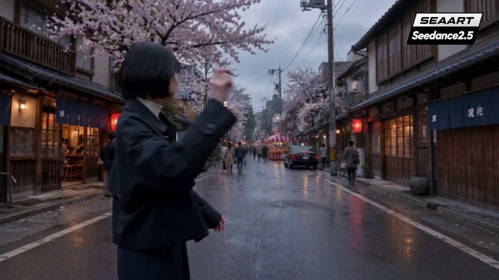
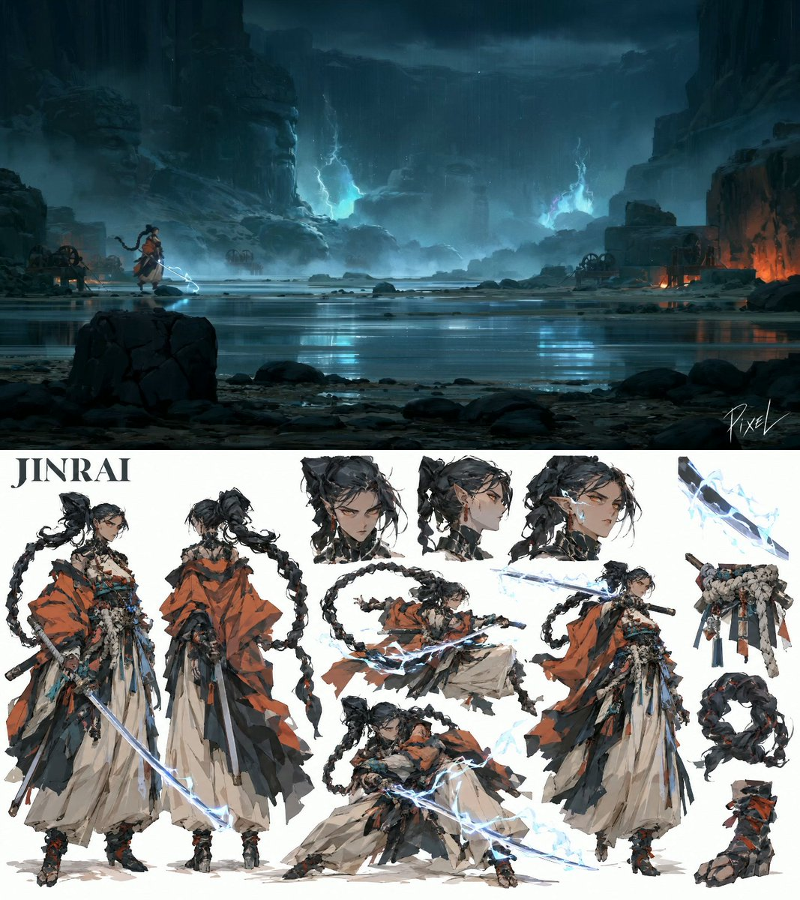
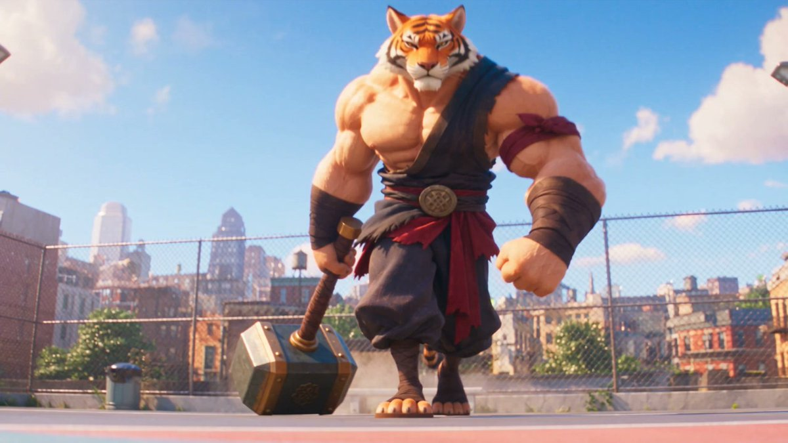
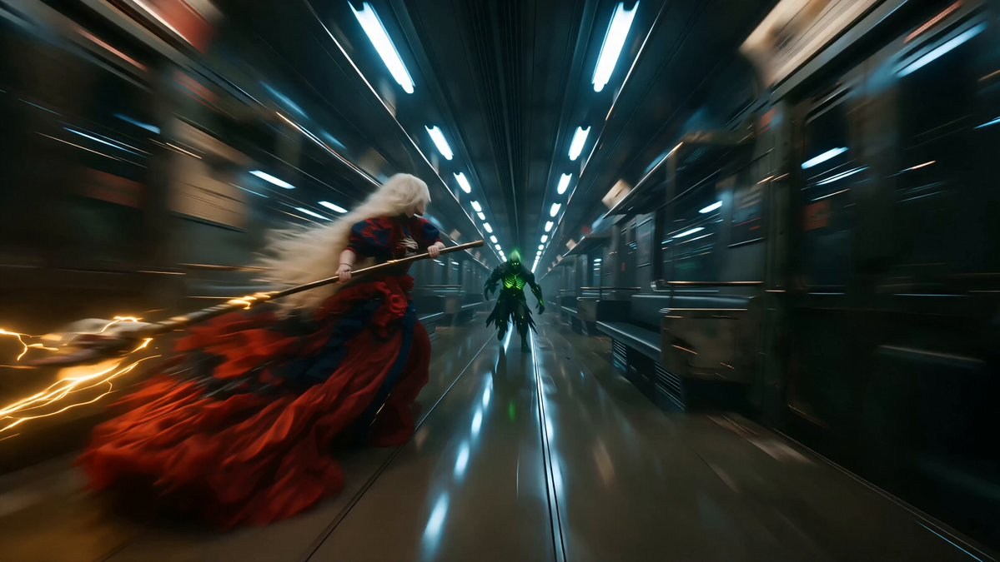
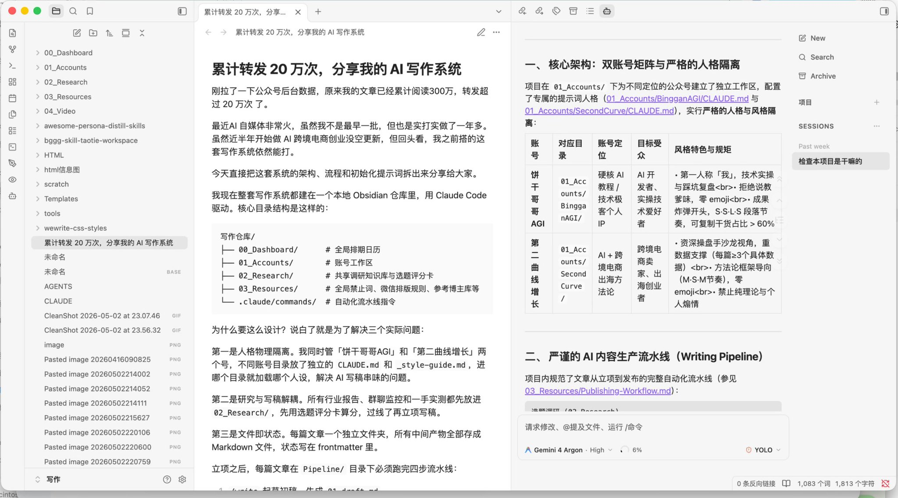
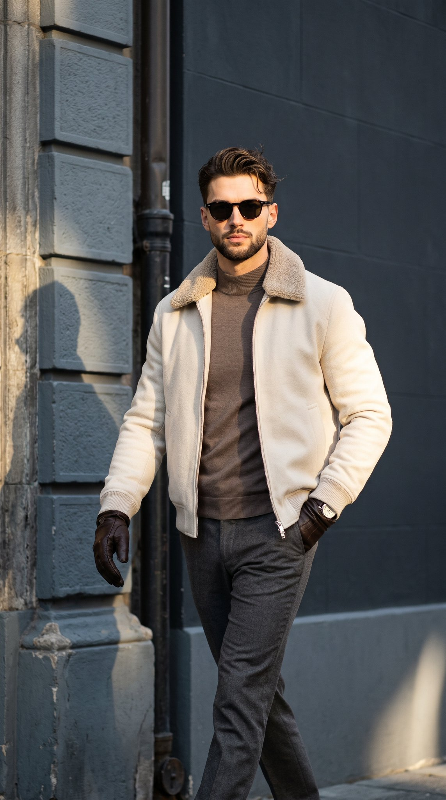
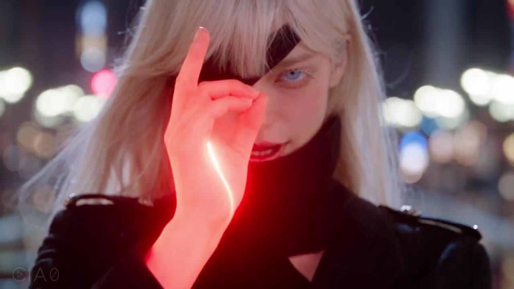

# 每周 X Prompt 精选 · 2026-11-09

> 覆盖时间：2026-11-02 ~ 2026-11-08（北京时间，周一至周日）｜ 来源：X 公开帖子，按热度、可复制性和成片质量挑选 ｜ 共 7 条

**目录**
1. [一支飞镖穿过整条日本商店街·30 秒一镜到底](#1-一支飞镖穿过整条日本商店街30-秒一镜到底)（视频 · Seedance 2.5）
2. [《TEMPEST & VOID》雷暴武士 vs 虚空修罗·水墨水粉风对决](#2-tempest--void雷暴武士-vs-虚空修罗水墨水粉风对决)（视频 · Midjourney v8.2 → GPT Image 2.5 → Seedance 2.5）
3. [《COURTSIDE CHAOS》球场打架喜剧动画](#3-courtside-chaos球场打架喜剧动画)（视频 · Seedance 2.5）
4. [霓虹地铁·镰刀女子 15 秒连斩](#4-霓虹地铁镰刀女子-15-秒连斩)（视频 · Midjourney 8.2 + ChatGPT → Seedance 2.0）
5. [公众号 AI 写作系统初始化提示词](#5-公众号-ai-写作系统初始化提示词)（写作 · Claude Code / 任意 Agent）
6. [冬季男装街拍·硬光高反差](#6-冬季男装街拍硬光高反差)（图像 · Nano Banana 2.1）
7. [白发蒙眼术师·夜城 15 镜时间轴](#7-白发蒙眼术师夜城-15-镜时间轴)（视频 · Seedance 2.5 时间轴提示词）

---

## 1. 一支飞镖穿过整条日本商店街·30 秒一镜到底
- **模型/工具**：Seedance 2.5（单条提示词，30 秒，16:9）
- **作者**：[@ai_anelia](https://x.com/ai_anelia)
- **原帖**：https://x.com/ai_anelia/status/2118266623652163686 （11-05，133 赞）；完整提示词在作者自己的回复 https://x.com/ai_anelia/status/2118266706133176428
- **为什么值得收**：本周点赞最高的提示词帖。镜头全程跟着“同一支”飞镖走，提示词反复锁死“永远是同一支、不复制、不消失、不变成子弹”，再把一路穿过的泡泡、公交车窗、火圈、气球按秒排好，是写一镜到底“追物体”长镜头的好模板。



<details>
<summary><b>Seedance 2.5 Prompt（点开展开）</b></summary>

```text
16:9 ultra-wide, 30s, realistic cinematic. ONE continuous take, no cuts, no jump cuts, no transitions, no black frames.

Real Japanese shopping street: wooden machiya, grey tiled roofs, izakaya, blue noren, red paper lanterns, cherry trees with falling petals, pedestrians, buses, taxis, festival stalls, balloons. Cool grey grade with warm izakaya light and pink petals as accents. Sharp throughout, no DOF blur, no motion blur, no anime, no CG look.

A Japanese woman, short black hair, light top, dark loose trousers, holds a slim silver throwing dart. It's always the SAME dart, consistent shape and size, never duplicated, never disappears, never becomes a bullet.

Camera follows the dart from the throw and flies forward with it. The dart's small metal end stays near frame center at a small scale — never a frame-filling close-up, never drifting around frame. People and cars enter from far and sweep past the edges.

0-2s she aims and throws, camera catches up behind her.
2-7s a girl blows a pink bubble; dart pops it, she gasps.
7-12s dart enters a moving city bus through the window, glass cracks and drifts, passengers flinch and dodge; exits the far window.
12-15s a festival performer holds a burning ring of fire; dart flies through its center, flames curling in slow motion.
15-19s a taxi driver spots it and turns in shock as camera passes the window.
19-23s a woman reaches out to grab it, misses by inches; dart grazes paper flower decorations, scraps scatter.
23-27s a cluster of balloons; dart pops a pink one, others sway.
27-30s the wooden target board fills the approach; the tip drives in, small cracks and splinters. END on impact.

Bullet time along the way: petals, glass and balloon fragments move slowly while camera and dart stay continuous.

Sound: street ambience, dart whoosh, gasps, bubble pop, glass shatter, fire, balloon pop, final thud into wood. No voiceover, subtitles, watermark or text.

Avoid: cuts, black frames, dart close-up, dart off-center, multiple darts, teleporting people, damage without contact, injury, blood, explosions, blur, anime, over-sharpening.
```

</details>

## 2. 《TEMPEST & VOID》雷暴武士 vs 虚空修罗·水墨水粉风对决
- **模型/工具**：Midjourney v8.2（角色/场景原画）→ GPT Image 2.5（按原画风格出角色设定板）→ Seedance 2.5（成片），在 FramiaPro 上完成
- **作者**：[@itsPixieVerse](https://x.com/itsPixieVerse)
- **原帖**：https://x.com/itsPixieVerse/status/2117884530933805225 （11-04，124 赞 / 88 收藏）；三段提示词都在作者自己的回复：[MJ](https://x.com/itsPixieVerse/status/2117884535585280512) · [GPT Image 设定板](https://x.com/itsPixieVerse/status/2117884541172150399) · [Seedance](https://x.com/itsPixieVerse/status/2117884547677438208)
- **为什么值得收**：一整套从原画到成片的三段式流程全部公开。MJ 先定画风，GPT Image 把参考图当“风格圣经”出设定板，Seedance 再按镜头号执行，并反复用 NOT/NO 排除“卡通描边、赛璐璐、塑料 CG”，保住水粉笔触质感。作者补充：MJ 提示词主要在 API 版 MJ 上效果好，没有用 sref。同作者 11-07 的 VALA 赛博跳伞（129 赞）也是同一套路。



<details>
<summary><b>第一步：Midjourney v8.2 角色 + 场景 Prompt（点开展开）</b></summary>

```text
JINRAI (THE STORM RONIN):
Jinrai, the Storm Ronin, lethal duelist. 10 heads tall adult woman, long coiled black dragon-tail hair braid, pointed ears, amber eyes, cybernetic neck collar. Wears an oversized draped terracotta-orange haori, off-white layered hakama trousers, thick knotted rope belt with hanging charms, wrapped tabi boots. Holds a long curved katana crackling with flat-painted cyan lightning. Poised standing stance, hand on hilt, full body, three-quarter view. Palette: terracotta orange, off-white, black; electric cyan lightning accents. Stylized 2D painterly character concept, digital illustration, flat color blocks, artistic thin rough lines, rough random brush work on the edges, graphic fashion silhouette, elongated believable anatomy, angular facial planes, broad opaque brushwork, faceted values, crisp shapes, tactile materials, floor shadow, clean-white background negative: man, male, photorealism, glossy CGI, anime, cute, teenager, petite, text, logo, extra limbs, cropped feet

------

MADAME MURASAKI (THE VOID ASURA):
Madame Murasaki, the Void Asura, four-eyed demon sorceress. 10 heads tall adult woman, pale lavender skin, four glowing red eyes, pointed ears, high architectural black topknot. Wears an open draped off-white kimono with torn train, dark flame-patterned inner sash, thick bead rope belt with hanging miniature mask charms, black high-heeled geta sandals with red ribbons. Left clawed hand channels an arcing ribbon of flat-painted violet lightning. Poised sorcery stance, three-quarter view, full body. Palette: pale lavender, bone white, charcoal; vivid violet lightning accents. Stylized 2D painterly character concept, digital illustration, flat color blocks, artistic thin rough lines, rough random brush work on the edges, graphic fashion silhouette, elongated believable anatomy, angular facial planes, broad opaque brushwork, faceted values, crisp shapes, tactile materials, floor shadow, clean-white background negative: man, male, photorealism, glossy CGI, anime, cute, teenager, petite, text, logo, extra limbs, cropped feet

------

Environment: 
The Quarry of Drowned Monoliths: cyclopean ancient stone quarry submerged in mirror-like shallow black water. Colossal half-carved basalt deity statues, fractured 40m stone blocks, weathered iron winches, driving rainstorm. Empty, no people. Brooding nocturnal tempest, twin cyan and violet lightning flashes illuminating black water reflections, heavy rain mist. Eye-level extreme wide establishing shot, deep three-layer space: foreground silhouette cracked stone chisel block, midground submerged colossal carved heads, background quarry cliff dissolved in 75% dark storm haze. Palette: obsidian black, slate stone, charcoal; electric cyan & violet storm accents. Stylized 2D painterly environment concept, digital illustration, flat color blocks, artistic rough lines, broad opaque brushwork, faceted values, crisp shapes, tactile materials, atmospheric depth. --no torii gate, shrine, temple, trees, photorealism, glossy CGI, anime, text, logo
```

</details>

<details>
<summary><b>第二步：GPT Image 2.5 角色设定板 Prompt（点开展开）</b></summary>

```text
JINRAI (THE STORM RONIN):
Create a premium, organic studio CHARACTER CONCEPT DESIGN SHEET in a 16:9 widescreen layout on a pure solid white background. THE ATTACHED REFERENCE IMAGE DEFINES THE ART STYLE — treat it as a strict style bible and reproduce its exact rendering technique in every figure on this sheet.

[STYLE — MIRROR THE REFERENCE EXACTLY]: Replicate the reference image's rendering verbatim: painterly matte digital gouache with flat posterized color blocks, shapes defined purely by value and color cuts with NO outlines and NO lineart of any kind, hard-edged brush shapes, muted desaturated palette identical to the reference, identical overall brightness and contrast (light, airy, pure white background — do NOT darken).

[PROPORTIONS & FEMININE ANATOMY LOCK]: Extremely tall adult woman in her early 20s, towering fashion-model anatomy, strictly 10 heads tall. Sculpted athletic feminine frame, defined bust contours, narrow waist, long athletic legs, elongated neck, mature sharp jawline.

[SUBJECT_DESCRIPTION]: High-fashion storm ronin with a colossal coiled black dragon-tail hair braid, pointed ears, amber eyes, cybernetic neck collar. Wears a draped oversized terracotta-orange haori over layered off-white hakama trousers, a thick knotted rope shimenawa belt with hanging charms, and wrapped tabi boots. Holds a katana crackling with flat-painted cyan lightning.
Composition layout:
1. Turnarounds on left: neutral standing stance with katana drawn, and full rear view showing the massive coiled dragon braid and billowing haori drape.
2. Top area features three head studies: cold focused amber glare, profile showing pointed ear and braid root, and intense battle gaze with electric sparks on cheekbones.
3. Center and right showcase dynamic martial stances: low battoujutsu drawing crouch with cyan lightning trails, mid-air spin whipping the heavy braid like a flail, and an upright one-handed parry.
4. Floating isolated detail cutouts on the right: cyan lightning arcing along katana steel, thick knotted rope belt with hanging charms, dragon braid loop structure, wrapped tabi boot with red ties.

[TEXT & PROHIBITIONS — INLINE]: Pure white seamless ground. The ONLY text allowed on the sheet is "JINRAI" in clean bold typography in one corner. Absolutely no metadata boxes, no labels, no bullet points, no panel borders, no outlines, no cel-shading, no 3D render look. BANNED: male chest, flat pectorals, teenager, petite, short stature, cute expressions, photorealism, glossy CGI render. 100% stylized 2D gouache painting.

------

MADAME MURASAKI (THE VOID ASURA):
Create a premium, organic studio CHARACTER CONCEPT DESIGN SHEET in a 16:9 widescreen layout on a pure solid white background. THE ATTACHED REFERENCE IMAGE DEFINES THE ART STYLE — treat it as a strict style bible and reproduce its exact rendering technique in every figure on this sheet.

[STYLE — MIRROR THE REFERENCE EXACTLY]: Replicate the reference image's rendering verbatim: painterly matte digital gouache with flat posterized color blocks, shapes defined purely by value and color cuts with NO outlines and NO lineart of any kind, hard-edged brush shapes, muted desaturated palette identical to the reference, identical overall brightness and contrast (light, airy, pure white background — do NOT darken).

[PROPORTIONS & FEMININE ANATOMY LOCK]: Extremely tall adult woman in her early 20s, towering statuesque build, strictly 10 heads tall. Sculpted feminine bust and core, long slender legs, elongated neck, pale lavender-indigo skin.

[SUBJECT_DESCRIPTION]: Four-eyed asura demon sorceress with pale lavender skin, four glowing red eyes, pointed ears with mechanical earrings, and a high architectural black topknot. Wears an open off-white draped kimono robe with torn trailing hems, a flame-patterned inner sash, a thick dark bead-garland rope belt with hanging miniature mask charms, and black high-heeled geta sandals with red ankle ribbons. Channels an arcing ribbon of flat-painted violet lightning from her left hand.
Composition layout:
1. Turnarounds on left: neutral standing pose channeling violet lightning, and full rear view showing the high topknot, back drapes, and torn kimono train.
2. Top area features three head studies: cold four-eyed sneer, sharp profile showing ear piercings and cheek eyes, and laughing unhinged combat expression.
3. Center and right showcase dynamic sorcery poses: floating mid-air spellcasting stance whipping violet lightning, low evasive side-glide with robes flaring, and summoning a spectral violet asura claw.
4. Floating isolated detail cutouts on the right: four glowing red eyes on lavender face, violet lightning ribbon wrapping clawed hand, hanging miniature noh mask charms, high-heeled geta sandal with red ribbons.

[TEXT & PROHIBITIONS — INLINE]: Pure white seamless ground. The ONLY text allowed on the sheet is "MURASAKI" in clean bold typography in one corner. Absolutely no metadata boxes, no labels, no bullet points, no panel borders, no outlines, no cel-shading, no 3D render look. BANNED: male chest, flat pectorals, teenager, petite, short stature, cute expressions, photorealism, glossy CGI render. 100% stylized 2D gouache painting.
```

</details>

<details>
<summary><b>第三步：Seedance 2.5 分镜 Prompt（点开展开）</b></summary>

```text
#1: THE FACE-OFF & SPOKEN DIALOGUE

Cinematic 2.5D animation in the style of fully painterly rendering, characters and environments look like gouache concept-art paintings in motion, visible brush texture on skin, cloth and buildings, flat posterized color blocks with hard-edged light shapes, matte finish, soft filmic volumetric lighting, shallow depth of field. NOT flat 2D cartoon, NO bold black outlines, NO cel-shading, NOT glossy CGI, NOT Unreal Engine, NO photorealism, no plastic skin.

CHARACTERS:
- @[Image01] (Jinrai): 10-heads-tall storm ronin, coiled black dragon braid, glowing amber eyes, terracotta haori over cream hakama, holding katana crackling with cyan lightning.
- @[Image02] (Madame Murasaki): 10-heads-tall demonic asura sorceress, pale-indigo skin, four glowing red eyes, open white kimono, hand channeling crackling violet lightning ribbons.

SETTING: @[Image03] (The Quarry of Drowned Monoliths). Shallow reflective black water, half-submerged giant stone statues, pouring rain, atmospheric storm lightning.

CINEMATOGRAPHY, ACTING & SPOKEN DIALOGUE (5 SCENES | EXACTLY 30 SECONDS):
00:00-00:07 (Shot 1 | The Water Stride): Wide tracking shot across shallow black water; @[Image01] (Jinrai) strides forward, boots rippling reflections, katana blade humming with cold cyan arcs. Fifty paces away, @[Image02] (Murasaki) floats down atop a half-submerged stone deity head, violet electricity curling around her clawed fingers.
00:07-00:13 (Shot 2 | Jinrai’s Indictment): Low-angle push-in on Jinrai; rain streams down her sharp jawline; long dragon-tail braid whips in the gale as she points her electrified katana forward.
SPOKEN DIALOGUE (Jinrai, cold steel resolve): "You shattered the mountain wards, Murasaki. The abyss is flooding the valley below."
00:13-00:19 (Shot 3 | The Asura’s Mockery): Reverse tight close-up on Murasaki; all four red eyes blink with poisonous amusement, her lips parting into a cruel, fanged smirk.
SPOKEN DIALOGUE (Murasaki, mocking melodic purr): "Your wards were a coward's cage, little storm. I gave this world teeth."
00:19-00:25 (Shot 4 | The Stance Drop): Point-blank cut on Jinrai; amber eyes flare with blinding white-blue voltage; she drops into a low drawing stance, water parting violently beneath her feet from the raw electrical aura.
SPOKEN DIALOGUE (Jinrai, sharp whisper): "Then bleed on them."
00:25-00:30 (Shot 5 | The Ignition Charge): Murasaki laughs hysterically, flaring her massive violet plasma whip high into the rain clouds. Both women launch forward across the water at supersonic velocity, leaving glowing cyan and violet wakes. Freezes at 00:30 on the exact mid-air strike seam.

clear three-layer depth: foreground stone chisel blocks and water ripples cropped in silhouette, both combatants resolved in high-contrast lightning in midground, background submerged monoliths dissolved in 75% dark storm haze. Weighty natural character animation, cloth, long hair, and plasma reacting to storm physics.

AUDIO DESIGN: Heavy downpour, low sub-bass thunder roll, water splashes, distinct spoken dialogue echoing across stone quarry, crackling cyan and violet electrical arcs, ending on a high-voltage sonic boom freeze.

PROHIBITIONS (INLINE NEGATIVES): Torii gates, shrines, temples, trees, ninjas, minions, peaceful resolution, friendly expressions, photorealism, glossy CGI render, smooth 3D plastic skin, anime cel outlines, lineart, camera drift, extra limbs. 100% stylized 2D gouache painting.

-------

#2: THE UNINTERRUPTED BATTLE

Cinematic 2.5D animation in the style of fully painterly rendering, characters and environments look like gouache concept-art paintings in motion, visible brush texture on skin, cloth and buildings, flat posterized color blocks with hard-edged light shapes, matte finish, soft filmic volumetric lighting, shallow depth of field. NOT flat 2D cartoon, NO bold black outlines, NO cel-shading, NOT glossy CGI, NOT Unreal Engine, NO photorealism, no plastic skin.

CONTINUATION: Snaps forward instantly from Part 1’s mid-air collision freeze.

CHARACTERS & ENVIRONMENT: Identical to Part 1. @[Image01] (Jinrai) vs. @[Image02] (Murasaki) fighting across @[Image03] (The Quarry of Drowned Monoliths).

CINEMATOGRAPHY & RAPID 15-CUT COMBAT CHOREOGRAPHY (EXACTLY 30 SECONDS):
00:30-00:32.0 (Shot 1 | Detonation Seam): The frozen impact detonates; cyan lightning and violet plasma collide, blasting a 50-foot circular wall of displaced black water across the quarry.
00:32.0-00:33.8 (Shot 2 | Blade Parry): High-speed ground track; Jinrai slashes with her blue-lightning katana; Murasaki parries with her hip tanto, violet sparks showering across her exposed shoulder.
00:33.8-00:35.5 (Shot 3 | Violet Lightning Arc): Murasaki whips her left hand forward, hurling a jagged ribbon of violet lightning; Jinrai side-slips across the water, cleanly cleaving the bolt in two.
00:35.5-00:37.2 (Shot 4 | Dragon Braid Flail): Dynamic pivot; Jinrai whips her heavy coiled hair braid like an iron flail, shattering a submerged stone statue and forcing Murasaki backward.
00:37.2-00:39.0 (Shot 5 | Asura Teleport): Murasaki dissolves into purple smoke tendrils, materializing directly above Jinrai, executing a diving axe-kick with her pointed geta heel.
00:39.0-00:41.0 (Shot 6 | Waterbed Crater): Jinrai braces her katana horizontally; the impact drives both into the waterbed, sending a shockwave that exposes the dry mud floor for a second.
00:41.0-00:43.0 (Shot 7 | Voltage Burst): Point-blank chest blast; Jinrai unleashes a blinding point-blank burst of cyan electricity from her palm, launching both fighters skidding 30 paces apart.
00:43.0-00:45.0 (Shot 8 | Vertical Monolith Run): Speed-ramp cut; Murasaki runs vertically up the face of a 40-meter carved stone deity head, violet lightning trailing behind her.
00:45.0-00:47.0 (Shot 9 | High-Altitude Pursuit): Jinrai vaults up the stone blocks in a blur of terracotta fabric and electric blue sparks, closing the distance in three leaps.
00:47.0-00:49.0 (Shot 10 | Aerial Climax Clash): Mid-air duel; four hyper-speed parries exchanged in one second high above the flooded quarry, steel screeching against plasma.
00:49.0-00:51.5 (Shot 11 | Phantom Demon Hand): Murasaki’s four eyes flare crimson; an enormous spectral violet asura hand manifests and swats Jinrai downward through the rain.
00:51.5-00:53.5 (Shot 12 | The Skipping Touchdown): Jinrai skips across the surface of the black water like a flat stone, boots digging in, halting her momentum instantly without falling.
00:53.5-00:56.0 (Shot 13 | The Mach-3 Thrust): Jinrai channels maximum storm voltage; her entire blade and hair braid ignite into blinding white-blue fire as she lunges in a supersonic ground thrust.
00:56.0-00:58.0 (Shot 14 | The Severing Impact): Sonic-boom pass; Jinrai blurs clean past Murasaki; an architectural blue lightning wave cleaves through the stone monolith behind them, shattering Murasaki’s violet aura.
00:58.0-01:00.0 (Shot 15 | Poster Hero Frame): Locked low-angle hero shot; Jinrai stands victorious in the reflective water, snapping her katana into its scabbard with a mechanical *click*, while Murasaki collapses to one knee behind her, violet electricity fading into rain. Hold for 2 seconds.

clear three-layer depth: foreground displaced water spray and stone rubble cropped in silhouette, both fighters resolved in midground with maximum value contrast, background flooded quarry walls dissolved in 75% dark tempest haze. Weighty natural character animation, cloth, water, and lightning arcs reacting to violent kinetic momentum.

AUDIO DESIGN: ZERO SPOKEN DIALOGUE. Explosive thunder claps, screaming high-voltage electrical hums, heavy water splashes, blade clash rings, stone splintering cracks, sonic-boom thrust roar, ending on a crisp scabbard click into solitary falling rain.

PROHIBITIONS (INLINE NEGATIVES): Any dialogue, voiceovers, talking, slow-motion combat, sluggish editing, less than 14 cuts, torii gates, shrines, friendly interactions, photorealism, glossy CGI render, smooth 3D plastic skin, anime cel outlines, lineart, camera drift, extra limbs. 100% stylized 2D gouache painting.
```

</details>

## 3. 《COURTSIDE CHAOS》球场打架喜剧动画
- **模型/工具**：Seedance 2.5（两张角色参考图 + 一条提示词，30 秒 3D 动画）
- **作者**：[@HeyAbhishek](https://x.com/HeyAbhishek)
- **原帖**：https://x.com/HeyAbhishek/status/2117956306225287210 （11-04，121 赞 / 68 收藏）；完整提示词在作者自己的回复 https://x.com/HeyAbhishek/status/2117956319689011273
- **为什么值得收**：上周《夏日绕路》作者的新作。这次写的是动作喜剧：灵巧的银毛小个子靠篮球花式戏耍扛大锤的老虎，提示词把“笑点从哪来”（轻松自信 vs 用力过猛出糗）直接写成规则，适合学怎么给打戏定喜剧节奏。



<details>
<summary><b>Seedance 2.5 Prompt（点开展开）</b></summary>

```text
Create a 30-second cinematic 3D anime action-comedy fight titled COURTSIDE CHAOS.
Use the two uploaded character reference images as the strict visual references for both characters. Character 1 is the silver-grey animal-like fighter in a relaxed black suit, and Character 2 is the massive muscular tiger warrior carrying a giant hammer. Preserve their exact appearances, body proportions, outfit colors, facial structures, hairstyles, accessories, fur patterns, and weapon design throughout the entire clip.
CHARACTERS:
Character 1 is Silver, a stylish fictional animal-like humanoid fighter with soft silver-grey fur, an expressive rounded face, a short muzzle, very large pointed ears with pink inner fur, thick dark eyebrows, amber eyes, and short swept-up black hair. He wears a fashionable relaxed-fit charcoal-black blazer with rolled-up sleeves, a white crew-neck shirt, loose black tailored trousers, a black belt, white sneakers, a silver pendant necklace, and a wristwatch, exactly as shown in the reference image. His exposed forearms and hands have warm peach-colored skin. He has a relaxed, playful, effortlessly confident personality. He is always calm, never intimidated, and fights using smooth dance-like footwork, unpredictable agility, perfect timing, and playful basketball tricks. His expressions remain cool, cheeky, and slightly mischievous.
Character 2 is Tiger, an enormous muscular anthropomorphic orange tiger warrior with distinctive black facial stripes, white cheek fur, powerful arms, an extremely broad chest, thick neck, and intimidating physical presence. He wears the exact rugged black asymmetrical warrior outfit, dark wrist wraps, red fabric sashes, loose black trousers, and wrapped open-toe sandals shown in the reference image. He is aggressive, impatient, extremely competitive, and increasingly furious every time Silver humiliates him. His only weapon is his signature enormous dark-metal hammer with gold-bronze reinforced edges, decorative metallic detailing, and a long leather-wrapped handle, exactly matching the reference image. The weapon must remain visually identical throughout.
STYLE:
Premium cinematic cel-shaded 3D anime, Unreal Engine-quality rendering, thick expressive black outlines, bold color blocking, crisp hard-edge shadows, subtle hand-painted textures, vibrant daylight colors, sharp anime impact frames, controlled motion blur, expressive character animation, exaggerated squash-and-stretch reactions, and dynamic cinematic camera movement.
The final video should feel like a high-budget stylized anime fighting-game cinematic with hilarious physical comedy, impressive fighting choreography, and polished visual storytelling. Not photorealistic, not flat 2D.
FORMAT:
16:9 widescreen
30 seconds
4K-quality detail
Fast, clean, readable choreography
No dialogue
No subtitles
No voice-over
No text overlays
No watermarks
SETTING:
A beautiful outdoor urban basketball court on a bright summer afternoon. Brilliant blue sky, scattered white clouds, warm golden sunlight, colorful painted court markings, two basketball hoops at opposite ends, chain-link fencing, a low concrete seating bench, distant apartment buildings, and a few leafy trees beyond the fence.
One orange basketball is on the court. The near hoop has a thick padded support pole. Keep the location, hoop positions, court markings, shadows, and props consistent throughout.
The entire fight happens on this empty basketball court. No spectators, no additional characters, no neon lighting, no nighttime atmosphere.
ACTION TIMELINE:
0:00 to 0:03
Open with a dramatic low-angle tracking shot of Tiger marching onto the sunny basketball court, dragging his enormous hammer across the painted ground. He aggressively slams it onto the court, creating a dramatic dust burst and thin surface cracks.
Cut to Silver standing near the three-point line, casually spinning the orange basketball on one finger. He looks at Tiger, raises one eyebrow, and gives a playful little shrug.
0:03 to 0:06
Tiger charges and swings his giant hammer horizontally toward Silver.
Silver instantly bends backward in an effortless limbo-style dodge while keeping the basketball balanced on his fingertip. The hammer sweeps just above his face.
Silver straightens up, spins around Tiger with smooth dance-like footwork, and lightly taps the tiger's shoulder from behind.
Tiger turns around furiously, but Silver has already moved away.
0:06 to 0:09
Tiger launches an enormous overhead hammer strike.
Silver suddenly drops into a low basketball dribble, slips sideways beneath the incoming attack, and bounces the ball between Tiger's legs.
The hammer crashes into the court behind Silver with a huge anime impact burst.
Silver catches the returning basketball after it bounces off the ground behind Tiger and immediately performs a smooth behind-the-back dribble.
Tiger looks completely confused.
0:09 to 0:12
Tiger roars and lunges forward with a massive punch while holding his hammer in his other hand.
Silver effortlessly pivots around the punch and performs a flashy crossover dribble. Tiger overcommits, stumbles forward, and barely catches his balance.
Silver casually shoots the basketball toward the near hoop.
Cinematic low-angle tracking shot follows the ball through the bright blue sky. It drops perfectly through the net with a clean swish.
Tiger turns and sees Silver celebrating with a tiny shoulder dance.
0:12 to 0:15
The basketball lands beneath the hoop and bounces back onto the court.
Tiger angrily rushes toward Silver, swinging his hammer in a wide circular attack.
Silver slides backward on his feet, narrowly avoiding the first swing, then casually steps sideways as the second swing passes him.
Tiger's momentum carries him toward the padded basketball support pole. His hammer strikes the thick padding with a loud rubbery thump.
The pole vibrates, the hoop shakes, and Tiger recoils with a ridiculous stunned expression.
Silver catches the bouncing basketball nearby.
0:15 to 0:18
Tiger becomes even more furious. He lifts the hammer overhead and charges straight toward Silver for another devastating strike.
Silver dribbles toward him, suddenly plants one foot, and performs a spectacular basketball spin move.
Tiger swings downward but completely misses.
Silver slips around his side, plants both feet, and springs upward into an exaggerated slow-motion anime basketball jump.
For one glorious second, Silver appears suspended against the brilliant blue sky, holding the ball in one hand.
0:18 to 0:21
Dynamic camera follows Silver as he flies toward the near basketball hoop.
He performs a spectacular one-handed slam dunk.
BOOM.
The rim flexes and rebounds realistically. The basketball shoots through the net and bounces onto the court.
Silver releases the rim immediately, twists gracefully in midair, and lands in a perfect superhero-style crouch.
Tiger watches with his mouth wide open, furious and completely speechless.
0:21 to 0:24
Tiger charges again with one final aggressive hammer attack.
Silver calmly retrieves the bouncing basketball and turns toward him.
At the last second, Silver performs a sudden sideways basketball fake, moving the ball across his body.
Tiger instinctively follows the movement, swings too wide, and loses his balance.
His feet scramble comically across the painted court as he tries desperately to stop himself.
0:24 to 0:27
Tiger staggers backward toward the low concrete bench at the court's edge.
His hammer drops safely onto the ground beside the bench.
He falls backward into a seated position on the bench with an enormous comedic thump. The bench stays intact.
A small puff of dust rises around him.
Close-up on Tiger's enormous face. His eyes widen, his mouth falls open, and his expression changes from rage to pure humiliation.
Silver casually walks into frame, spinning the basketball on one finger.
0:27 to 0:30
Silver stops several steps in front of the seated Tiger.
With a cheeky grin, he lightly tosses the basketball toward Tiger.
Tiger instinctively catches it against his chest, surprised.
Silver points toward the basketball hoop, makes a playful shooting gesture with his hands, and gives a confident wink.
Tiger looks at the basketball, then at Silver, completely bewildered.
Silver turns around and casually moonwalks away across the sunlit court.
End on a beautiful wide cinematic shot with Silver dancing away in the foreground and the defeated tiger sitting on the bench holding the basketball.
CAMERA:
Use continuously varied premium anime action cinematography. Dramatic low-angle hero shots, energetic side-tracking shots, punchy close-ups on facial expressions, sweeping basketball follow-cams, fast whip pans, dynamic ground-level perspectives, brief slow-motion moments, and spectacular wide shots.
Every major attack must have clear setup, movement, impact, and reaction.
Keep both fighters spatially consistent. Avoid confusing teleportation, disconnected attacks, or unnecessary camera spins. Give the basketball dunk one strong cinematic slow-motion moment before returning to fast-paced action.
AUDIO:
Energetic cinematic anime action-comedy soundtrack with funky electric bass, punchy hip-hop drums, playful brass accents, dramatic percussion, and comedic rhythmic breaks.
Detailed sound effects: hammer dragging, court cracking, basketball dribbling, sneaker squeaks, powerful whooshes, metallic vibrations, bouncing ball, basketball net swishes, rim flexing, exaggerated comedic thumps, and crisp anime impact accents.
The music should build during the fight, peak during Silver's spectacular slam dunk, and end with a playful comedic flourish.
No spoken dialogue.
CONSISTENCY RULES:
Exactly two characters only.
One continuous outdoor basketball court.
Bright afternoon daylight throughout.
Use both uploaded character images as the absolute visual references.
Silver's silver-grey fur, oversized pointed ears, pink inner ears, amber eyes, swept-up black hairstyle, thick eyebrows, rounded facial structure, charcoal-black relaxed blazer, rolled-up sleeves, white crew-neck shirt, silver pendant necklace, wristwatch, loose tailored black trousers, belt, and white sneakers must remain identical in every shot.
Silver must retain his original sleek athletic human-like physique and expressive animal-like face. No change to his facial shape, ears, hairstyle, or body proportions. His blazer must remain relaxed and properly fitted, never transforming into a tight formal suit, hoodie, or athletic outfit. No wardrobe changes, no added accessories, and no missing clothing.
Tiger must retain his original orange fur, distinctive black tiger stripes, white facial markings, enormous muscular physique, black asymmetrical warrior outfit, red fabric sashes, wrapped arms, loose black trousers, and original facial structure. No outfit changes or additional body features.
Only one basketball exists throughout the video. Its trajectory, bounces, and position must remain physically coherent.
Tiger has exactly one giant hammer, identical to his reference image. Preserve its dark-metal rectangular head, gold-bronze decorative plates, reinforced edges, and wrapped handle. No additional weapons.
The hammer remains in Tiger's hands until he drops it beside the bench during the final sequence.
The basketball hoop, court layout, and bench must remain in fixed positions.
Silver must never appear frightened, injured, or exhausted.
Tiger must never appear seriously injured.
No blood, no gore, no dismemberment.
No magical powers, teleportation, energy blasts, or supernatural effects.
No random props or background characters.
No sudden visual style changes.
Use exaggerated but readable anime physics.
The comedy must come from Silver's effortless confidence, clever basketball moves, Tiger's embarrassing mistakes, and the contrast between overwhelming strength and perfect timing.
Make the fight incredibly entertaining, visually spectacular, funny, and easy to follow from beginning to end.
```

</details>

## 4. 霓虹地铁·镰刀女子 15 秒连斩
- **模型/工具**：Midjourney 8.2 + ChatGPT（首帧/角色），Seedance 2.0（2K 视频）
- **作者**：[@liluocheng13](https://x.com/liluocheng13)
- **原帖**：https://x.com/liluocheng13/status/2119302185263743113 （11-08，67 赞 / 17 收藏）；中文提示词就在正文里
- **为什么值得收**：中文分段打戏提示词：0–3 秒突进、3–7 秒连击、7–11 秒控场、11–15 秒终极斩杀，每段都写了镜头怎么动（侧后方急推、地面仰拍、广角俯冲）和动态模糊、镜头震颤，换角色换武器就能复用。



<details>
<summary><b>Seedance 2.0 Prompt（点开展开）</b></summary>

```text
0–3秒：瞬杀突进

在脏乱、霓虹灯闪烁的黑暗地铁内，手持镰刀的华丽女子原地爆冲，侧后方镜头以极限速度向前推进，径向动态模糊拉满。

女子挥舞电化巨镰，快速横劈骷髅战士。怪物踉跄倒飞，骨屑与金属碎光四溅。每次打击伴随镜头短暂震颤、横向推移与失焦。顶灯高频闪烁，光影切割女子的身影。

3–7秒：极速连击

怪物合围，女子极速侧身闪避，滑铲擦地溅出金色电火星。折返瞬间，双手挥镰施展大范围横斩、竖劈，环绕镜头高频小幅晃动，全程保持强烈动态模糊。

女子砍中怪物躯干，紧接回旋踢踹退近身敌人。镜头从地面向上仰拍，女子衣服和头发随风飘动，气势凌厉，霸气十足。

7–11秒：控场清剿

霓虹灯高频闪烁，女子挥舞巨镰压制群怪。镰刃裹挟狂暴金色电流，倒踢衔接360度旋身斩，一击击飞三名敌人。

怪物撞向立柱，广角镜头高速俯冲，画面边缘拉伸畸变，强烈动态模糊。

重击触发环形能量冲击波，掀动烟尘与碎片。落地冲击引发镜头低频震颤。女子双眼锁定目标，金色光点形成拖影，所有动作无缝衔接。

11–15秒：终极斩杀

女子沉身侧立，右手握镰举至胸前蓄力。全身缠绕狂暴金色电流，能量核心强烈发光。

镜头微俯，锁定女子全身，动态模糊拉满。

女子瞬间发动终极突进，一道狂暴的金色电光残影伴随巨镰贯穿所有怪物，触发猛烈能量爆炸，冲击波掀起大量碎屑与纸屑。

烟尘逐渐散去，女子右手持镰向身侧斜劈，甩出一道金色残光，随后收势伫立，面向镜头。
```

</details>

## 5. 公众号 AI 写作系统初始化提示词
- **模型/工具**：Claude Code（作者用法，Obsidian 本地仓库）；也可以交给其他能读写本地文件的 Agent
- **作者**：[@bggg_ai](https://x.com/bggg_ai)
- **原帖**：https://x.com/bggg_ai/status/2118717157148422544 （11-06，63 赞 / 126 收藏）；目录结构、四步流水线和初始化提示词都在正文里
- **用法**：先导出公众号后台历史数据（CSV），再存几篇对标博主的爆款文章，连同原帖正文和下面这段一起交给 Agent。
- **为什么值得收**：本周收藏数最高的写作类帖子。核心是“写稿、挑刺、修改、打分”拆成四个互相看不到上下文的子 Agent，80 分才放行，避免模型自己写完自己夸。初始化提示词会从你的历史数据里提炼选题公式、风格节奏、正反样本和禁词表。



<details>
<summary><b>AI 写作系统初始化 Prompt（点开展开）</b></summary>

```text
请读取我一并发送的《AI 写作系统》短文、公众号后台历史数据（CSV）、个人代表作及对标爆款文章，在当前目录初始化我的专属 AI 写作系统：

1. 基础架构与流水线：按短文目录树建库，在 `.claude/commands/write-pipeline.md` 中配置 Writer → Critic → Editor → Scorer 四个上下文隔离的独立 Sub-agent 流水线（含 80 分质量闸门与打回机制）。
2. 提炼账号 `CLAUDE.md` 与 `_style-guide.md`：深度分析投喂的数据与文章，补齐 4 个维度：
   - 数据驱动选题公式：从 CSV 统计高阅读高互动特征、标题公式、低表现雷区及长短文分流标准；
   - 风格与节奏编码：拆解开头切入方式、段落长短句节奏、高频口癖与干货最低占比；
   - GOOD vs BAD 样本：从原文提取开头、小标题、结尾的正反面配对示例，作为审稿锚点；
   - 去 AI 味与防爹味红线：生成全局禁词表，规定用「我」复盘、禁用「你」说教及总结式结尾。
3. 选题评分卡：在 `02_Research/` 生成量化《选题评分卡.md》，规定先算分过线再触发写稿。
```

</details>

## 6. 冬季男装街拍·硬光高反差
- **模型/工具**：Nano Banana 2.1（Gemini App），9:16
- **作者**：[@pictsbyai](https://x.com/pictsbyai)
- **原帖**：https://x.com/pictsbyai/status/2118981279459037686 （11-07，52 赞）；完整提示词就在正文里
- **为什么值得收**：一条把服装、背景、光线都写成色号（#EAE6DF、#7D6B5D…）的写实街拍提示词，连 85mm f/2.8、1/1000s、ISO 200 都给了。低角度 45° 金色硬光加压暗阴影的欧洲男装街拍质感，换衣服和配色就能做成系列图。



<details>
<summary><b>Nano Banana 2.1 Prompt（点开展开）</b></summary>

```text
A confident adult male in winter menswear is captured in a three-quarter length, candid street-style stride from head to mid-shin, centered in the frame with his left leg crossed forward and his torso slightly twisted toward the camera. He has dark brown hair with warm highlights, tapered above the ears with a wavy, three-to-four-inch textured top swept back from a subtle left part, showing natural flyaways and a glossy finish, paired with a groomed short boxed beard, neutral closed lips, relaxed eyebrows, and dark sunglasses. He wears a cream off-white wool bomber jacket (#EAE6DF) featuring a beige shearling collar, layered over a warm taupe brown mock-neck sweater (#7D6B5D) and charcoal gray tailored trousers (#5A5856). Both hands are clad in dark brown leather gloves; his left hand is partially tucked into his trouser pocket revealing a wristwatch at the cuff, while his right arm swings outward to the left for balance with naturally curled fingers. Behind him, a shallow-depth urban building facade splits the background asymmetrically: the left third features a weathered, cool slate gray rusticated stone pillar (#62686E) with horizontal mortar joints and vertical chiseled tooling marks, separated by a dark vertical metal drainpipe with mounting brackets from a smooth, matte deep slate masonry wall (#1B2026) occupying the right two-thirds. Hard, highly directional golden sunlight from a low-angle source 45 degrees to the left sculpts the scene with high contrast, placing strong specular highlights on his right sleeve, shearling collar, forehead, cheekbone, and the left stone pillar, while casting harsh-edged deep black and slate shadows across the right side of his face, torso, and the background wall, softened only by subtle cool daylight ambient fill and a diagonal slash of light at the bottom right. Shot straight-on at eye-to-chest level in the style of classic European menswear street photography using an 85mm lens at f/2.8, 1/1000s shutter speed, and ISO 200, this realistic digital photograph exhibits a medium depth of field with a slightly softened background, sharp fabric and stone textures, high-contrast color grading with crushed shadow blacks, warm skin tones, and subtle film grain, framed in a 9:16 vertical aspect ratio.
```

</details>

## 7. 白发蒙眼术师·夜城 15 镜时间轴
- **模型/工具**：Seedance 2.5（作者标注“Timeline prompt seedance 2.5”），需要上传角色参考图 @Image1
- **作者**：[@Cia0_exe](https://x.com/Cia0_exe)
- **原帖**：https://x.com/Cia0_exe/status/2119076341647908998 （11-07，32 赞）；时间轴提示词在作者自己的回复 https://x.com/Cia0_exe/status/2119076544304013327 。作者 11-08 又用同一套做了“虚式·紫”特效版 https://x.com/Cia0_exe/status/2119412093061587425
- **为什么值得收**：30 秒拆成 15 个 2 秒镜头，每镜只写一个动作和身体怎么发力（屈膝蓄力、肩带身侧倾、剑指逐节送出），再穿插日语台词。这是本周最工整的中文“每 2 秒一镜”时间轴写法，换成别的角色、别的招式也能直接套。



<details>
<summary><b>Seedance 2.5 时间轴 Prompt（点开展开）</b></summary>

```text
SHOT 01｜0–2s｜蒙眼起飞 · 直冲楼顶
@Image1双眼蒙着黑布带；双膝微屈下压蓄力、脚尖一点，身体由缓到快骤然上冲，黑裙摆与长白发先贴向下、再被上升气流甩开后扬起；升到高处后她以肩带身小角度侧倾，由垂直流畅划出一道弧线切向斜前方高楼群。
SHOT 02｜2–4s｜高空调向 · 双手推带
她飞至楼群正上方，身体微倾减速、双臂自然前抬，双手指尖捏住布带中央上缘，把布带向上推过额头；推带同时右手肘向后一引权作调姿，躯干随气流轻轻起伏。
SHOT 03｜4–6s｜露出蓝眸 · 破风俯冲
布带停在额头上方，她轻吸一口气，湛蓝双眼半阖睁开，眼里映着霓虹；随即上身微前压、双臂向后掠平收紧，双腿并拢成流线型，像雨燕般持续加速俯冲；近地时她先微仰头、用躯干带头向上拉起，身体一沉后顺弧线贴柏油路掠飞。
SHOT 04｜6–8s｜拉起爬升 · 苍之起式
她右手随呼吸自然收到胸前结"剑指"——食指中指并拢前伸、其余手指屈拢，指尖向身后斜下方点半圈锁定怪物；同时仍在爬升，肩颈先转、身体随后压过弧线，动作柔和带惯性。
SHOT 05｜8–10s｜术式·苍 · 背后点出
她淡淡俯视，唇齿轻启念出台词；剑指先慢旋半圈再向前一点，肩肘腕逐节送出后即回，同时借势小半圈回旋。
台词：「術式順転——アオ。」
SHOT 06｜10–12s｜苍 · 高空吸引漩涡
她保持剑指、另一手如翼展开平衡，肩膀随吸力轻微回旋、长发与裙摆在气流中螺旋飘动；身体被气流轻轻托起小半圈。
SHOT 07｜12–14s｜苍 · 压缩崩解
她单指点住，神情淡漠、指尖稳如磐石；另一只手自然垂落、身体在气流里随波轻晃，衣发缓缓回落。
SHOT 08｜14–16s｜屏障震碎 · 近身空战
数头怪物飞到离她极近处，触到她之前如撞上不可见硬壁猛然顿住；她纹丝不动、双手自然垂放，只随惯性往前滑，甚至无需转头。
SHOT 09｜16–18s｜屏障连爆 · 穿楼切换
她侧身滑过楼顶天线，第二批怪物前赴后继撞成爆裂；她连头不偏、眼睫极轻一动，飞行轨迹如丝顺滑。
SHOT 10｜18–20s｜赫 · 空中弹指起势
她右手翻转成掌、拇指与中指相扣蓄力，眼神微沉；身体向后上方轻仰，像慢慢拉开一张弓，肩背肌肉随之轻微收紧。
SHOT 11｜20–22s｜术式·赫 · 背后弹指
她念出台词，覆手向外猛地弹开，手腕肘部带出爆发力，身体被反冲向后一滑、随即屈膝蜷身重新稳住，整套动作连贯回收。
台词：「術式反転——アカ。」
SHOT 12｜22–24s｜赫 · 冲击横推
她保持出掌姿态、长发外套猛烈后掀，随后缓缓收势、借余波向前滑翔，双腿随气流自然并靠。
SHOT 13｜24–26s｜紫 · 高空结印
她几乎无风悬停，双手缓缓向两侧拉开，像撕开夜幕；身体随结印先下沉半身、再挺直，呼吸与手印节奏同步，动作慢而稳。
台词：「虚式——ムラサキ。」
SHOT 14｜26–28s｜紫 · 虚空抹灭
她双手前送把空洞推出，随球体前移，身体微向前倾再回正，身姿从容不迫。
SHOT 15｜28–30s｜领域展开 · 归于寂静
她结复杂手印、双臂舒展展开领域；随后双手落回，拉下布带重新蒙眼，与空荡夜城一同静止，呼吸渐缓、发丝衣摆慢慢垂下。
台词：「領域展開。」
```

</details>

---

## 本周趋势
- **Seedance 2.5 进入“30 秒一条”时代**：飞镖一镜到底、球场打架、夜城术师都是 30 秒单条生成，提示词从“描述画面”变成“按秒写时间轴 + 一致性约束”。
- **“MJ 定画风 → GPT Image 出设定板 → 视频模型照拍”成为标准流水线**：itsPixieVerse 两条作品都是这个三段式，接上了上周“先出分镜板再拍”的思路。
- **否定清单越写越长**：NOT 2D cartoon / NO cel-shading / no plastic skin 这类排除项几乎每条视频提示词都有，用来锁住画风、不让模型跑偏。
- **GPT Image 2.6、Gemini Omni 1.2 Flash 本周上线**：带来大量“同一提示词、多模型对比”帖，但多数只给结果、不给可复制的完整提示词，本期没有收录。
- **写作提示词转向“Agent 系统初始化”**：比起一段风格指令，更多人分享整套目录结构、子 Agent 流水线和评分闸门，再用一段初始化提示词让 Agent 自己搭起来。
