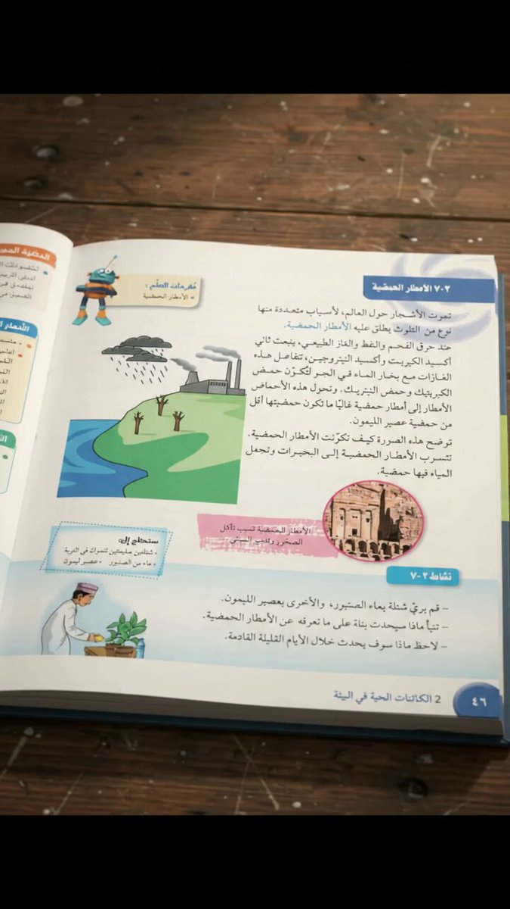
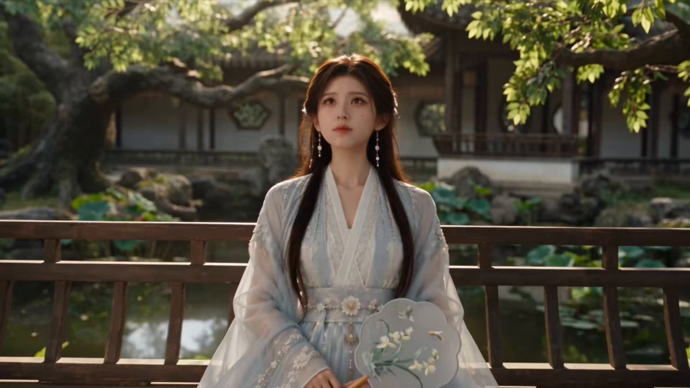
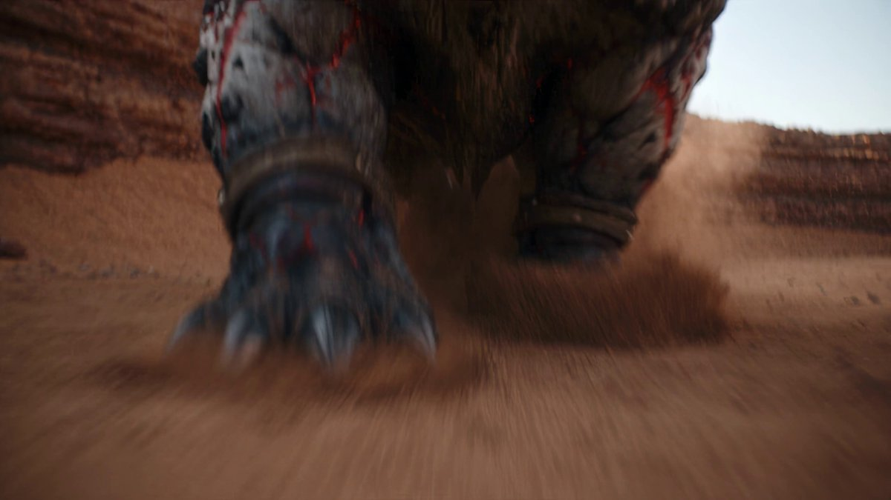
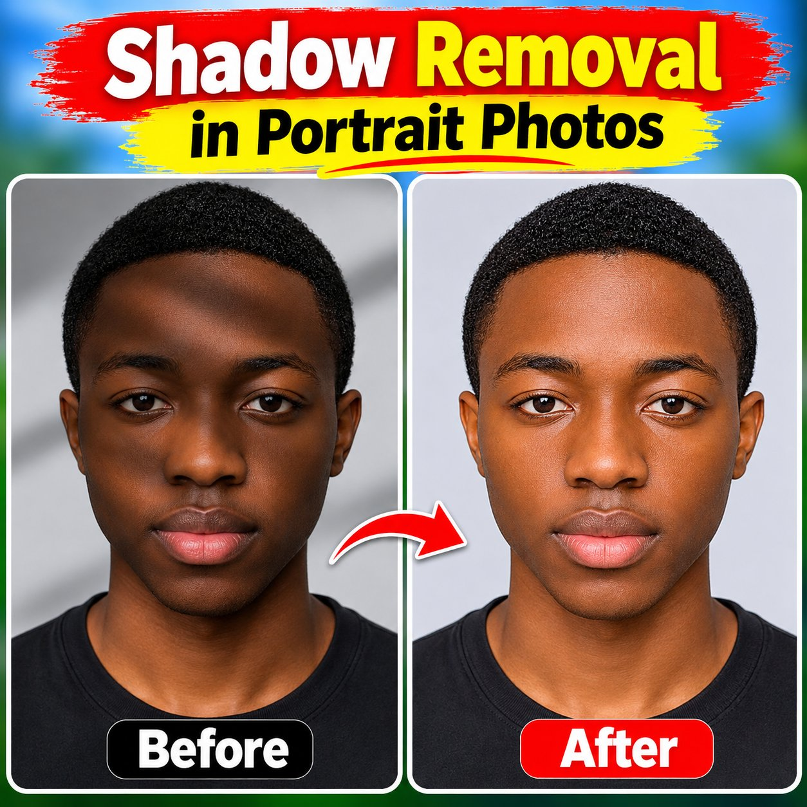
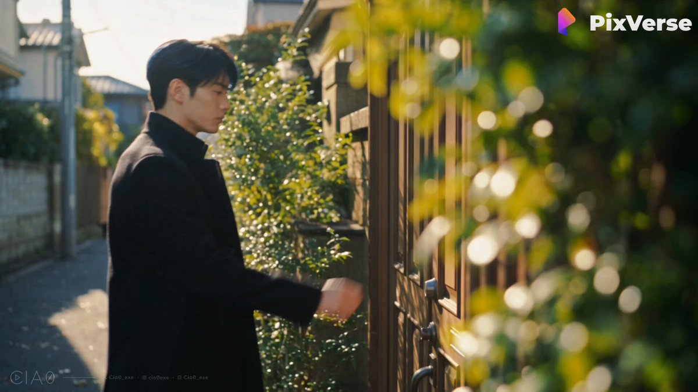

# 每周 X Prompt 精选 · 2026-11-16

> 覆盖时间：2026-11-09 ~ 2026-11-15（北京时间，周一至周日）｜ 来源：X 公开帖子，按热度、可复制性和成片质量挑选 ｜ 共 7 条

**目录**
1. [新模型上线，先让 Agent 清理一遍旧提示词](#1-新模型上线先让-agent-清理一遍旧提示词)（写作/Agent · Claude Code / Codex 等编程 Agent）
2. [让课本页“活”过来·3D 教学视频](#2-让课本页活过来3d-教学视频)（视频 · Gemini 4 Hydrogen）
3. [逆天！中国人会飞·古装趴飞 12 镜](#3-逆天中国人会飞古装趴飞-12-镜)（视频 · 纯文生视频，古装写实）
4. [350 吨的巨兽，还只是幼崽](#4-350-吨的巨兽还只是幼崽)（视频 · Seedance 2.5）
5. [一句提示词去掉人像脸上的阴影](#5-一句提示词去掉人像脸上的阴影)（图像编辑 · 通用图像编辑模型）
6. [照片变“解构瑞士风”抽象海报](#6-照片变解构瑞士风抽象海报)（图像编辑 · 通用图像编辑模型）
7. [《独自升级》真人版·告别车海印](#7-独自升级真人版告别车海印)（视频 · Seedance 2.5，PixVerse 上生成）

---

## 1. 新模型上线，先让 Agent 清理一遍旧提示词
- **模型/工具**：Claude Code / Codex 等能读写整个项目的编程 Agent（转引 Anthropic 的 @alexalbert__）
- **作者**：[@dotey](https://x.com/dotey)
- **原帖**：https://x.com/dotey/status/2119894229581508868 （11-10，507 赞 / 666 收藏）；提示词就在正文里，引用的原帖 https://x.com/alexalbert__/status/2119884951550386671
- **为什么值得收**：本周收藏最多的提示词帖。新模型更聪明，以前为旧模型堆的补丁式规则反而会拖后腿。这一句话让 Agent 通读整个项目（包括 CLAUDE.md、skills、提示词文件），把有把握的直接修掉，没把握的列清单交给你审，适合每次换模型时跑一遍。

<details>
<summary><b>清理提示词 Prompt（中文 / 英文原意）（点开展开）</b></summary>

```text
阅读整个项目，找出所有损坏、不一致、低效或不再需要的东西。修复你确信的部分，并将其余部分列出供我审查。
```

</details>

## 2. 让课本页“活”过来·3D 教学视频
- **模型/工具**：Gemini 4 Hydrogen（上传一张课本页照片，图生视频，16:9）
- **作者**：[@smalkalbani](https://x.com/smalkalbani)
- **原帖**：https://x.com/smalkalbani/status/2121844887033458954 （11-15，410 赞 / 343 收藏）；完整提示词（阿拉伯语）在作者自己的回复 https://x.com/smalkalbani/status/2121844890409562356
- **为什么值得收**：本周点赞第二高的提示词帖，也是少见的“教育用”视频提示词。拍一页课本，插图就从纸面上立起来演示知识点，最后再落回原位。提示词反复强调“页面不许换、文字不许改、不许编造新知识点”，只要把最后的年级说明改掉，就能用于任何科目。下面给出中文译文和阿拉伯语原文。



<details>
<summary><b>Gemini 4 Hydrogen Prompt · 中文译文（点开展开）</b></summary>

```text
任务：把一页真实的课本变成可互动的 3D 教学场景。
把附上的图片当作一页原版课本，生成一段 16:9 的电影感教学视频：这一页纸本身作为真实的 3D 实物出现，教学元素从纸面上“长”出来，并在纸面上方运动。

基础场景：
真实的课本页完整呈现，平放在合适的桌面上，略微倾斜的 3D 视角，能看到纸张厚度、自然纹理和真实阴影。
页面上的所有文字、图片、插图、颜色和排版位置都必须与原页完全一致。

开始“复活”：
镜头缓慢靠近页面，页面里的主要教学元素逐渐从平面插图变成 3D 模型。
模型从原来的位置轻轻升起，像是从纸里钻出来一样，视觉上始终与页面相连。

页面上方的教学场景：
纸面上方的空间变成一个微缩教学世界，元素以立体尺寸出现，用自然的运动把科学/教学概念演示清楚。
所有运动和过程都发生在纸面之上，真实阴影落在纸上，光线统一，让元素看起来真的立在书上。
原始页面在整个过程中始终在模型下方可见，不能消失，也不能换成别的背景。

镜头运动：
使用平稳的电影机位：先给整页的全景，再切到贴近、倾斜的视角，展示元素的高度和纵深，围绕模型轻微环绕，但不脱离与书本的关系。

结尾：
演示结束后，立体元素逐渐回到页面上原来的位置，平滑地变回平面插图。
镜头最后停在与开头一样的完整课本页上。

视觉风格：
高度写实、电影级画质、细节精细、3D 材质、柔和光线、自然阴影、流畅运动、清晰的空间纵深。

基本规则：
原始课本页是所有镜头里固定不变的核心元素。
不要替换或重新设计页面。
不要改动页面上的任何文字、数字或插图。
让元素从它们在页面上的真实位置冒出来。
不要让视频出现在书本上方的屏幕或矩形框里。
教学场景必须是立体的，并与纸面融为一体。
只使用图片里的内容，不要编造新的知识点或教学元素。
不要添加 logo、文字或音乐。
保持科学准确、画面清晰。

重要说明：课程是【六年级科学，即 12 岁学生】。

最终效果：
一页课本变成令人惊叹的写实 3D 教学世界：插图从纸里走出来、活起来，用自己的运动讲清概念，然后平滑地回到页面上原来的位置。
```

</details>

<details>
<summary><b>原文（阿拉伯语）（点开展开）</b></summary>

```text
"المهمة: تحويل صفحة كتاب مدرسي حقيقية إلى مشهد تعليمي تفاعلي ثلاثي الأبعاد.
استخدم الصورة المرفقة بوصفها صفحة أصلية من كتاب مدرسي، وأنشئ فيديو سينمائيًا تعليميًا بنسبة 16:9، تظهر فيه الصفحة نفسها كجسم مادي واقعي ثلاثي الأبعاد، تنبثق منه العناصر التعليمية وتتحرك فوق سطحه.
المشهد الأساسي:
تظهر صفحة الكتاب الحقيقية بكامل تفاصيلها، مستلقية على سطح مناسب، بمنظور ثلاثي الأبعاد مائل قليلًا، مع إظهار سماكة الورق وملمسه الطبيعي والظلال الواقعية.
حافظ على جميع النصوص والصور والرسومات والألوان وتوزيع العناصر كما تظهر تمامًا في الصفحة الأصلية.
بداية الإحياء:
تقترب الكاميرا ببطء من الصفحة، ثم يبدأ العنصر التعليمي الرئيسي الموجود فيها بالتحول تدريجيًا من رسم مسطح إلى نموذج ثلاثي الأبعاد.
يرتفع النموذج برفق من موضعه الأصلي، وكأنه يخرج من داخل الورق، مع بقائه متصلًا بصريًا بالصفحة.
المشهد التعليمي فوق الصفحة:
تتحول المساحة الموجودة فوق الورقة إلى عالم تعليمي مصغر، تظهر فيه العناصر بحجم مجسم، وتتحرك بطريقة طبيعية توضح الفكرة العلمية أو التعليمية.
تحدث جميع الحركات والعمليات فوق سطح الصفحة، مع ظلال واقعية تسقط على الورق، وإضاءة متناسقة تجعل العناصر تبدو وكأنها موجودة فعليًا فوق الكتاب.
تبقى الصفحة الأصلية مرئية أسفل المجسمات طوال المشهد، دون اختفائها أو استبدالها بخلفية أخرى.
حركة الكاميرا:
استخدم زوايا تصوير سينمائية هادئة، تبدأ بلقطة واسعة للصفحة، ثم تنتقل إلى منظور قريب ومائل يكشف ارتفاع العناصر وعمقها، مع حركة دوران خفيفة حول النموذج دون فقدان ارتباطه بالكتاب.
النهاية:
بعد اكتمال العرض التعليمي، تعود العناصر المجسمة تدريجيًا إلى مواقعها الأصلية داخل الصفحة، وتتحول بسلاسة إلى رسوماتها المسطحة.
تنتهي اللقطة بظهور صفحة الكتاب كاملة كما كانت في البداية.
الأسلوب البصري:
واقعية عالية، جودة سينمائية، تفاصيل دقيقة، خامات ثلاثية الأبعاد، إضاءة ناعمة، ظلال طبيعية، حركة سلسة، وعمق بصري واضح.
قواعد أساسية:
صفحة الكتاب الأصلية هي العنصر الثابت والأساسي في جميع المشاهد.
لا تستبدل الصفحة ولا تعِد تصميمها.
لا تغيّر أي نص أو رقم أو رسم موجود فيها.
اجعل العناصر تنبثق من أماكنها الحقيقية داخل الصفحة.
لا تجعل الفيديو يظهر داخل شاشة أو إطار مستطيل فوق الكتاب.
يجب أن يكون المشهد التعليمي مجسمًا ومندمجًا مع سطح الورق.
استخدم محتوى الصورة فقط، دون اختراع معلومات أو عناصر تعليمية جديدة.
لا تضف شعارات أو كتابات أو موسيقى.
حافظ على الدقة العلمية والوضوح البصري.

ملاحظة مهمة: المنهج هو [علوم للصف السادس أي طالب بعمر 12 سنة.]

النتيجة النهائية:
مشهد واقعي مذهل لصفحة كتاب مدرسي تتحول إلى عالم تعليمي ثلاثي الأبعاد، حيث تخرج الرسومات من الورق وتنبض بالحياة، وتشرح الفكرة بحركتها فوق الصفحة، ثم تعود إلى مواضعها الأصلية بسلاسة."
```

</details>

## 3. 逆天！中国人会飞·古装趴飞 12 镜
- **模型/工具**：纯文生视频（作者未标注具体模型；提示词结构是常见的 Seedance / 即梦分镜写法），需上传人物参考图 图1
- **作者**：[@GrayNoteLab](https://x.com/GrayNoteLab)
- **原帖**：https://x.com/GrayNoteLab/status/2121211667765993552 （11-13，79 赞 / 52 收藏）；正文里有全局设定和镜头 01，完整 12 个镜头放在作者自己回复里的夸克网盘 https://x.com/GrayNoteLab/status/2121215764686680135 （作者提示：国内网盘需关掉代理访问）
- **为什么值得收**：中文“锁定式”长提示词的范例。分成【人物锁定】【空间锁定】【声音】三块：飞行姿势按平飞、爬升、俯冲分别写清楚，规定时速不低于 400km/h，并用近处参照物的残影和衣裙狂舞来表现速度；场景从园林水榭一路向前到平流层云海，不许回头。这套写法换成别的“超能力”题材也能直接用。



<details>
<summary><b>文生视频 Prompt（正文部分：全局设定 + 镜头 01）（点开展开）</b></summary>

```text
东方古装写实电影质感；真实皮肤、发丝、布料质感；胶片级色调；禁CG感、塑料感
【人物锁定】女主A：图1，全片只有A一人。飞行姿态以趴飞为基线：平飞时身体俯卧、与航线平行，头在前、脚在后，双臂收在身侧或微微张开；爬升时身体随航线带一点仰角——头略高于脚、与爬升方向成一条直线（符合空气动力学，不写死水平趴着）；俯冲时随航线头低脚高。绝不站立飞行、绝不身体自己直立起来飞，不摆动四肢。高速段必须呈现真实空间位移，且再快也要保留她可辨认的趴飞姿态与身体轮廓，不许糊成一条残影或光带、看不出人形。全片速度基线：她的飞行速度不得低于400km/h——参照物必须以极快的相对速度向她身后掠过，贴地、贴水、贴崖段的近处参照物拉出残影；动能极大。衣摆、裙摆、衣袖与长发被强风扯动得极其夸张：布料被气流压贴在身上、边缘撕扯般猎猎狂舞，绝不轻飘飘地缓缓飘动——衣裙的狂舞本身就是高速的证据。
【空间锁定】行进路线一条直线向前：园林水榭→云雾山崖→峡谷河流→海上→云海，场景按此顺序更替，方向始终向前、不回头、不折返；高度一路爬升：海面低空→穿上云层→平流层（与客机同高）。全片截止到镜12，收尾停在平流层云海上的航迹，不再有后面的行程。
【声音】全片无背景音乐、无歌曲演唱，只保留环境音效：亭中的微风与鸟鸣、飞行时的风啸、峡谷与贴水段的水声、客机远远的轰鸣、镜11音障迸发后迟来的低沉音爆轰鸣；无对白、无字幕。

【镜头01】【时长】3.0秒【景别】中景推至面部特写
【画面】园林水榭里，A静坐在榭台上，手持一柄圆形团扇，抬眼望向画面上方，整个人纹丝不动；日光透过树叶洒下斑驳光点。推近到面部时，她鬓边几缕发丝无风自动、被一股自下而上的气流轻轻掀起——她正在蓄力。
【运镜】推镜头：镜头缓慢向前推进，从中景逐渐靠近主体，最终停在面部特写或关键细节上。自她持扇的中景起、缓慢推近，落幅停在她的面部特写，扇面只留在画面下缘。
```

</details>

## 4. 350 吨的巨兽，还只是幼崽
- **模型/工具**：Seedance 2.5（3 张参考图：部落首领、幼兽、成年兽，30 秒，16:9）
- **作者**：[@tokyo_Valentine](https://x.com/tokyo_Valentine)
- **原帖**：https://x.com/tokyo_Valentine/status/2121449132066001120 （11-14，58 赞）；完整提示词在作者自己的回复 https://x.com/tokyo_Valentine/status/2121449136205746380 。同作者本周还有《小丑军团占领时代广场》（136 赞）和《斗兽场处刑人》，都是同一套结构
- **为什么值得收**：一条带“反转”的怪兽动作片提示词：前 20 秒是猎杀幼兽的爽片，后 10 秒用地面震动的小石子、骤停的欢呼和地平线后先露出的巨角，揭开 50 米的成年兽。每秒一拍，还写了“可以合并成长镜头，不是每秒强制切”，并把体型、尺寸和“两只兽不是同一只放大”写成硬约束，值得学。



<details>
<summary><b>Seedance 2.5 Prompt（点开展开）</b></summary>

```text
BASIC DIRECTION
30-second film, 16:9. Photoreal live-action Hollywood creature-action cinema. One continuous location: a broad red-sandstone canyon basin at dawn, with rocky ledges and a low saddle beyond the far ridge. Warm sunrise, cool shadows, airborne sand, realistic skin, feathers, bone, stone and volcanic heat distortion. Fast, heavy action followed by a terrifying reversal. Begin with the juvenile already charging; no opening titles or setup shot.

REFERENCE LOCK
@Image 1 = the tribal chief, approximately 4m tall. Preserve his exact face, muscular proportions, black hair, feather headdress, red-and-white body paint, skull shoulder armor, garments, bone footwear and distinctive bone blade.
@Image 2 = juvenile Gaia Rhinos, 12m TOTAL BODY LENGTH, approximately 5.5m shoulder height. Preserve its pale stone armor, black dorsal spikes, horns, red molten fissures, circular shoulder markings, four legs and armored tail.
@Image 3 = parent Gaia Rhinos, 50m TOTAL BODY LENGTH, approximately 14m shoulder height and 18m overall height including its horn. Preserve this reference's darker armor, enormous pale horn, spikes, glowing red fissures, shoulder spirals and quadrupedal silhouette. Use this image as the parent regardless of the printed sheet name.
Supporting cast: adult Native American warriors in this fictional fantasy setting, normal human height, visually distinct individuals with ropes, spears and shields. Only the chief has @Image 1's giant proportions and exact regalia.
The two beasts are separate individuals. The parent is not a transformation or enlarged duplicate of the juvenile. Maintain their different designs and fixed dimensions. Preserve the large circular red markings on their shoulders; do not move these markings onto their faces. For the reveal, the parent's actual small eyes glow with subtle red concentric light inside the irises, without changing their shape or position. Reference sheets provide appearance only, never layouts, labels or backgrounds.

CAMERA AND CONTINUITY
Action-movie camerawork continues every second throughout the entire video.
Each one-second interval is a moving-camera beat, not a compulsory edit. Join compatible beats into continuous shots. Keep action direction, cliff positions and eyelines coherent. Show contact, force and consequences clearly. Use foreground rocks, normal-size warriors and the 4m chief as scale references. Motion blur stays directional; silhouettes remain readable. Only the blade impact uses brief slow motion. During the final reveal, deliberate rising and widening camera moves reveal scale without frantic cutting.

TIMELINE
00–01s: Ground-level camera retreats from the charging juvenile. Its forefoot slams beside the lens, kicking stones past camera as the canyon floor shakes. Immediate weight and danger.

01–02s: Fast lateral tracking reveals the juvenile's entire 12m body racing through the red canyon, with small warriors concealed along the ledges for scale.

02–03s: Crane rapidly up to a low angle on the 4m chief. He raises his bone blade in a sharp signal while watching the beast below.

03–04s: Whip-pan along the ridge as the hidden warriors rise together and cast thick lassos. Loops fly toward the juvenile from both sides.

04–05s: Moving high angle follows loops catching around horn bases and armored shoulders. Lines anchored around rock outcrops tighten as other warriors release prepared boulders.

05–06s: Low lateral tracking catches boulders smashing against the juvenile's stone armor. Rock fragments and hot mineral sparks burst outward; its charge staggers but continues.

06–07s: Track beside the juvenile as it twists and drags the taut ropes. Anchors break loose, loose lines whip behind it, and warriors holding the lines skid across sand.

07–08s: A close three-quarter tracking shot shows the juvenile sweeping its horn sideways. The blunt side strikes one warrior's raised shield and launches him off his feet, without piercing him.

08–09s: Whip-pan follows the airborne warrior into a tumbling landing on a sandy slope. His shield rolls ahead; he moves after landing. No graphic injury.

09–10s: Whip back to the juvenile bucking broadside beneath the chief's ledge. A molten seam between dorsal armor plates flares into view as its back twists.

10–11s: Low forward dolly follows the chief sprinting one step and launching from the ledge, bone blade ready. The juvenile remains visibly below him.

11–12s: Descending side tracking follows his short, heavy drop toward the juvenile's back. Feathers stream upward; his feet target the gap between dorsal spikes.

12–13s: Close moving profile shows his feet land on the armored back. He absorbs the impact with bent knees and braces against the beast's violent bucking.

13–14s: Brief half-second slow motion: the chief drives the bone blade into the existing molten ARMOR SEAM. A tight lateral arc clearly shows blade contact, cracking stone and red mineral sparks. No flesh or blood.

14–15s: Snap back to real time. The juvenile's forelegs buckle. The chief pulls his blade free and springs toward the adjacent low rock ledge as the body tilts.

15–16s: Wide lateral tracking follows the juvenile sliding forward, scraping the canyon floor. Its collapsing mass plows a deep furrow through sand and loose stone.

16–17s: Rising wide shot: the juvenile falls onto its side with a colossal impact. A rolling sand cloud spreads outward; the chief is visible safely on the nearby rock.

17–18s: Sweep past the warriors as they raise their spears and give a brief, wordless victory cheer. Keep the fallen juvenile visible beyond them.

18–19s: Low dolly toward the juvenile's face. Its actual eye flickers weakly and it releases a low, sustained, wavering distress call; the celebration continues farther away.

19–20s: Tight moving eye detail. The call weakens and trails away; the eye fades out. The juvenile dies and becomes completely still.

20–21s: Telephoto push toward the empty distant canyon. A much deeper roar answers with the same wavering quality. The parent remains entirely hidden.

21–22s: Macro camera slides across the dead juvenile's armor. Tiny pebbles jump in rhythmic tremors, then larger grains begin bouncing. The body itself stays motionless.

22–23s: Dolly along the warriors' faces. Their cheers stop abruptly; raised spears waver and one lowers. Every gaze turns toward the far ridge.

23–24s: Low forward push from behind the chief. He looks toward the approaching tremors as dust trickles off the ridge and the ground vibrates more strongly.

24–25s: Crane upward toward the ridge. The parent's enormous pale horn pierces the moving dust first, followed by the upper edge of its dark armored head.

25–26s: Continue tilting upward. Its real eyes glow red high above the warriors, with subtle concentric iris light. Its separate glowing shoulder spirals emerge lower and farther back.

26–27s: Pull back and rise into a wide three-quarter view as the entire 50m parent advances through the low saddle into the basin. All four legs and its long armored body become readable.

27–28s: Continue into a wide lateral composition showing the dead 12m juvenile, the 4m chief, normal-size warriors and the 50m parent together at comparable depth. The parent stops beside its offspring and lowers its muzzle toward the still body.

28–29s: Arc behind the chief's shoulder. Beyond him, the parent lifts its head from the dead juvenile and fixes its gaze on the warriors. Hold the size contrast and the sudden understanding.

29–30s: Tight low-angle push on the chief's face and hands. Silent, jaw set, he regrips the SAME bone blade and raises his guard toward the parent. Hard cut to black at 29.8s; end at 30.0s.

SOUND
Diegetic effects only: canyon wind, thunderous footfalls, rope strain and snaps, rushing air, impacts, scraping stone, volcanic crackle, sand, armor movement, breathing, brief wordless cheers and creature calls.
The juvenile's fading call and the parent's answering roar must sound related, with the parent's voice vastly deeper and heavier. After the answer, human cheering stops; retain wind, breathing and approaching seismic footfalls. Let the parent's final exhale cut off with the blackout.
NO BGM, score, musical drone, percussion track, dialogue, narration or spoken words.

EXCLUSIONS
No anime, illustration, stylized game rendering, reference-sheet panels, captions, subtitles, logos, text or interface elements. No blood, gore, dismemberment or impalement of humans. Damage is stone armor, sparks and sand. No firearms, additional powers, fire breath, energy beams, extra beasts, duplicated chiefs, character fusion, changing sizes, revival of the juvenile or early visual reveal of the parent. The parent remains quadrupedal. No prolonged slow motion, static slideshow or dust hiding the decisive blade impact and final scale comparison.
```

</details>

## 5. 一句提示词去掉人像脸上的阴影
- **模型/工具**：通用图像编辑模型（上传人像照片；Nano Banana / GPT Image 一类都可以）
- **作者**：[@abs_crea8or](https://x.com/abs_crea8or)
- **原帖**：https://x.com/abs_crea8or/status/2119786311041089604 （11-09，53 赞 / 27 收藏）；完整提示词在作者自己的回复 https://x.com/abs_crea8or/status/2119786365759955401
- **为什么值得收**：很实用的修图提示词：把脸上的硬阴影、明暗脸修成均匀的棚拍光，同时用一整段 IDENTITY PRESERVATION 锁住五官和肤色，明确“不美颜、不改脸”。证件照、头像、产品图里的人像补光都能用。



<details>
<summary><b>人像去阴影 Prompt（点开展开）</b></summary>

```text
ULTRA-REALISTIC SHADOW REMOVAL & NATURAL LIGHTING PROMPT

Use the uploaded photograph as the exact reference image. Completely remove all shadows from the face, forehead, cheeks, nose, eyes, lips, chin, neck, and background.

LIGHTING & FACE ENHANCEMENT:

- Apply soft, even, professional studio lighting across the entire face.
- Ensure both sides of the face are equally illuminated.
- Remove harsh shadows, dark patches, dramatic lighting effects, and unwanted highlights.
- Restore natural skin brightness and balanced exposure.
- Make the eyes, nose, lips, and facial details clearly visible.
- Maintain realistic skin texture without excessive smoothing.

BACKGROUND:
Keep the background clean, simple, and evenly illuminated with a natural light-grey tone.

IDENTITY PRESERVATION:
Preserve the person's exact original facial identity, facial structure, skin tone, hairstyle, eyes, eyebrows, nose, lips, ears, and natural facial proportions. Do not beautify, reshape, replace, or alter the person's appearance.

FINAL RESULT:
A clean, bright, evenly illuminated, ultra-realistic professional studio portrait with absolutely no visible shadows covering the face. Natural lighting, balanced exposure, sharp facial details, and high-resolution photographic quality.
```

</details>

## 6. 照片变“解构瑞士风”抽象海报
- **模型/工具**：通用图像编辑模型（上传照片，输出 3:4 竖版海报）
- **作者**：[@icreatelife](https://x.com/icreatelife)
- **原帖**：https://x.com/icreatelife/status/2119828849672462569 （11-10，53 赞 / 25 收藏）；完整提示词在作者自己的回复 https://x.com/icreatelife/status/2119828853900050903
- **为什么值得收**：上半张保留原照片，下半张从同一张照片里提取两三个视觉特征（轮廓、动势、重心），用几何色块和留白重新抽象，再用暖白底、纸纹和轻微套色错位做出印刷感。“不许直接复制或镜像原图”这条限制，是它不像普通拼贴的关键。旅行照、建筑照都很合适。


<details>
<summary><b>抽象海报 Prompt（点开展开）</b></summary>

```text
Transform each uploaded photo separately into an independent 3:4 vertical poster, without mixing images. The upper and lower halves should each occupy 50% of the composition, connected seamlessly at the center, with no visible frame or border.

Upper Half — Original Photography

Preserve the main subject, pose, proportions, spatial relationships, materials, lighting, and colors of the original photograph. Allow only subtle color correction, proportional cropping, or natural background extension. Do not distort, redesign, or alter the main subject.

Lower Half — Abstract Graphic Interpretation

Extract two or three recognizable visual characteristics from the same photograph, such as contours, movements, centers of gravity, or repeated visual rhythms.

Use a minimal number of geometric color blocks, lines, cuts, overlapping printed shapes, and negative space to transform these features into independent abstract symbols that express movement and dynamic tension.

Do not draw a complete representation of the original subject. Do not simply repeat, mirror, or duplicate the photograph.

Visual Style — Deconstructed Swiss Design

Follow the principles of digital imagery and deconstructed Swiss graphic design, emphasizing a single strong visual focus, restrained composition, and generous negative space.

Extract one or two dominant colors and one supporting accent color from the original photograph.

Combine these colors with a warm-white background, flat print-like color fields, extremely subtle paper grain, and slight local printing misregistration.

Add only a few structurally meaningful lines, curves, and points.

The design should feel experimental yet intentional, with strong visual rhythm, asymmetrical balance, and sophisticated editorial restraint.

Typography

Keep any text extremely small, understated, and readable. Typography should complement the composition without competing with the imagery.

Restrictions

Avoid large headlines, random fonts, watermarks, commercial UI elements, neon gradients, arbitrary geometric patterns, dense charts, heavy decoration, and outdated graphic design aesthetics.

Final Aesthetic

The finished poster should be concise, organized, contemporary, and visually striking, with a subtle handmade printing quality.

Maintain a clear contrast between the realistic photographic upper half and the abstract graphic lower half while ensuring a seamless visual connection between them.

The result should resemble a sophisticated experimental art poster created by an independent graphic designer, not a conventional photo collage or digitally filtered image.
```

</details>

## 7. 《独自升级》真人版·告别车海印
- **模型/工具**：Seedance 2.5（作者在 PixVerse 上生成；3 张参考图：男主、女主、烟影巨龙，30 秒，16:9）
- **作者**：[@Cia0_exe](https://x.com/Cia0_exe)
- **原帖**：https://x.com/Cia0_exe/status/2120864940957577569 （11-12，35 赞）；中文提示词在作者自己的回复 https://x.com/Cia0_exe/status/2120865061187252307 。同作者 11-13 的《Hanuman X Krishna》特效版也公开了繁体中文提示词 https://x.com/Cia0_exe/status/2121221600980898057
- **为什么值得收**：上周“每 2 秒一镜”打戏时间轴的作者，这次换成克制的情感戏：除了画面和镜头，还专门写了“角色性格与内心”，要求“全程收着演”，把情绪放进睫毛轻颤、指节收紧这类细节里；镜头光学（halation 光晕、anamorphic 横向眩光、镜头呼吸）贯穿全片。适合学怎么用文字给 AI 演员“说戏”。



<details>
<summary><b>Seedance 2.5 Prompt（点开展开）</b></summary>

```text
电影级 live-action 写实质感，30秒，16:9 宽银幕，24fps，变形宽银幕镜头。真实摄影、真实物理、真实光影，35mm 胶片颗粒（Vision3 250D），浅景深，轻微冷色调，45° 快门角度带来的自然运动模糊。**镜头光学特性贯穿全片**：画面边缘有轻微暗角与椭圆散景，高光处带柔和的 halation 光晕，面对强光源时出现水平方向的青蓝 anamorphic 横向拉丝眩光，阳光穿过镜头片组时在特定角度绽开一束极淡的彩虹衍射光，整体有呼吸般的极轻镜头微颤（lens breathing）。所有动作、表情与布景自然、克制、有真实分量；情绪越含蓄越动人，绝不夸张或煽情。

**角色参考（外形硬锁定·不可漂移）：**
@Image1 作为男主角参考：年轻男性，黑偏蓝短发，眼神深邃冷峻、气质矜持内敛，长款黑色质感大衣、白色T恤、黑色长裤、黑色皮靴。@Image2 作为女主角参考：年轻女性，金色短发波波头，白色长袖领口衬衫、蓝色牛仔短裤、赤足，气质清冷优雅，斜挎一只小巧的浅米色帆布肩包，细带斜过胸前、包身贴着腰侧、样式素净略带旧迹。@Image3 作为巨龙参考：**躯体并非血肉实体，而是由浓稠黑烟与活影凝聚成的幽灵般半透明巨兽**——体内深处透出通体泛青蓝色的冷光，光自龙身内部溢出；构成身体与双翼的"黑色"实为不断翻滚、翻涌、抽搐的浓黑烟雾与游走的阴影，边沿如烟尘般向内卷绕又向外飘散，时聚时散、时浓时淡；鳞片、棘刺、脊线与片状薄膜双翼皆由流动的黑烟勾勒，隐约可见身后景物透过龙身若隐若现。**三者的发型、服装、配色、体态与烟雾形态严格保持一致，不得改变或新增装饰；女人的小肩包始终斜挎在身，每帧位置与方向稳定。**

**角色性格与内心（关键·深挖）：**
@Image1 清冷、寡言、深藏不露——爱从不宣之于口，只藏在迟迟不愿开口的沉默、侧过脸躲开的眼神，和每次先行半步护住她的身体倾向上。@Image2 外冷内柔、骄傲又温柔——明明牵挂到心慌，说出口的却只有一句克制的话；只有那双捧住对方脸的、微微发颤的手，出卖了她全部的不舍。两人的爱极深却极淡：所有情绪都收进睫毛的轻颤、指节的收紧、呼吸的错拍里；越克制，越动人。表演全程"收"着演——不许夸张的面部表情、不许大幅宣泄、不许用力过猛的拥抱，越淡越疼。

**分镜时间轴：**

**0–2秒【门前·等候·街区在呼吸】：**
午后晴空，安静窄巷里一栋独栋木屋前。摄像机低机位侧跟，随 @Image1 沉稳的步伐缓缓前移，浅景深把前景的绿植虚化成两片模糊的绿色光斑；他快到时忽地慢下半步、垂眼极轻地吸了一口气，才抬手在木门上轻敲两下，指节停顿。阳光从他斜后方泻下，映射在他黑色大衣厚实的呢绒纹理与蓝黑发梢上，拉出一道细如发丝的金色轮廓光，发梢高光处晕开一层极淡的 halation 光晕，为冷调画面注入一点暖意。**整条街区是活的**——门旁绿植在微风里轻晃，晾晒的衣摆在远处轻摆，地面碎光斑随枝叶摇曳而明灭，细尘在光柱里缓缓浮沉，一只猫从墙头轻巧走过，巷口传来极轻的街声与模糊人语，风掀动他大衣下摆时带起一丝极细微的布帛声。

**2–4秒【开门·一问·眼波里的温柔】：**
门轴发出清晰的轻响、门向内打开，@Image2 赤足踏上木阶——她斜挎的小肩包先随着身子探出在胸前轻轻一晃，她不自觉地理了一下滑落的包带。镜头从她的中景缓缓推近到中近景，随着对焦呼吸般的微颤，门缝泻出的暖光与户外冷光在她脸上交汇成一明一暗的柔和过渡，逆光让她的金色短发边缘浮起一圈毛茸茸的光，镜头在这一角度突然绽出一细条几乎不可察的横向彩虹衍射光，正好横过发梢。先是一愣，随即抬眼看向 @Image1，唇角极轻、极慢地扬起，眼神由诧异转成柔软，平静开口（日语）：「ねぇ、あなた……。何に乗って来たの？」巷风吹动她的发丝与白领，光影流转，她拇指无意识地绞了一下包带上垂下的细绳又松开。

**4–6秒【不答·召唤前的一息】：**
镜头切回 @Image1 侧脸特写，背景的窄巷与绿植被浅景深压成一片含混的青黄色调，窗棂的影子斜斜划过墙面；他没有回答，微微垂下眼，喉结轻轻一动，神色沉静得近乎冷冽。接着他缓缓抬起右手向前一伸，手指自然张开，低沉开口（日语）：「起きろ。」；话音落下，四周空气倏然一静，**世界像被人一把按住了**——风停了、晾衣不再摆、树叶僵住，连远处街声都像被抽走；随即他脚边那道影子如油墨入水般无声炸开、向外漫延，地面腾起一圈逆向旋转的尘土与落叶，无数细小的黑灰碎末开始缓慢地逆着地心引力向上飘升，街灯与门板随之轻颤，一口被压低的气沉积在整条巷子里。

**6–8秒【巨龙现世·狂风大作·天地惊动】：**
低角度仰拍——@Image1 身后的阴影轰然裂开成满天翻卷的黑烟，@Image3 巨龙自烟海中拔地升起：它庞然的黑色身躯不是血肉，而是**浓稠黑烟与活影在半空中疾速凝聚、翻滚、胀大**，体内深处透出的青蓝色冷光在烟团缝隙间断续喷涌；巨大双翼由流动的黑烟撑开，遮蔽半条巷子的天光。它仰首发出一声震彻天地的龙啸，**啸声化为肉眼可见的环状冲击波**：一圈圈空气涟漪自龙首向外荡开，身边的水汽被震成瞬间的白雾，镜头因声浪而剧烈震动、猿臂般地微微一倾，画面边缘的暗角瞬间压深。刹那间狂风如墙般横扫街巷，尘埃与落叶卷成漩涡，成群的飞鸟惊起、黑压压地四散飞逃，白昼的天空被飞散的烟与尘搅成昏黄的混沌；树木剧烈弯腰、窗棂战栗，@Image2 抬手遮风，发丝与衣摆猎猎翻飞，小肩包被风压得贴上腰际，她的眼睛被风吹得眯起，却仍定定地望向 @Image1。

**8–10秒【携手上龙·起飞前的一握】：**
巨龙低伏下身躯，黑烟自鳞缝间缓缓缭绕、像一条条活的绸带贴着地面流动，青蓝色的光从它腹部幽微地漏出，映在两人脚边。@Image1 先踏上龙颈，回身向 @Image2 伸出手——掌心先贴住她手背、再稳稳收紧，像在问她"愿意跟我走吗"；她将手放进他掌心，眼里掠过一丝笃定，赤足踏上微凉、似烟似实却稳稳承住她的龙鳞，另一手按住肩包的细带。两人并肩在龙背上坐稳，巨龙后肢发力、双翼猛振，**起飞的气浪在巷子里炸开一圈贴着地面急速扩散的尘环**，镜头贴地仰拍、随龙身极速拔起，快速下坠的地面景物在运动模糊里拉成一道道斜向的色带，强光从画面上方灌入，一道水平的青蓝 anamorphic 眩光在镜头前利刃般一闪；@Image2 的手指悄悄抓紧了 @Image1 的手腕。

**10–12秒【绕城飞行·白昼壮阔·城市活着】：**
镜头环绕到二人侧前方，巨龙载着他们掠过城市上空；@Image3 的烟质身躯在气流中不断变形，边沿的黑烟被风撕成向后飞散的尾迹，青蓝色的光如活物般在烟雾纹理里游走。**整座城市在呼吸**——楼房街道河流在下方绵延流动，江面反射着晃眼的日光碎银，屋宇阴影随云影游移，街巷里细小的车流与人影如细沙般缓缓移动，成群的飞鸟从龙旁惊散。风把两人的衣与发向后扯起，@Image1 的大衣下摆如翼般张开，@Image2 一手扣住龙脊的鳞棱、一手按住被掀起的小肩包带，微微侧目俯瞰；阳光迎面打来，镜头前晕开一圈柔和的日晕与几抹横向的彩虹拉丝，把她澄澈的眼睛映得发亮，唇边浮起一瞬极淡的放松，身子不自觉地朝 @Image1 靠近了一点。

**12–14秒【黄昏渐临·一句道别】：**
镜头缓缓拉近二人的侧脸，浅景深把身后整座渐小的城市融成一团暖金与青蓝交织的斑斓散景，一颗颗圆形光斑在镜头边缘缓缓游移；天色由蔚蓝渐染暖金，夕阳开始为云层与城市天际线镀上一条鎏金边，风声在渐弱的配乐中显得空旷。@Image1 目视前方天际线，沉默片刻后平静开口（日语）：「……明日、行く。」；这句话轻得几乎被风吹散，夕阳从他侧方射来时，一道温暖的金色逆光从肩后漏入，把他的睫毛与下颌线勾成一圈柔光，镜头上浮起一层淡薄的暖橙色 halation。@Image2 闻言，眼睫极轻地一颤，扣着鳞棱的手指慢慢收紧，指尖在龙鳞上无意识地划了一下，却始终没有回头，只低低"嗯"了一声。

**14–16秒【克制回应·牵挂翻涌】：**
近景对切——@Image2 沉默一瞬、喉咙发紧，把包带在手心里攥了又攥，才轻声开口（日语）：「気をつけて……。ごめんなさい、力になれなくて。迷惑をかけるのが怖いから。」；说最后半句时她的视线几不可察地垂下，夕阳的暖光斜切过她的脸，与她本人的清冷形成一冷一暖的分界。@Image1 闻言微微偏过头，神色柔和却坚定，声音低沉（日语）：「……ただ、別れを言いに来ただけだ。君を危険に巻き込むわけにはいかない。」；两人都没有看对方，只有风从他们之间的空隙穿行而过，吹乱彼此的影子；镜头在两人之间轻柔地对视调度，背景暮色与流动的金色光斑让这一刻安静得近乎窒息。

**16–18秒【山顶降落·落地时他先护她】：**
暮色四合，巨龙盘旋着乘着晚风缓缓下降，烟质身躯在气流里松散又聚合，稳稳落在城市边缘一座青草覆盖的山丘上——翼风将整片草坡压出一圈圈向外荡开的绿色波浪，黑烟自龙身缓缓飘散、贴着草尖流淌开去。@Image1 先一个利落却沉稳的翻身跃下龙背，脚掌落地时惊起草叶上细小的夜露，随即回身，一手托住她的腰、一手牵稳她的手，将她轻轻接下；她的赤足落在微凉的草上，小肩包在身侧轻轻一晃，她顺手把包带拨正。镜头低机位横移，浅景深带出二人身影与身后华灯初上的城市天际线，初亮的灯火在镜头里化成一颗颗暖黄的圆形散景，一束柔蓝的暮色流光横过画面一角。

**18–20秒【并肩而坐·万家灯火·安静中的靠近】：**
两人并肩坐在山丘缓坡的草地上，下方是渐次亮起的万家灯火，最后一抹晚霞与初升的夜色在天边交汇，第一颗星刚刚在深蓝的天幕上亮起；巨龙安静地蜷伏在二人身后不远处，青蓝色的呼吸一明一暗，黑烟若有似无地贴地轻绕、把它的轮廓不断重组。@Image2 把肩包解下、随手放在身侧草地上；两人之间先隔着一小段距离，气氛安静而珍贵，她悄悄把身子挪近一寸，@Image1 没有转头，却把膝盖往她那边倾了倾。镜头以极缓的弧线轻轻环绕，把城市灯火、两人肩影与巨龙微光收进同一个画面，草浪随风起伏，一圈极淡的月光在镜片边缘晕开，如一滴化开的银。

**20–22秒【托脸·一句祈愿·把不舍说出口】：**
@Image2 侧过身，草叶轻轻作响；她双手轻轻捧住 @Image1 的头，指尖贴着他的面颊，几不可察地微微发颤，眼里有极力压住的一层薄薄水光。他垂眸看她，四目相对，城市灯火在两人眼中映成细小的光点，在她发间的高光处，一道极细极淡的彩虹衍射光恰好滑过——像把某种说不出口的话照亮了一瞬。她低声而真挚地开口（日语）：「無事に、帰ってきてね……あなた。」；夜风轻扬，吹动她的发梢扫过他手背，@Image1 闭了闭眼，像要把这句话一个字一个字刻进心里，喉头微微一动，却没说话。

**22–24秒【一吻·克制深情·万籁俱寂】：**
镜头极缓地推成近景，浅景深让后方整片城市灯火虚化成一大片温暖的金色光斑，如洒落的碎金在他们身后缓缓流动；@Image1 微微前倾，先极轻地吻上她的唇，像在试探，又慢慢加深——一个安静、克制却笃定的吻，没有激切，只有珍重。她的手指缓缓滑到他的衣领轻轻攥住，他的手缓缓覆上她的手背。风声在这一刻几不可闻，背景音乐几近停顿，世界只剩他们交错的呼吸与心跳；一束柔暖的逆光从肩头斜掠而入，把他们贴合的两张脸勾出一圈细腻的轮廓，镜头上晕开淡薄的暖橙色光晕，如梦似幻。

**24–26秒【靠入怀中·归属感】：**
吻缓缓分开，两人额头几乎相抵，呼吸可闻，鼻尖几不可察地蹭了一下；@Image2 身子轻轻一软，把头慢慢靠进 @Image1 的胸膛，双眼柔柔闭合，像终于敢卸下所有逞强，小肩包静静躺在他们脚边，包带在夜风里极轻地晃了晃。@Image1 的下巴轻抵她的发顶，一手环住她的肩、另一手覆在她的手背上，呼吸轻缓而安定，胸腔里是一句无声的许诺。镜头留在近景，画面边缘的圆形散景如活物般缓缓流动，一小片城市的暖光映在他们交叠的衣料上，温柔地明灭。

**26–28秒【轻抚发顶·无言守护】：**
镜头缓慢环绕至二人侧面——@Image1 抬起另一只手，极轻、极慢地一下一下抚过 @Image2 金色的发顶，动作温柔而珍重，像在触碰一件易碎的珍宝；她的呼吸渐渐安稳，身子又往他怀里偎紧了些。身后的巨龙将一片烟质翅膀缓缓收拢，替两人挡去山口的夜风，黑烟温柔地缭绕在一旁，青蓝色的微光在暗夜里如呼吸般明灭，把她的金发映出一层极淡的、毛茸茸的蓝边。月牙开始爬上枝头，夜风掠过时，草浪与他的衣摆同时轻扬，镜头边缘有一圈极浅的蓝色 moon-flare 缓慢晕开。

**28–30秒【定格·未尽之约】：**
画面渐定——她安静依偎在他胸口，他的手仍停在她发上，两人身后是不夜城的璀璨灯火、初升的星河与静卧巨龙青蓝色的微光；那只浅米色的小肩包静静躺在他们脚边的草叶间，与被夜风扬起的一缕她的金发一道，成为画面里最温柔的细节。巨龙烟质的身躯在背景里缓缓吞吐、若隐若现，像一道安静的守护；最后一缕夜风扬起草叶与衣摆，镜头以极慢的速度缓缓停住，对焦在两人交叠的轮廓上，一切散景都晕成柔和的色斑，画面定格在这份克制而深情的安稳里，留下一段未尽的约定。

**音效与氛围：**
白昼窄巷的环境声——麻雀啁啾、微风、门轴轻响、远处车流与猫的脚步声；召唤时万籁骤静一瞬，随即龙啸炸响、冲击波破空、狂风呼啸、群鸟振翅惊飞、窗棂战栗；飞行段是高空风声与衣袂猎猎声，城市低鸣在下方若隐若现；黄昏后世界渐静，只剩夜虫与远处微弱的街声；吻前那一瞬万籁俱寂，只余两人的呼吸与心跳；收尾一缕夜风掠过草坡。配乐为极简缓慢的钢琴与弦乐，随起飞渐起、随黄昏转柔、随亲吻回落到近乎无声、随定格淡出。
```

</details>

---

## 本周趋势
- **新模型扎堆上线，“同提示词多模型对比”刷屏**：Seedream 5.5、MiniMax H3 Image（开源）、GPT Image 2.6、Seedance 2.5 Flash 本周都有新动作，大量帖子是“同一提示词 × 3~4 个模型”的对比图，但多数只给结果不给完整提示词，或者把提示词放在 Telegram 里，本期没有收录。
- **视频提示词从“写画面”转向“写表演、写反转”**：巨兽幼崽的后 10 秒反转、《独自升级》的“角色性格与内心”，都说明 30 秒长度够了以后，大家开始在节奏、情绪和剧情上下功夫。
- **“锁定”写法成为中文长提示词的标配**：【人物锁定】【空间锁定】【参考锁定】，把姿势、尺寸、方向、数量写成不能违反的规则，专门防止模型跑偏或复制角色。
- **实用型图像编辑提示词更受收藏**：去阴影补光、照片变海报这类“上传一张图就能用”的提示词，收藏比明显高于纯展示类作品。
- **写作/Agent 方向：换模型就做“提示词减法”**：dotey 转引的这句清理提示词收藏最高，说明大家开始把 CLAUDE.md、skills 当成需要定期清理的资产，而不是越堆越长。
