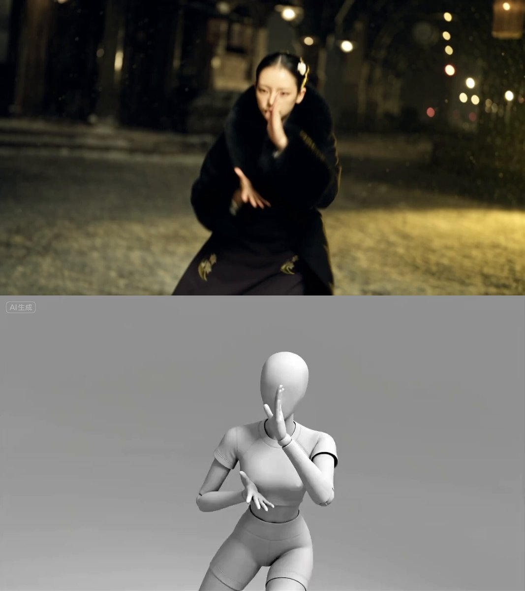
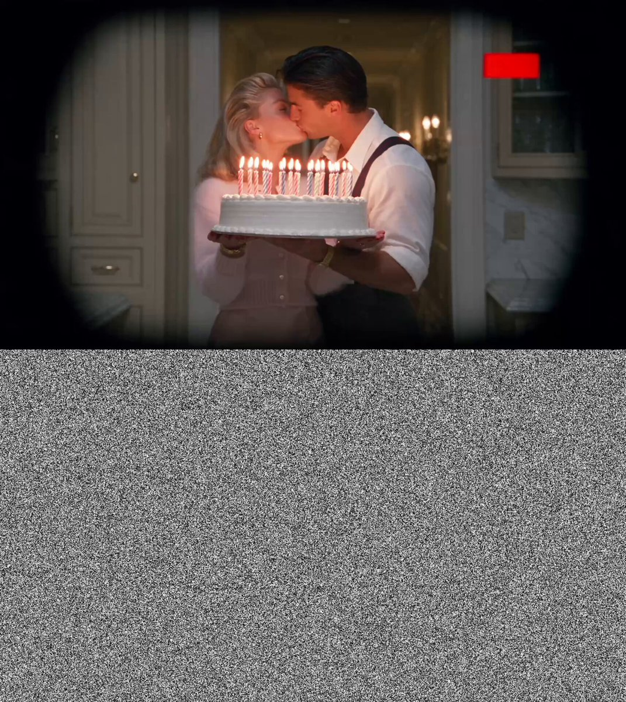
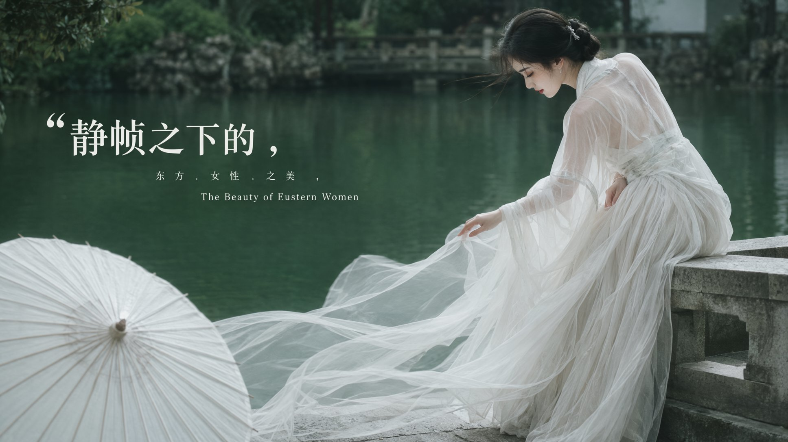
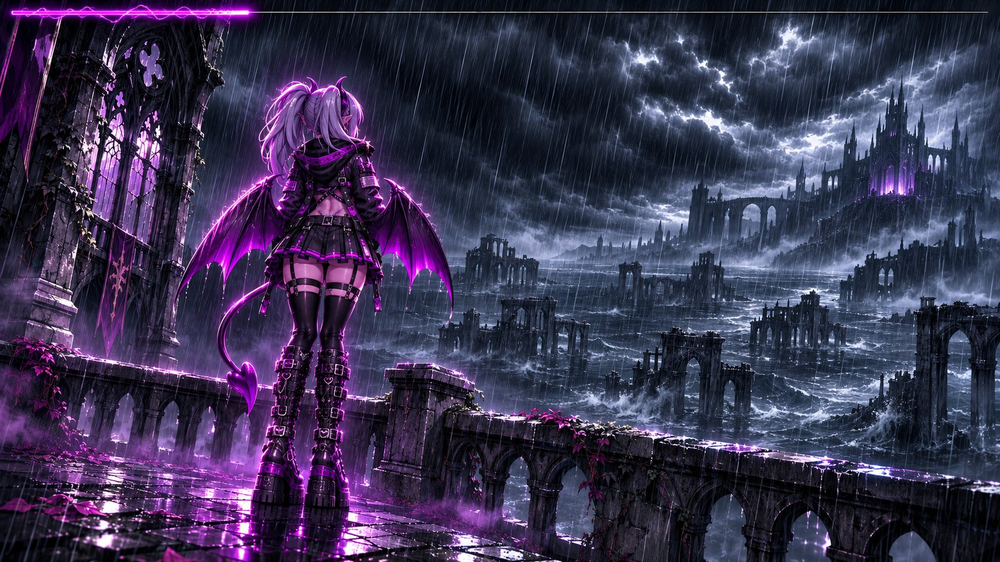
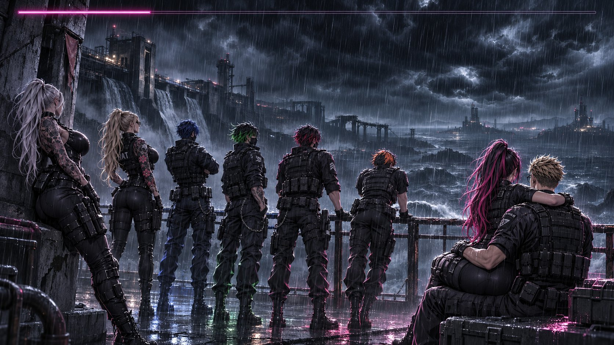
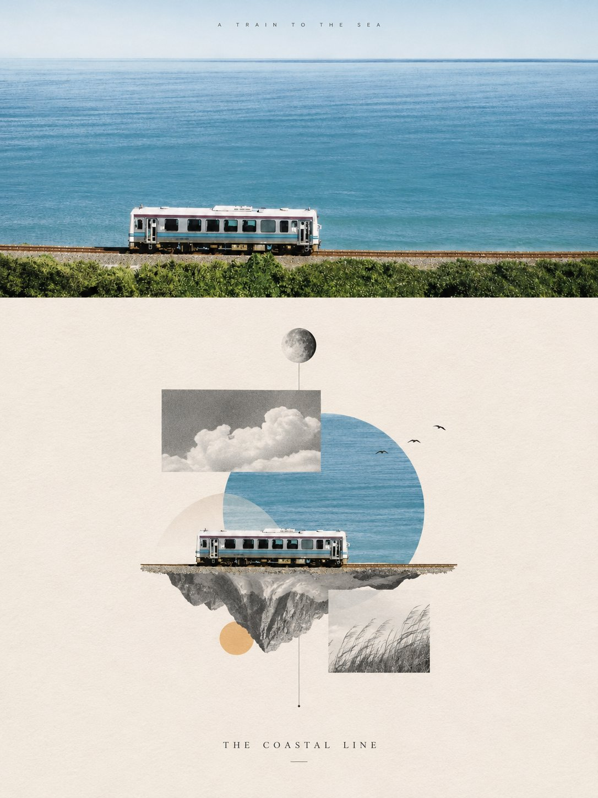
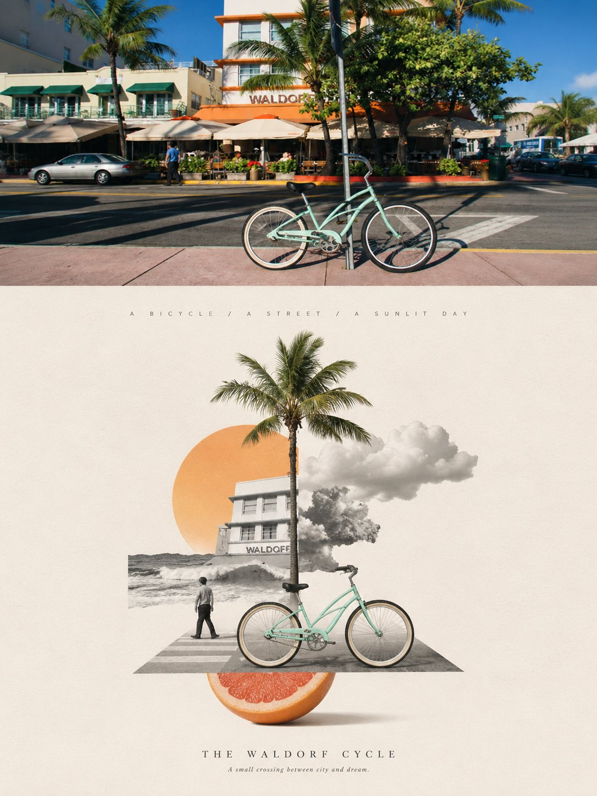

# 每周 X Prompt 精选 · 2026-11-23

> 覆盖时间：2026-11-16 ~ 2026-11-22（北京时间，周一至周日）｜ 来源：X 公开帖子，按热度、可复制性和成片质量挑选 ｜ 共 7 条

**目录**
1. [太极拳白膜，动作稳了再换皮](#1-太极拳白膜动作稳了再换皮)（视频 · Seedance）
2. [1990s 好莱坞家庭剧·25 秒生日晚宴](#2-1990s-好莱坞家庭剧25-秒生日晚宴)（视频 · Seedream 5.0 Pro + Seedance 2.5）
3. [电影静帧下的东方美学·四模型横评](#3-电影静帧下的东方美学四模型横评)（图像 · MOSS-Image / Seedream 5.5 / GPT Image 2.6 / Nano Banana 2.1）
4. [雨的重量·游戏加载画面](#4-雨的重量游戏加载画面)（图像 · 通用图像模型，2.5D 动漫）
5. [一张照片变极简超现实拼贴海报](#5-一张照片变极简超现实拼贴海报)（图像编辑 · GPT2）
6. [明制凤冠霞帔·六模型同题横评](#6-明制凤冠霞帔六模型同题横评)（图像 · GPT Image 2.6 / Seedream / Muse / Nano Banana / Grok）
7. [让 Codex 说人话的 AGENTS.md 约定](#7-让-codex-说人话的-agentsmd-约定)（写作/Agent · Codex / GPT）

---

## 1. 太极拳白膜，动作稳了再换皮
- **模型/工具**：Seedance（作者在回复里确认；需上传原白膜视频，以及要替换的人物参考和场景参考）
- **作者**：[@JunjunAi123](https://x.com/JunjunAi123)
- **原帖**：https://x.com/JunjunAi123/status/2122692624062755202 （11-17，579 赞 / 598 收藏）；完整提示词拆在作者自己的两条回复里 https://x.com/JunjunAi123/status/2122692828459638914 、https://x.com/JunjunAi123/status/2122694205948739861
- **为什么值得收**：本周赞和收藏都最高的提示词帖。先用白膜把武术动作的重心和轨迹锁死，再用提示词只换人和场景，并写明“时长、动作、镜头全部跟原视频走，不许变形、不许身份漂移”。动作类视频最容易跑偏，这套分条写法把“换皮”和“保动作”拆开了。



<details>
<summary><b>白膜换人换景 Prompt（点开展开）</b></summary>

```text
【视频替换任务】: 输出总时长与@原视频一致。原视频内容不拉伸、不变速、不循环、不重复播放任何片段。

【主角人物】: 将原视频视频画面中白膜主角人物严格替换为@。背景环境替换成参考@场景图片。
全程中心位置、身体摆放、比例、姿态、动作和画面位置必须与原视频保持一致，但是不要参考原视频的人物发型服装轮廓！
允许环境光自然影响显色，但不改变身份或服装本身的颜色。禁止变形、禁止身份漂移、禁止参考图之间的融合。

【动作与节奏】: 全部逐帧保留@原视频的原始动作编排。每个替换角色必须遵循被替换原人物完全相同的身体运动肢体动作、头部转动、朝向、行走速度和节奏，不得添加、删除或重新调整任何动作的时间。

【镜头与构图】: 全部保持@原视频的镜头角度、镜头运动、焦距、景深和各镜头时长不变，不得重新构图、裁剪、缩放、防抖或新增切镜。

【环境与光照】: 全部不沿用@原视频 白模原片的纯白或灰色背景。保留原片空间透视、队形、站位和遮挡。采用参考图中色调，人物面部可辨、暗部保留细节，近景、拉远以及人物转身过程中均延续同一环境，不得突然恢复亮背景。
```

</details>

## 2. 1990s 好莱坞家庭剧·25 秒生日晚宴
- **模型/工具**：Seedream 5.0 Pro（底图）+ Seedance 2.5（25 秒，16:9，8 镜；需上传 Dana / Rick / Kelly / Tom / Joan、客厅和摄像机参考）
- **作者**：[@ivanka_humeniuk](https://x.com/ivanka_humeniuk)
- **原帖**：https://x.com/ivanka_humeniuk/status/2122298434023489733 （11-16，154 赞 / 139 收藏）；完整提示词在作者自己的第一条回复 https://x.com/ivanka_humeniuk/status/2122298437416693967
- **为什么值得收**：25 秒家庭剧把表演、声音和走位写成硬约束：全片不用配乐，只留房子里的真实声；人物会抢话、会犹豫、会听对方说话。第一镜故意用 1991 年家用摄像机的寻像器和闪红点，后面切回 35mm，反转发生在蛋糕摔碎之后。适合学怎么用文字给 AI 演员“说戏”，并把场景的唯一动线卡住。下面给出中文译文和英文原文。



<details>
<summary><b>Seedance 2.5 Prompt · 中文译文（点开展开）</b></summary>

```text
📌 提示词（Seedance 2.5）：

25 秒，16:9，8 个镜头，一部 1990 年代早期的好莱坞家庭剧。夜晚，1991 年，达娜 25 岁生日晚宴，富裕郊区住宅。

参考：@Dana、@Rick、@Kelly、@Tom 和 @Joan 分别锁定每位角色的脸、发型、身材和服装。@LivingRoom 锁定客厅。@Camcorder 锁定达娜的摄像机。

画面质感：按 1991 年 35mm 彩色负片拍摄。暖琥珀色与蜂蜜色，只有窗外是冷蓝色夜色，饱和度克制，皮肤有真实质感，轻微柔光，烛焰带淡淡光晕（halation），可见细腻胶片颗粒，高光奶油感，阴影温暖而深。全片只使用屋里的实景光源：厨房里的蛋糕蜡烛和黄铜吊灯、走廊两侧的黄铜壁烛灯、客厅的水晶吊灯、台灯、餐桌上的蜡烛和壁炉。仅第 1 镜是家用模拟摄像机画面：细节偏软、色彩溢出、隐约扫描线，寻像器圆形暗角，右上角有一个闪烁的小红点。

镜头：经典 1990 年代好莱坞调度——轨道、斯坦尼康和摇臂，平视，面部多三分之四侧面，镜头始终在缓慢移动。

表演：扎实、自然主义的电影表演，像 90 年代早期最好的好莱坞家庭剧。每个人都像真实房子里的真人，不知道有摄像机：他们呼吸、眨眼、挪重心、把视线移开再看回来、碰一下袖口，会互相打断、叠着说话，节奏自然，带一点犹豫。面部放松而真人，情绪写在眼睛、呼吸和身体上，幅度小而私密。别人说话时，听的人要一直“活着”，在台词之前、之中、之后都有自然反应和动作。

声音：全片不要音乐、不要配乐。只保留房子里的自然声：房间底噪、蜡烛跳动、第 1 镜里摄像机马达的嗡鸣、蛋糕落地的沉闷撞击、大理石和拼花地板上的高跟鞋、杯盘碰撞、壁炉噼啪、呼吸。只有下面引号里的台词被说出。画面干净，无字幕、无说明文字、无屏幕字。

房子：厨房沿墙是奶油色橱柜和大理石台面，中间是开阔的大理石地面。它只有一个门口，正对着一条笔直的奶油色走廊，两侧是黄铜壁烛灯，地上有一条长跑毯，走廊尽头直接通向客厅。厨房、走廊、客厅：这是唯一动线，达娜，然后是里克和凯莉，都沿同一方向走这条路。客厅长餐桌边只有琼和汤姆两个人：他们并排坐着，面向走廊入口，其余椅子都空着。

角色：
@Dana，今天 25 岁，里克的妻子，黑色双排扣西装连衣裙配金色纽扣，大号金耳环，右手拿着 @Camcorder。骄傲，又深受伤害；她不许他们看见自己崩溃。声音：美式英语，偏低的温暖女中音，带一点沙哑，不紧不慢，吐字清楚。
@Rick，30 岁，达娜的丈夫，白衬衫袖子卷起，海军蓝领带松开，海军蓝与酒红色条纹吊裤带。傲慢；他在意的是那盘录像带，胜过在意妻子。声音：美式英语，光滑的男中音，推销员式的快语速，略带鼻音的中西部元音。
@Kelly，22 岁，达娜的妹妹，粉色安哥拉开衫，粉色缎面超短裙，金色心形盒式吊坠。害怕被揭穿。声音：美式英语，偏高的明亮女高音，又快又喘，句尾上扬。
@Tom，27 岁，凯莉的丈夫，圆形金丝边眼镜，牛仔夹克，头上戴着纸制派对尖帽。随和，毫不知情。声音：美式英语，轻声的温和男高音，慢而轻松，带着友善的暖意。
@Joan，52 岁，两姐妹的母亲，象牙色丝绸蝴蝶结衬衫，手里夹着点燃的香烟。温暖而敏锐。声音：美式英语，成熟女中音，慢而轻，带一点吸烟者的沙哑，辅音偏软。

第 1 镜（0–2.5 秒）：摄像机主观视角，从厨房门口拍，在圆形寻像器暗角里，红点闪烁。厨房开阔的中间，@Rick 和 @Kelly 隔着一个白色奶油生日蛋糕接吻，蛋糕上有 25 支点燃的蜡烛，凯莉用玻璃盘托着。手持缓慢向前，电动变焦悄悄推近。1.2 秒时凯莉睁开眼看见镜头，猛地从里克身边退开；1.9 秒蛋糕从她手里滑脱，朝地面落去。

第 2 镜（2.5–6 秒）：切回 35mm 胶片。镜头从他们脚边的大理石地面低机位打开，蛋糕倒扣落地，奶油溅开，蜡烛散落在地上却还燃烧着；镜头平滑升起，变成门口平视的 @Rick 与 @Kelly 中景双人镜头，他们站在厨房中央的狼藉上，凯莉双手已空。两人同时转向门口的达娜，眼睛看向镜头稍外侧，对着她叠着说话。里克向前半步，摊开手掌，想把事情圆过去，说：“达娜……宝贝，这不是……”凯莉一只手捂在嘴边，喘着，叠在他上面说：“达娜，我发誓，不是你看到的那样。”

第 3 镜（6–9.5 秒）：@Dana 站在厨房门口的中近景，身后是点着灯的走廊，85mm，浅景深，三分之四正面，缓慢推近。她把 @Camcorder 从眼前慢慢放到身侧，直视他们，呼吸着，下颌绷紧，眼睛发亮但稳住。然后她对着他们说，语气干、带刺，下面藏着受伤，最后一个词略微哽住：“笑一个。今天是我的生日。”8.8 秒她猛地转身，快步沿走廊走开。

第 4 镜（9.5–13.5 秒）：在厨房里，从 @Rick 和 @Kelly 身后看，越过他们，穿过门口，正对着走廊，@Dana 的背影正在走远。35mm，在他们身后缓慢向前推。凯莉把脸转向里克，抓住他的袖子，又快又怕地低声说：“她会放给汤姆看。”里克拉了拉松开的领带，眼睛盯着门口，声音低而冷：“除非我先拿到那盘带子。”12.5 秒他们追出去：绕过地上摔碎的蛋糕，穿过同一个门口，沿同一条走廊下去。

第 5 镜（13.5–16 秒）：和第 3、第 4 镜同一条走廊，两侧黄铜壁烛灯和长跑毯。斯坦尼康在 @Dana 前方后退，她大步朝镜头走来，壁灯从两侧滑过，头发在动，手里是 @Camcorder，下颌咬紧。她正后方、走廊尽头正中，厨房门口被吊灯照亮；@Rick 和 @Kelly 从那个门口赶出来，沿走廊追她，凯莉穿着高跟鞋，几乎是在跑。

第 6 镜（16–19 秒）：客厅完全按 @LivingRoom。从刚走进来的 @Dana 肩后拍全景，她从走廊进入，在离桌子几步远的拼花地板上停下。35mm，深焦，缓慢推轨。@Joan 和 @Tom 是桌边仅有的两个人，并排面向她，琼在画面左侧，汤姆在右侧，正吃到一半：汤姆笑着给琼倒香槟，琼的香烟还在唇边。他们看见达娜的脸色，停住了。琼放下香烟，看着达娜，声音软而关切：“亲爱的……怎么了？”汤姆抬头看达娜，轻松而困惑，手里拿着餐巾：“蛋糕呢？”

第 7 镜（19–22.5 秒）：从桌子一侧拍 @Dana 的中近景，85mm，三分之四正面，周围是吊灯的虚化光斑，身后走廊入口柔焦，缓慢推近。她的视线从母亲移到汤姆。她把 @Camcorder 稍稍抬起，带着一点讽刺的微笑，嘲弄下面压着怒气：“我给你们大家拍了一部特别有意思的电影。”21.3 秒 @Rick 和 @Kelly 从她身后的入口冲进来，猛地刹住，上气不接下气，焦点向后滑到他们身上。

第 8 镜（22.5–25 秒）：从桌子后方拍全景，越过左侧 @Tom 和右侧 @Joan 的肩膀，缓慢推近：@Dana 站在拼花地板中央，握着摄像机；她身后入口处，@Rick 和 @Kelly 还在喘气，凯莉半躲在里克后面，抓着他的袖子，两人都很害怕。琼和汤姆只看着达娜。琼慢慢把香烟按灭在烟灰缸里，眼睛并不看烟灰缸；汤姆慢慢把餐巾放到桌上。

```

</details>

<details>
<summary><b>原文（英文）（点开展开）</b></summary>

```text
📌 PROMPT  (Seedance 2.5):

25 seconds, 16:9, 8 shots, an early 1990s Hollywood family drama. Night, 1991, Dana's 25th birthday dinner in a wealthy suburban house.

REFERENCES: @Dana, @Rick, @Kelly, @Tom and @Joan set each character's face, hair, body and outfit. @LivingRoom sets the living room. @Camcorder sets Dana's camcorder.

LOOK: Shot on 35mm colour negative film in 1991. Warm amber and honey tones, cool blue night only in the windows, muted saturation, natural skin with real texture, soft diffusion, gentle halation around candle flames, visible fine film grain, creamy highlights and deep warm shadows. Lit only by the practical lights of the house: cake candles and brass pendant lamps in the kitchen, brass wall sconces in the corridor, crystal chandelier, table lamps, dinner candles and the fireplace in the living room. Shot 1 only is analog camcorder video: soft detail, colour bleed, faint scanlines, the dark rounded edge of the eyecup and a small blinking red dot in the upper right corner.

CAMERA: Classic 1990s Hollywood coverage: dolly, Steadicam and crane moves, eye-level framing, faces in three-quarter angles, the camera always gently moving.

ACTING: Grounded, naturalistic film acting, like the best Hollywood family dramas of the early 90s. Everyone behaves like a real person in a real house, unaware of the camera: they breathe, blink, shift their weight, glance away and back, touch a sleeve, cut each other off and talk over each other with natural rhythm and small hesitations. Faces stay relaxed and human; feelings show in the eyes, the breath and the body, at a small, private scale. Listeners stay alive while others speak, reacting and moving naturally before, during and after every line.

SOUND: No music and no score anywhere in the video. Only the natural sound of the house: room tone, candle flicker, the camcorder motor whir in shot 1, the heavy thud of the cake, heels on marble and parquet, glasses and cutlery, the fireplace crackling, breathing. Only the quoted lines are spoken. Clean picture without subtitles, captions or on-screen text.

THE HOUSE: The kitchen has cream cabinets and marble counters along its walls and a wide open marble floor in the middle. It has one doorway, which opens straight onto a straight cream corridor with brass candle sconces on both walls and a long runner rug, and the far end of that corridor opens directly into the living room. Kitchen, corridor, living room: this is the only path, and Dana, then Rick and Kelly, all take it in the same direction. In the living room Joan and Tom are the only two people at the long dinner table: they sit side by side facing the corridor entrance, and every other chair stays empty.

CHARACTERS:
@Dana, 25 today, Rick's wife, black double-breasted blazer dress with gold buttons, large gold earrings, @Camcorder in her right hand. Proud and deeply hurt; she refuses to let them see her break. Voice: American English, low warm alto with a light husky rasp, unhurried, clear diction.
@Rick, 30, Dana's husband, white shirt with rolled sleeves, loosened navy tie, navy-and-burgundy striped braces. Arrogant; he cares about the tape more than about his wife. Voice: American English, smooth baritone, quick salesman pace, slightly nasal Midwestern vowels.
@Kelly, 22, Dana's sister, pink angora cardigan, pink satin mini skirt, gold heart locket. Scared of being found out. Voice: American English, bright high soprano, fast and breathy, upward lilt at the end of sentences.
@Tom, 27, Kelly's husband, round gold wire-rim glasses, denim jacket, a paper party cone on his head. Easygoing and has no idea. Voice: American English, gentle soft-spoken tenor, slow easygoing pace, friendly warmth.
@Joan, 52, the sisters' mother, ivory silk bow blouse, a lit cigarette. Warm and perceptive. Voice: American English, mature mezzo, slow and gentle, soft smoker's rasp, softened consonants.

SHOT 1 (0 to 2.5s): Camcorder point of view from the kitchen doorway, inside the dark rounded eyecup, red dot blinking. In the open middle of the kitchen @Rick and @Kelly kiss over a white buttercream birthday cake with 25 lit candles that Kelly holds on a glass plate. Slow handheld step forward, the motorised zoom creeping in. At 1.2s Kelly opens her eyes and sees the lens, she jerks back from Rick, and at 1.9s the cake slips out of her hands and drops toward the floor.

SHOT 2 (2.5 to 6s): Back to 35mm film. The shot opens low on the marble floor right at their feet as the cake lands upside down and splatters across the marble, candles scattering and still burning on the floor; the camera rises smoothly to a medium two-shot of @Rick and @Kelly standing over the mess in the open middle of the kitchen, seen from the doorway at eye level, Kelly's hands now empty. They both turn to Dana in the doorway at once, looking straight at her with their eyes just past the lens, and talk over each other, speaking to her. Rick takes a half step forward, palms open, trying to talk his way out: "Dana... babe, it's not..." Kelly, one hand at her mouth, breathless, over him: "Dana, I swear, it's not what it looks like."

SHOT 3 (6 to 9.5s): Medium close-up of @Dana standing in the kitchen doorway, the lit corridor behind her, 85mm, shallow depth of field, three-quarter front, slow push in. She slowly lowers @Camcorder from her eye to her side and looks straight at them, breathing, jaw tight, eyes shining but steady. Then she says it right to them, dry and sarcastic with hurt underneath, her voice catching slightly on the last word: "Smile. It's my birthday." At 8.8s she turns sharply and walks away fast down the corridor.

SHOT 4 (9.5 to 13.5s): Inside the kitchen, behind @Rick and @Kelly, looking past them through the doorway straight down the corridor, where @Dana's back is walking away. 35mm, slow dolly forward behind them. Kelly turns her face to Rick, grabs his sleeve and whispers to him, fast and frightened: "She's gonna show Tom." Rick straightens his loosened tie, his eyes on the doorway, low and cold: "Not if I get that tape first." At 12.5s they go after her: around the smashed cake on the floor, through that same doorway and down that same corridor.

SHOT 5 (13.5 to 16s): The same corridor as in shots 3 and 4, brass candle sconces on both walls and the long runner rug. Steadicam moving backward in front of @Dana as she strides fast toward the camera, the sconces sliding past, her hair moving, @Camcorder in her hand, jaw set. Directly behind her, dead centre at the far end of the corridor, the kitchen doorway glows with the kitchen's pendant lights; @Rick and @Kelly hurry out of that doorway and come down the corridor after her, Kelly half running in her heels.

SHOT 6 (16 to 19s): The living room exactly as @LivingRoom. Wide shot from just behind @Dana's shoulder as she comes in from the corridor and stops on the parquet a few steps short of the table. 35mm, deep focus, slow dolly. @Joan and @Tom, the only two people at the table, sit side by side facing her, Joan on the left of frame and Tom on the right, in the middle of dinner: Tom laughing, pouring champagne into Joan's glass, Joan with the cigarette at her lips. They see Dana's face and stop. Joan lowers her cigarette, looking at Dana, soft and concerned: "Honey... what happened?" Tom, looking up at Dana, light and puzzled, napkin in hand: "Where's the cake?"

SHOT 7 (19 to 22.5s): Medium close-up of @Dana from the table side, 85mm, three-quarter front, chandelier bokeh around her, the corridor entrance soft behind her, slow push in. Her eyes move from her mother to Tom. She lifts @Camcorder a little and says with a small sarcastic smile, mocking and angry underneath: "I made you all a really interesting movie." At 21.3s @Rick and @Kelly rush into the entrance behind her and stop short, out of breath, and the focus slides back to them.

SHOT 8 (22.5 to 25s): Wide shot from behind the table over the shoulders of @Tom on the left of frame and @Joan on the right, slow push in: @Dana stands in the middle of the parquet holding the camcorder, and behind her in the entrance @Rick and @Kelly catch their breath, Kelly half hidden behind Rick, gripping his sleeve, both of them scared. Joan and Tom watch only Dana. Joan slowly stubs out her cigarette in the ashtray without looking at it; Tom slowly sets his napkin down on the table.
```

</details>

## 3. 电影静帧下的东方美学·四模型横评
- **模型/工具**：同一套提示词横评 MOSS-Image、Seedream 5.5、GPT Image 2.6、Nano Banana 2.1（16:9 电影静帧）
- **作者**：[@KishenArt](https://x.com/KishenArt)
- **原帖**：https://x.com/KishenArt/status/2122543695040069960 （11-17，54 赞 / 57 收藏）；完整提示词在作者自己的回复 https://x.com/KishenArt/status/2122545045610057759
- **为什么值得收**：关注列表作者，一套提示词横评四家。提示词按主题、长相、肤质、妆造、姿势、镜头和文字排版分块，还把“电影静帧下的，东方·女性·之美”写成画面内字幕的准确字形，要求不能错字乱码。作者认为 MOSS-Image 最有电影感，斗笠、虚化百合和留白里的标题都压得住。





<details>
<summary><b>东方美学电影静帧 Prompt（点开展开）</b></summary>

```text
--提示词分界线--
--主题风格设定--
电影感超写实的东方美学人像，画面像国风电影或古风纪录片的预告片静帧。前景是大面积虚化的百合花，人物半隐在花与斗笠之后，含蓄、诗意，留白很多，有很强的叙事感和意境。不要漫画、插画、CG塑料感，也不要影楼古装感。
--角色长相描述--
一位约23岁的成年东亚女性，顶级的东方神颜。五官精致，脸型是柔和的鹅蛋脸，眉眼细长，眼神低垂而沉静。鼻梁秀挺，唇形饱满，下巴小巧。整体气质清冷、温婉、内敛，有东方古典的韵味，成熟而不幼态。脸部大部分被斗笠的阴影和花瓣遮住，只隐约露出鼻尖和红唇。
--角色皮肤描述--
皮肤白皙细腻，质感温润，在斗笠的阴影下呈现柔和的明暗过渡，唇部和鼻尖被一缕光轻轻照亮。
肤质增强：真实人类皮肤质感，可见毛孔，发丝分明，高频细节，超写实，RAW品质，一亿像素中画幅质感，微对比，极致细节，不要塑料感皮肤，不要蜡感皮肤，不要过度平滑，不要AI伪影，成年女性。
--角色妆造描述--
妆容：淡雅的东方妆。底妆清透，眉形细长柔和，眼妆是浅浅的暖棕色，唇色是饱满的橘红色或朱砂红，是整张脸上最醒目的颜色。
美甲：干净的裸色短甲。
发型：黑色长发，几缕碎发被风吹散，飘在脸前和斗笠的边缘，发丝在逆光下根根分明。
配饰：头戴一顶大号的竹编斗笠，竹篾纹理清晰，略微倾斜，压低遮住上半张脸。
--角色身材描述--
身形纤细，肩颈线条柔和，体态端庄内敛，被宽松的衣服包裹着，克制不刻意。
--角色穿搭描述--
上衣：米白色或象牙白的亚麻褶皱中式上衣，交领或立领，面料有自然的细密褶皱和粗麻纹理，领口有一枚小小的盘扣或刺绣点缀。
下装：画面中没有出现。
鞋履配饰：没有显眼的首饰，以斗笠和百合花作为主要的造型元素。
--角色姿势与神态--
身体姿势：
身体微微侧向一边，头略微低下，斗笠倾斜，左肩前方抱着或倚着一大束粉白色的香水百合，花枝从画面左侧和下方伸进来，几朵花挡在镜头前。
表情神态：
头低垂，眼帘下垂，神情安静、沉思，嘴唇轻闭，带一点淡淡的忧伤和疏离，像在回忆往事。
--场景氛围--
户外的竹林或古园林，背景是大片虚化的墨绿色和灰绿色植物，空气潮湿，带一点薄雾。阴天的柔和漫射光，从侧上方的斗笠边缘透进来，在竹编的纹理上形成细碎的光斑。前景的粉白色百合花瓣严重虚化，形成大面积柔美的色块，营造出透过花丛窥视的视角。
--镜头参数和视角构图--
镜头参数：
佳能R5 Mark II，50mm-85mm中焦镜头，景深f/1.4-f/1.8，四分之一黑柔光滤镜。
视角构图：
电影横幅宽画幅，比例是2.39:1或16:9。主体在画面中间偏右，人物从斗笠拍到胸口的近景。前景的百合花虚化，占据画面的左侧和下方，形成前、中、后三层的纵深。焦点落在斗笠的竹编和人物的唇部，画面左侧留出空间给文字排版。
--画面美学--
东方美学的电影调色：低饱和、低对比，墨绿色、象牙白和百合的粉色构成雅致的色调，唇部的朱红色是视觉焦点。暗部柔和，高光克制，带一点胶片颗粒和轻微的柔光雾化，像王家卫或国风电影的静帧，含蓄、留白、有诗意。成像由镜头决定。
--画面文字排版--
文字是电影字幕或预告片海报式的排版，清晰锐利，不能有错字或乱码，叠在画面中部偏左的位置，压在百合花和斗笠的阴影上。
第一行主文案：白色的中文宋体或衬线字，字号较大，开头带一个大号的白色左引号，内容为「“电影静帧下的，」。
第二行主文案：位于第一行下方并略向右缩进，白色的中文宋体，字号略小，字与字之间带有间隔点，内容为「东方. 女性 .之美 ，」。
英文副标题：位于第二行的右下方，白色的英文衬线小字，内容为「The Beauty of Eastern Women」。
文字带有轻微的透明感和柔和的阴影，和画面自然融合，像电影的片头字幕。
--画面增强--
cinematic film still, oriental aesthetics, Chinese cinema style, Wong Kar-wai inspired mood, widescreen anamorphic frame, bamboo woven straw hat, foreground blurred pink and white lilies, shot through flowers, soft overcast diffused light, misty green bamboo forest background, muted desaturated color grading, vermilion red lips, ivory linen Chinese blouse, windblown hair strands, subtle film grain, elegant serif Chinese subtitle typography, crisp legible text, accurate Chinese characters, no misspelled text, no garbled text, adult woman about 23, top-tier East Asian beauty, real human skin texture, visible pores, individual hair strands, high frequency details, ultra realistic, RAW photo quality, 100MP medium format quality, micro contrast, extreme detail, no plastic skin, no wax skin, no over smoothing, no AI artifact, mature woman
```

</details>

## 4. 雨的重量·游戏加载画面
- **模型/工具**：通用图像模型（作者未标明单一模型；16:9，目标 4K，2.5D 动漫游戏加载画面；上传 1–9 张角色参考）
- **作者**：[@solak42_AI](https://x.com/solak42_AI)
- **原帖**：https://x.com/solak42_AI/status/2122103867441832248 （11-16，54 赞 / 26 收藏）；完整提示词在正文链接的 Pastebin https://pastebin.com/bVwijtF0
- **为什么值得收**：把“痛感”写成环境而不是表情：角色外观完全锁死，不许加伤痕、不许强迫哭泣，沉重感全部交给暴雨、暗调和角色自适应轮廓光。上传角色参考就能生成 16:9 的游戏加载画面，每次场景不同，顶部只有一条细加载条，画面里不许出现文字。提示词很长，下面先给出中文结构译文，再附英文全文。




<details>
<summary><b>加载画面 Prompt · 中文结构译文（点开展开）</b></summary>

```text
# 社区主提示词 V5.0
# 雨的重量 —— 地平线之外的加载画面
### 当整个世界重到无法再背负
**黑暗心理氛围 | 3A 电影感游戏加载画面 | 自适应多角色构图 | 高质量 2.5D 动漫**

## 参考输入
@image1 为必须的主角色参考；@image2–@image9 为可选的额外角色。有几张参考就出现几个角色，缺的不要编造。

最终规格：16:9 横构图，目标 3840×2160，高质量 2.5D 动漫，3A 电影感游戏加载画面；第三人称电影机位，从角色身后看向远方；每次生成换不同环境；姿态可以是站、靠、坐等自然姿势；氛围极度黑暗、压抑、忧郁；暴雨又重又密，是情绪的象征；角色自适应轮廓光与发光薄雾；界面只有一条极细的等离子体加载条；画面里绝对不要文字。

## 1. 首要目标
用参考图作为角色身份的唯一权威，做一张惊人但极度黑暗的电影感加载画面。角色站在高处，俯瞰被黑暗和暴雨吞没的巨大世界。雨不是天气，而是所有无法说出口的悲伤、悔恨、失去与痛苦的视觉隐喻。角色外观不要被改成“正在受苦”：不必哭泣、倒地或表演痛苦，他们只是存在于一个仿佛全世界的悲伤都在下落的环境里。痛苦不写在身体上，而写在周围的大气里。

## 2. 角色身份与外观绝对锁定
氛围可以变，角色不能变。发型发色、五官、身材轮廓、原服装与材质、标志色和配饰、物种解剖学、装备，全部保持。尤其禁止：加伤痕、淤血、破衣、强迫哭泣或疲惫表情、强迫颓丧姿势、让他们看起来受伤或虚弱、改变年龄或外形。雨水可以打湿头发和衣服，但不能破坏原设计。已有疤痕或标记保持原样。不要形体损伤、不要重新设计角色、不要强迫情绪表演。

## 3. 构图：风暴中的沉默
保持从角色身后眺望世界的电影构图。@image1 是视觉锚点，面向地平线。其他角色可站在附近、靠着墙或栏杆、坐在屋顶或石沿、坐在台阶上，用不同高度和接触点组成可信的群像。不要把他们摆成夸张的受难姿势。主角色保持背对镜头，其他人可以是背面或后侧三分之四。

## 4. 动态环境：不同的世界，同样的黑暗
每次生成必须换一个电影感场景，不要锁死在同一个地点，但所有场景共享同一套压抑、忧郁的大气。可选范围包括自然奇观（悬崖、雨中山顶、冰川、暗海、巨林、漂浮岛屿等）、现代未来（被暴雨吞没的都市屋顶、废弃高架、太空港、大坝等）以及古代或末日废墟。变化规则：场景每次不同，但光线、雨势、色调和情绪方向保持一致。

## 5–8. 雨、黑暗、轮廓光与薄雾
雨要又重又密、持续不停，承担全部情感叙事。黑暗是没有安慰的世界：色调以近黑、冷蓝灰、湿石色为主，天空不见阳光，环境光受到严格限制。轮廓光必须按每个角色的发色、服装和物种特征做自适应，成为黑暗里最后的一点光。发光薄雾要脆弱、稀疏，存在于风暴内部，不能变成梦幻或明亮的神迹光。

## 其他锁定（原文后半部分的核心约束）
- 加载条：画面顶部一条极细的等离子体加载条，进度约 20–25%，颜色或质感与 @image1 呼应；不要其他 HUD，不要文字、标题、标志或字幕。
- 不要生理伤害，不要破坏原角色设计。
- 保持后视构图和压倒性的环境尺度。
- 输出：16:9，4K 目标，高质量黑暗 2.5D 动漫，3A 电影感游戏加载画面。

角色始终不变。世界每次都换。雨替他们承受那些从不必表现出来的痛。

（以下为 Pastebin 英文全文，可直接复制使用。）

```

</details>

<details>
<summary><b>原文（英文全文）（点开展开）</b></summary>

```text
# COMMUNITY MASTER PROMPT V5.0
# THE WEIGHT OF RAIN — BEYOND THE HORIZON LOADING SCREEN
### When the World Becomes Too Heavy to Carry
**Dark Psychological Atmosphere | AAA Cinematic Game Loading Screen | Adaptive Multi-Character Composition | Premium 2.5D Anime**

---

## REFERENCE INPUT SYSTEM

**@image1 = Primary Character Reference (Mandatory)**

**@image2 = Secondary Character Reference (Optional)**

**@image3 = Third Character Reference (Optional)**

**@image4 = Fourth Character Reference (Optional)**

**@image5 = Fourth Character Reference (Optional)**

**@image6 = Fourth Character Reference (Optional)**

**@image7 = Fourth Character Reference (Optional)**

**@image8 = Fourth Character Reference (Optional)**

**@image9 = Fourth Character Reference (Optional)**

Automatically incorporate every supplied character reference.

- One reference = One character.
- Additional references = Additional characters.

Never invent characters for missing references.

### Final format

- **Aspect Ratio:** 16:9 Landscape
- **Resolution Target:** 3840 × 2160
- **Style:** Ultra-Premium HD 2.5D Anime
- **Presentation:** AAA Cinematic Video Game Loading Screen
- **Camera:** Third-Person Cinematic Rear View
- **Environment:** Dynamically Different Each Generation
- **Characters:** Adaptive to Supplied References
- **Poses:** Standing, Leaning, Sitting, Natural Environmental Poses
- **Atmosphere:** Extremely Dark, Oppressive, Melancholic
- **Rain:** Heavy, Relentless, Emotionally Symbolic
- **Signature Effect:** Character-Adaptive Rim Lighting and Luminous Mist
- **Interface:** Single Ultra-Thin Plasma Loading Bar
- **Text:** Absolutely None

---

## 1. PRIMARY OBJECTIVE — THE WEIGHT OF EVERYTHING UNSAID

Using the supplied character references as the sole authoritative identity sources, create a breathtaking but profoundly dark cinematic game loading screen.

The characters occupy a commanding elevated viewpoint, looking outward across an immense world consumed by darkness, rain, and suffocating atmospheric gloom.

The entire environment should feel burdened by an invisible emotional weight.

The rain is not merely weather.

**It is a visual metaphor for every sorrow, every regret, every loss, and every painful memory that cannot be expressed in words.**

It falls relentlessly across the world, surrounding the characters with an overwhelming sense of isolation.

The atmosphere must feel:

- Deeply melancholic.
- Emotionally oppressive.
- Cold and unforgiving.
- Quietly devastating.
- Lonely and desolate.
- Heavy with unspoken pain.
- Beautiful in its darkness.
- Overwhelming without becoming chaotic.

The characters remain visually unchanged.

They do not need to cry.

They do not need to collapse.

They do not need to display suffering.

They simply exist within an environment that feels as though the entire world's sorrow is falling around them.

**The pain is not written on their bodies. It exists in the atmosphere surrounding them.**

---

## 2. ABSOLUTE CHARACTER IDENTITY AND APPEARANCE LOCK

**CRITICAL: THE ATMOSPHERE CHANGES. THE CHARACTERS DO NOT.**

Each character reference remains the absolute authority for that character's identity.

Preserve:

- Exact hairstyle, length, and hair color.
- Original facial structure and features.
- Body proportions and recognizable silhouette.
- Original outfit, clothing layers, and materials.
- Signature colors and accessories.
- Species-specific anatomy.
- Original equipment and character-specific details.
- Natural individual proportions.
- Distinctive recognizable design elements.

### Character protection rules

Do not visually alter the characters to communicate sadness.

Specifically:

- Do not add injuries.
- Do not add bruises.
- Do not add cuts or scratches.
- Do not add blood.
- Do not add scars that are absent from the references.
- Do not tear or damage clothing.
- Do not force crying expressions.
- Do not force exhausted facial expressions.
- Do not force slumped or defeated postures.
- Do not make characters appear wounded or ill.
- Do not make them look physically weakened.
- Do not change their age or physical appearance.

Natural rainwater may wet hair, clothing, and exposed surfaces without damaging the original designs.

Existing reference details, including preexisting scars or markings, must remain unchanged.

The darkness must not erase or replace recognizable identifying features.

**No physical damage. No character redesign. No forced emotional acting.**

The entire emotional burden must be communicated through the world itself.

---

## 3. CHARACTER COMPOSITION — SILENCE IN THE STORM

Maintain the original cinematic rear-view character composition.

The camera observes the characters from behind as they overlook the immense, rain-covered world.

### Primary character — @image1

The primary character remains the visual anchor.

They may stand naturally near the elevated viewpoint, facing the horizon.

Their existing pose, recognizable appearance, and personality must be respected.

### Additional characters

When further references are included, incorporate all characters naturally.

They may:

- Stand beside or near the primary character.
- Lean against an existing wall, pillar, or railing.
- Sit on the edge of a rooftop.
- Sit on a wide stone ledge.
- Rest casually on existing stairs.
- Stand slightly behind the others.
- Sit with one knee raised.
- Lean with crossed arms.
- Observe the distant environment.
- Adopt another anatomically natural pose.

### Composition behavior

Do not force characters into dramatic suffering poses.

They should behave naturally as individuals occupying the same space.

Their silhouettes must remain recognizable.

Use varied heights, positions, and environmental contact points to create a believable group composition.

The primary character remains rear-facing.

Other characters may appear from behind or at natural rear three-quarter angles.

Their body language should not be artificially changed to exaggerate sorrow.

**The storm carries the emotional weight. The characters simply exist beneath it.**

---

## 4. DYNAMIC ENVIRONMENTS — DIFFERENT WORLDS, THE SAME DARKNESS

Every generation must feature a different cinematic environment.

The background should never be permanently locked to a single location.

However, every selected environment must share the same oppressive, melancholic atmospheric direction.

### Possible environments

**Natural and fantasy**

- A towering cliffside overlooking an endless blackened valley.
- A rain-covered mountain summit surrounded by suffocating storm clouds.
- An enormous waterfall disappearing into near-black mist.
- A frozen glacier beneath a sunless sky.
- A coastal cliff overlooking a violent, dark ocean.
- A colossal forest under an impenetrable storm canopy.
- A desolate canyon filled with drifting rain and fog.
- Floating islands half-hidden within immense black storm clouds.
- An ancient stone overlook above a rain-shrouded wilderness.
- A volcanic plateau beneath dark, ash-laden thunderclouds.

**Modern and futuristic**

- A skyscraper rooftop overlooking a city consumed by darkness.
- A futuristic megacity with distant lights barely piercing the storm.
- An abandoned elevated highway overlooking a drowned metropolis.
- An enormous industrial structure fading into cold rain and fog.
- An orbital observation deck overlooking storm-covered architecture.
- A silent spaceport beneath a blackened atmospheric sky.
- A railway platform overlooking a rain-soaked urban wasteland.
- A high concrete balcony above a city almost swallowed by fog.
- A massive hydroelectric dam surrounded by cold darkness.
- A distant futuristic skyline fading beneath immense storm clouds.

**Ancient and post-apocalyptic**

- A ruined fortress overlooking a devastated kingdom.
- A gothic cathedral rooftop beneath a suffocating night sky.
- A broken citadel overlooking an abandoned capital.
- A crumbling observation tower above a flooded civilization.
- A deserted battlefield seen from a distant ridge.
- A collapsed megastructure overlooking empty city streets.
- A coastal fortress overlooking endless black waves.
- An ancient temple beneath a dense curtain of rain.
- A monolithic wasteland disappearing into storm-driven mist.
- A forgotten sanctuary overlooking an empty world.

These are examples, not fixed limitations.

The generator may invent completely new locations.

### Dynamic variation rules

Every generation should change:

- Environmental category.
- Landscape layout.
- Architecture or terrain.
- Foreground platform.
- Skyline silhouette.
- Horizon placement.
- Distant landmarks.
- Depth of atmospheric fog.
- Storm-cloud formations.
- Arrangement of natural or artificial structures.
- Camera-to-environment relationship.

When a previous image is available, deliberately choose a contrasting environment.

When previous generations are unavailable, select a new setting independently without defaulting to the first option.

### Fixed emotional atmosphere

Regardless of the environment selected, maintain:

**DARKNESS. ISOLATION. RELENTLESS RAIN. EMOTIONAL WEIGHT. ATMOSPHERIC SUFFOCATION.**

The visual environment changes.

The emotional atmosphere remains consistently dark.

---

## 5. THE WEIGHT OF RAIN — EMOTIONAL ATMOSPHERIC STORYTELLING

**THIS IS THE PRIMARY ATMOSPHERIC DIRECTIVE OF V5.0.**

Rain should be rendered as an overwhelming environmental force that symbolically represents emotional suffering.

It must not physically injure, strike violently, or damage the characters.

The effect must remain entirely atmospheric.

### Emotional rain characteristics

- Dense rainfall stretching across the entire landscape.
- Relentless sheets of rain beneath heavy cloud formations.
- Thousands of cold, sharply illuminated droplets.
- Dark rain streaks disappearing into the distance.
- Heavy water flowing from existing architecture.
- Rain striking puddles with continuous ripples.
- Water cascading from ledges and rooftops.
- Saturated surfaces reflecting the oppressive atmosphere.
- Distant landmarks partially concealed by rainfall.
- Rain-filled haze softening the world beyond the characters.

The storm should feel almost endless.

The rain must appear physically believable, but its intensity, lighting, and composition should evoke the sensation of invisible emotional weight.

### The metaphor of pain

Use the environment to symbolize:

**GRIEF:** The landscape appears empty and abandoned.

**REGRET:** Distant landmarks fade into rain, almost impossible to reach.

**LONELINESS:** Immense negative space surrounds the characters.

**EMOTIONAL EXHAUSTION:** Heavy clouds and low-contrast darkness weigh upon the horizon.

**UNSPOKEN SORROW:** Rain continually disturbs reflections and obscures distant details.

**PERSEVERANCE:** The characters remain present, unchanged, within the storm.

These elements must be communicated visually without literal symbols, text, or dramatic character acting.

**It should feel as though the sky is mourning everything the characters cannot say.**

---

## 6. OPPRESSIVE DARKNESS — THE WORLD WITHOUT COMFORT

The atmosphere must be dramatically darker than a conventional cinematic game loading screen.

Avoid colorful, energetic, or heroic environmental lighting.

### Atmospheric palette

Favor:

- Near-black charcoal.
- Deep desaturated midnight blue.
- Cold slate gray.
- Dark steel.
- Muted gunmetal.
- Faded blue-gray fog.
- Blackened stone.
- Deep oceanic shadows.
- Subdued environmental colors.

The overall image should be predominantly dark.

### Sky treatment

The sky must feel enormous, heavy, and oppressive.

Include:

- Thick, layered black storm clouds.
- Low-hanging cloud formations.
- Dark atmospheric gradients.
- Uneven bands of cloud density.
- Rain curtains merging with distant clouds.
- Deep shadows between cloud masses.
- Small areas of faint diffused ambient illumination.

The clouds should visually dominate the environment, giving the impression that the sky itself is pressing downward.

No visible pressure or force should act directly on the characters.

### Environmental lighting restrictions

Avoid:

- Golden sunset lighting.
- Warm optimistic sunlight.
- Bright cheerful skies.
- Rainbow effects.
- Colorful celebratory lighting.
- Excessive neon.
- Beautiful clear horizons.
- Dreamy romantic environmental illumination.

The darkness should feel cold, solemn, and emotionally profound rather than simply frightening.

**The environment must feel abandoned by warmth, not abandoned by visual detail.**

---

## 7. CHARACTER-ADAPTIVE RIM LIGHT — THE LAST LIGHT IN THE DARKNESS

Preserve the existing character-specific aura farming effect.

Each character receives a rim-light color derived from their own reference.

**The colors must remain faithful to the references.**

### Atmospheric adjustment

The surrounding darkness should make the rim lighting appear more striking.

Rather than increasing overall scene brightness, concentrate the light into narrow, controlled highlights around each silhouette.

### Rim-light requirements

- Brilliant but restrained illuminated hair edges.
- Character-colored highlights along shoulders.
- Fine rim lighting on arms and torso.
- Subtle illumination along the legs.
- Wet material highlights.
- Rain droplets catching colored light.
- Soft volumetric scattering near character silhouettes.
- Deep shadows inside the figures.
- Strong contrast against the dark environment.

### Aura behavior

The aura must not appear cheerful or celebratory.

It should feel:

- Quiet.
- Isolated.
- Otherworldly.
- Powerful but restrained.
- Nearly swallowed by darkness.
- Defiant against the surrounding storm.

Each character retains their own original signature color.

Do not desaturate or recolor the characters themselves.

Only adjust how their established aura light interacts with the darker environment.

**Their light is not a victory celebration. It is a presence the darkness cannot erase.**

---

## 8. LUMINOUS MIST — FRAGILE LIGHT WITHIN THE STORM

Preserve the character-adaptive mist surrounding each figure.

The mist remains colored according to its corresponding character.

However, the environment surrounding the mist must be substantially darker.

### Mist characteristics

- Soft atmospheric fog gathering around the feet.
- Thin colored wisps moving slowly through rainfall.
- Delicate volumetric layers rising around legs.
- Feathered edges dissolving into darkness.
- Low-intensity light scattering.
- Subtle character-colored reflections on wet surfaces.
- Gentle overlapping mist between nearby characters.
- Gradual disappearance into distant rain and fog.

### Mood adjustment

The mist should feel quiet and mournful rather than explosive or triumphant.

The glow must remain recognizable but not dominate the entire scene.

Let the edges of the mist fade into near-black atmospheric space.

Do not physically transform the characters or introduce supernatural objects.

**The mist is the last trace of color in a world overwhelmed by rain.**

---

## 9. CINEMATIC LIGHTING — BEAUTY BURIED IN SHADOW

Use controlled, high-budget cinematic lighting with a strong emphasis on negative space and darkness.

### Lighting hierarchy

**Primary emphasis:** The character-specific rim lights.

**Environmental illumination:** Extremely faint, diffused storm-sky lighting.

**Atmospheric scattering:** Rain and mist catching the limited available light.

**Reflected illumination:** Broken highlights on wet ground, stone, glass, and metal.

### Required effects

- Deep environmental shadows.
- Minimal ambient brightness.
- Strong but narrow rim highlights.
- Low-key cinematic exposure.
- Carefully controlled bloom.
- Subtle volumetric light shafts.
- Natural wet-surface reflections.
- Faint light scattering through rain.
- Strong silhouette separation.
- Gentle atmospheric falloff.
- Almost-black background regions that still preserve environmental form.

Do not make the picture uniformly black.

The landscape should remain readable through layered silhouettes, distant rain, subtle reflections, and tonal separation.

The viewer must be able to recognize the environment without destroying the dark atmosphere.

**Darkness should create depth, not erase it.**

---

## 10. CAMERA — CINEMATIC OBSERVATION OF SILENT PAIN

**Aspect Ratio:** 16:9 Landscape.

**Lens:** Cinematic 24–35mm wide-angle.

**Perspective:** Third-person rear-view composition.

**Camera Height:** Waist-to-shoulder height, adjusted to the scene.

**Camera Orientation:** Subtle 5–10° Dutch angle when appropriate.

### Composition

- Primary character positioned near center or slightly off-center.
- Full-body or near-full-body rear view.
- Additional characters arranged naturally.
- Characters may stand, sit, or lean.
- Environmental scale remains dominant.
- Strong depth separation.
- Vast panoramic negative space.
- Dark storm clouds occupying a meaningful portion of the frame.
- Distant structures fading into rainfall.
- Foreground rain selectively blurred.
- Midground figures sharply outlined.
- Background consumed gradually by atmospheric darkness.

### Emotional camera language

Create the sensation that the camera is quietly observing a private, heavy moment.

The viewer should feel physically distant from the characters but emotionally connected through the atmosphere.

Avoid overly close character framing.

The vastness of the surrounding world should reinforce how small the characters appear beneath the storm.

**The world is enormous. The silence is heavier.**

---

## 11. ULTRA-THIN PLASMA LOADING BAR

**THIS REMAINS THE ONLY PERMITTED UI ELEMENT.**

Preserve the original loading bar design.

### Placement

- Flush with the absolute top edge.
- Perfectly horizontal.
- Nearly full canvas width.
- Approximately 2–4 pixels thick at 1920×1080 scale.
- Dark, translucent track.
- Left-to-right fill.
- Approximately 20–25% filled.

### Plasma appearance

The filled portion should resemble contained flowing plasma.

Include:

- Fine internal electrical currents.
- Delicate energy filaments.
- Small plasma turbulence.
- Subtle flowing gradients.
- Restrained localized bloom.
- A slightly brighter leading edge.

### Color

The loading bar uses @image1's signature aura color.

Additional characters retain their own aura colors but do not alter the loading bar.

The plasma should be visually noticeable against the dark atmosphere without becoming a distraction.

### Restrictions

- NO text.
- NO loading percentages.
- NO numbers.
- NO icons.
- NO additional HUD.
- NO secondary loading bars.
- NO loading messages.
- NO large UI panels.

---

## 12. ARTISTIC STYLE — DARK AAA 2.5D ANIME CINEMATIC

Create a masterpiece-quality dark cinematic anime illustration.

### Rendering requirements

- Premium Japanese 2.5D anime aesthetic.
- AAA psychological dark-fantasy or dramatic action-RPG atmosphere.
- Professional environmental concept art.
- Refined anime linework.
- Sophisticated cel shading.
- Smooth painterly shadows.
- Deep atmospheric perspective.
- Detailed environmental silhouettes.
- Physically believable rainfall.
- Volumetric storm clouds.
- Fine rain-scattering effects.
- High-quality wet-surface reflections.
- Dark cinematic color grading.
- Restrained luminous effects.
- Powerful silhouette readability.
- Layered environmental depth.
- High dynamic range with controlled highlights.
- Film-quality environmental rendering.

The illustration should resemble an unforgettable loading-screen image from a dramatic, emotionally driven anime video game.

**NOT photorealistic. NOT live action. NOT horror gore.**

---

## 13. EMOTIONAL NARRATIVE — THE PAIN THAT HAS NO SHAPE

This scene represents emotional pain without visible physical suffering.

The characters are not injured.

They are not visibly broken.

They do not need to cry.

They do not need to express anything.

The environment expresses everything for them.

The rain feels relentless.

The sky feels impossibly heavy.

The world stretches outward into darkness.

Distant structures disappear behind curtains of rainfall.

Every reflection is broken by ripples.

Every horizon is obscured.

The atmosphere suggests a sorrow too immense for any single individual to explain.

Yet the characters remain exactly as they are.

Their individual lights continue to illuminate the storm.

### Emotional storytelling priorities

**1. SORROW WITHOUT TEARS**

Convey grief through rainfall, dark clouds, empty space, and environmental silence rather than character expressions.

**2. PAIN WITHOUT WOUNDS**

Do not depict physical suffering. The emotional burden exists solely in the atmospheric presentation.

**3. WEIGHT WITHOUT FORCE**

Create a visually oppressive sky and dense rain without physically pushing down, bending, or weakening the characters.

**4. LONELINESS WITHOUT SEPARATION**

Even with multiple characters, the environment should retain a profound sense of isolation.

**5. DARKNESS WITHOUT LOSING IDENTITY**

The world may fade into shadow, but the characters remain recognizable and unchanged.

**6. BEAUTY WITHOUT COMFORT**

The scene should be hauntingly beautiful, yet emotionally cold and unforgiving.

**7. PERSEVERANCE WITHOUT PERFORMANCE**

The characters do not need to perform heroic actions. Their natural presence within the storm is enough.

---

## 14. STRICT NEGATIVE CONSTRAINTS

### Character protection

- NO character identity modifications.
- NO redesigned faces, hair, clothing, or accessories.
- NO altered character personalities.
- NO forced crying.
- NO forced sadness expressions.
- NO wounded expressions.
- NO collapsed or defeated poses.
- NO visible injuries.
- NO bruises.
- NO new scars.
- NO blood.
- NO physical trauma.
- NO torn or battle-damaged clothing.
- NO physical weakening.
- NO invented characters.
- NO missing referenced characters.
- NO duplicated characters.
- NO unnatural anatomy.

### Atmospheric restrictions

- NO cheerful atmosphere.
- NO warm golden sunlight.
- NO bright sunny skies.
- NO rainbows.
- NO celebratory mood.
- NO colorful optimistic environmental lighting.
- NO excessively vibrant landscape.
- NO pleasant clear weather.
- NO overly bright backgrounds.
- NO exaggerated horror imagery.
- NO literal physical manifestation of pain.
- NO magical objects symbolizing grief.
- NO rain physically harming the characters.
- NO complete loss of environmental visibility.

### Aura restrictions

- NO character aura color swapping.
- NO merged character identities.
- NO giant energy explosions.
- NO excessive bloom.
- NO oversized magic circles.
- NO unrelated luminous symbols.
- NO chaotic rainbow effects.
- NO aura covering character designs.

### Interface restrictions

- NO text.
- NO subtitles.
- NO dialogue.
- NO loading percentage.
- NO numerical indicators.
- NO HUD other than the specified loading bar.
- NO minimaps.
- NO health bars.
- NO inventory screens.
- NO menus.
- NO logos.
- NO watermarks.
- NO signatures.
- NO decorative borders.

### Rendering restrictions

- NO live-action appearance.
- NO photorealistic photography.
- NO excessive blur.
- NO generic character silhouettes.
- NO flat environmental perspective.
- NO repetitive background composition.
- NO distorted anatomy.
- NO low-detail illustration.

---

## 15. FINAL MASTER DIRECTIVE — WHEN THE SKY CARRIES THE PAIN

Create ONE breathtaking **16:9 premium AAA 2.5D anime cinematic game loading-screen illustration**.

Use every supplied character reference as an absolute and unchangeable identity source.

The primary character remains the central visual anchor.

Additional characters should be incorporated naturally, standing, sitting, leaning, or adopting other believable environmental poses.

**DO NOT ALTER THE CHARACTERS TO COMMUNICATE PAIN.**

Their appearances, clothing, species features, natural poses, proportions, and individual identities must remain intact.

Instead, transform the entire environment into a profoundly dark and emotionally oppressive world.

Each generation must feature a different cinematic background while maintaining the same melancholic emotional direction.

The characters overlook a vast, rain-soaked landscape beneath an enormous, darkened sky.

Heavy storm clouds gather overhead.

Dense rainfall stretches across the world.

Distant landmarks disappear into layers of cold atmospheric haze.

Wet surfaces reflect faint fragments of light.

The storm should symbolically embody the accumulated weight of grief, sorrow, loneliness, regret, and memories that refuse to fade.

**It should feel as though the entire sky is carrying an unbearable emotional burden.**

Yet nothing physically harms the characters.

Their individual, reference-adaptive rim lights remain visible against the darkness.

Soft, luminous mist gathers around their feet and gently dissolves into the rain.

Each character retains their own unique aura color.

The world should feel almost completely devoid of warmth, with the characters' narrow luminous outlines providing the clearest visual separation from the storm.

At the absolute top edge of the canvas, include ONE ultra-thin horizontal loading bar, approximately 20–25% filled with glowing plasma matching @image1's aura color.

No text.

No additional HUD.

No physical wounds.

No forced emotional expressions.

No character redesigns.

### ABSOLUTE FINAL PRIORITIES

**1. CHARACTER PRESERVATION:** Original designs and poses remain unchanged.

**2. ATMOSPHERIC PAIN:** The environment, not the characters, expresses sorrow.

**3. OPPRESSIVE DARKNESS:** Deep shadows, heavy cloud cover, cold and desaturated surroundings.

**4. RELENTLESS RAIN:** Emotionally weighted through lighting and density, never physically harmful.

**5. MULTI-CHARACTER SUPPORT:** Incorporate all references naturally, with standing, leaning, and sitting poses.

**6. DYNAMIC BACKGROUNDS:** A visually different world and composition every generation.

**7. INDIVIDUAL AURAS:** Preserve character-adaptive rim lighting and luminous mist.

**8. CINEMATIC FRAMING:** Rear-view perspective with overwhelming environmental scale.

**9. PLASMA LOADING BAR:** Ultra-thin, top-aligned, 20–25% filled, matching @image1.

**10. EMOTIONAL STORYTELLING:** Profound sorrow, isolation, and silent endurance communicated entirely through atmosphere.

---

## FINAL OUTPUT

**16:9 LANDSCAPE | 4K TARGET | PREMIUM DARK 2.5D ANIME | AAA CINEMATIC GAME LOADING SCREEN | MULTI-CHARACTER ADAPTATION | ABSOLUTE CHARACTER IDENTITY PRESERVATION | NATURAL STANDING / LEANING / SITTING POSES | CINEMATIC REAR VIEW | DYNAMICALLY VARIED ENVIRONMENT | EXTREMELY DARK ATMOSPHERE | PSYCHOLOGICAL EMOTIONAL WEIGHT | RELENTLESS HEAVY RAIN | NO PHYSICAL DAMAGE | INDIVIDUAL CHARACTER-ADAPTIVE RIM LIGHT | LUMINOUS ATMOSPHERIC MIST | ULTRA-THIN TOP PLASMA LOADING BAR | 20–25% FILLED | NO TEXT | NO ADDITIONAL HUD**

**THE CHARACTERS REMAIN UNCHANGED.**

**THE WORLD CHANGES EVERY TIME.**

**THE RAIN CARRIES THE PAIN THEY NEVER HAVE TO SHOW.**
```

</details>

## 5. 一张照片变极简超现实拼贴海报
- **模型/工具**：GPT2（上传照片，输出 3:4 竖版上下双联海报）
- **作者**：[@xiaoxiaodong](https://x.com/xiaoxiaodong)
- **原帖**：https://x.com/xiaoxiaodong/status/2124157540091175127 （11-21，32 赞 / 19 收藏）；完整提示词就在正文长帖里
- **为什么值得收**：关注列表作者本周最干净的一条短提示词。不堆形容词，只用“摄影蒙太奇、尺度错位、黑白彩色对置、瑞士极简编辑设计”这类方法词，把任意照片变成 3:4 上下双联海报。作者自己也说，到了 2026 年底，提示词更需要的是术语，而不是长度。




<details>
<summary><b>极简超现实拼贴 Prompt（点开展开）</b></summary>

```text
将照片创作成3:4竖版上下双联海报：上半保持真实摄影风貌，下半以暖白纸底呈现极简超现实拼贴。提炼照片中的核心主体与场景意象，通过异质元素嫁接、尺度错位与黑白彩色对置，构成一幅诗意视觉隐喻。采用摄影蒙太奇、精准剪裁、克制色彩和细腻纸张肌理；主体居中纵向排列，四周保留大面积呼吸留白，上方搭配极细英文微字，下方点缀小型衬线标题，形成静谧、疏离的当代观念艺术与瑞士极简编辑设计。
```

</details>

## 6. 明制凤冠霞帔·六模型同题横评
- **模型/工具**：同一套提示词横评 GPT Image 2.6、Seedream 5.5、Seedream 5.0 Pro、Muse Image、Nano Banana 2.1、Grok Image 2.0（严格 9:16 全身）
- **作者**：[@DeepBlueX0](https://x.com/DeepBlueX0)
- **原帖**：https://x.com/DeepBlueX0/status/2123975650335924394 （11-21，12 赞 / 8 收藏）；完整提示词就在正文长帖里。原帖左至右依次为上述六家直出
- **为什么值得收**：同一条明制凤冠霞帔提示词跑了六家模型，专门写成“逐件穿上”动画的完成态底图：凤冠、霞帔、腰封、马面裙、绣花鞋分层都要看得见，背景必须让路。这周多模型横评很多，但这条把完整提示词留在了正文里，还写了严格 9:16 和“不要红盖头遮脸”这类可复用约束。


<details>
<summary><b>明制凤冠霞帔 Prompt（点开展开）</b></summary>

```text
中式传统婚礼新娘，成年东亚女性，完整全身站立，正面微微侧身，姿态自然端庄，身体重心稳定，双臂微微离开身体，双手自然下垂或轻轻交叠于身前，便于完整看清整套婚礼服饰的结构与层次。人物气质温婉典雅，端庄秀美，神情平静柔和，带轻微含蓄笑意。

她穿着一整套经典明制中式婚礼凤冠霞帔造型。头戴华美凤冠，冠体结构清晰华丽，饰有金色凤鸟纹、点翠感金饰、珠翠、珍珠垂饰、步摇与流苏，层次丰富且精致。发型为传统中式新娘盘发，发髻稳妥工整，与凤冠自然衔接。面容秀美，妆容精致雅致，保留真实皮肤纹理与自然立体五官，不过度磨皮。

服饰主体为典型明制婚礼服制：内层中式立领或圆领中衣，外层红色大袖嫁衣，肩背披挂完整霞帔，霞帔自肩部自然下垂，边缘纹样、前胸结构、披挂关系清楚可辨；下身为层叠式长裙或马面裙结构，裙摆完整展开但不过度飞扬；腰间有清晰腰封、丝绦、玉佩、流苏垂饰；脚穿精致中式绣花婚鞋。整套服饰以正红与金色为主，辅以少量珠白与翠色点缀，布满龙凤纹、牡丹纹、祥云纹、团花纹和金线刺绣。丝绸、织锦、缎面、金线、珠饰、金属饰件的材质差异明确，层次丰富，贵气华丽但真实自然。

强调服装各组成部分边界清晰、层级明确，凤冠、耳饰、霞帔、内层衣襟、外层嫁衣、大袖、腰封、裙装、绣花鞋、玉佩和流苏都应清楚可见，适合作为后续“逐件穿上、逐层叠加”的动画完成态底图。不要夸张飘带遮挡主体，不要复杂前景遮挡，不要大幅摆动裙摆，不要手持团扇、捧花、灯笼等额外道具，不要红盖头完全遮住脸部；如出现红盖头，可轻搭于后方或肩后，不影响面部与凤冠展示。

画面采用真实写实摄影风格，电影级但自然克制，低AI感，真实皮肤质感，真实服装褶皱，真实金属与珠饰反光，细节高清。构图为严格9:16竖版，全身完整入镜，头顶与裙摆都留有充足空间，主体位于画面中央略偏下，整体结构稳定，便于后续视频延展。镜头为正面全身人像视角，轻微人像透视，避免广角畸变，人物比例自然修长。

背景为简洁、干净、低干扰的中式室内婚礼空间，可为暖色调古典婚房、木质屏风、淡雅帷幔、红木陈设或克制的中式布景，但背景元素需弱化处理，不能喧宾夺主，不要杂乱家具，不要复杂人群，不要其他人物入镜。背景主要用于营造中式婚礼氛围，同时突出新娘与婚服本身。整体光线柔和均匀，服装轮廓清楚，红金色层次分明，人物面部、凤冠与霞帔细节完整可见。

整体目标是一张“经典明制凤冠霞帔婚礼最终完成态”的高质量底图：人物完整，服饰华丽，层次分明，结构清晰，背景简洁，便于后续制作“凤冠霞帔逐件穿上”的图层式动画。无字幕，无额外文字，无水印，无多人。左下角保留低调艺术署名“● DeepBlue”：实心圆点为纯#0B3D91 深蓝色，后接白色自然手写体“DeepBlue”，低调简洁，不喧宾夺主。

严格9:16竖版，单图。
```

</details>

## 7. 让 Codex 说人话的 AGENTS.md 约定
- **模型/工具**：Codex / GPT 等编程或写作 Agent（放到系统级 AGENTS.md）；作者同时提到 @thsottiaux 针对“GPT 不怎么说人话”的解法
- **作者**：[@jinchenma_ai](https://x.com/jinchenma_ai)
- **原帖**：https://x.com/jinchenma_ai/status/2123277889236070660 （11-19，13 赞 / 14 收藏）；完整提示词就在正文长帖里
- **为什么值得收**：冲着最近 GPT / Codex“不怎么说人话”的问题，作者公开了自己一直放在系统级 AGENTS.md 里的协作约定。上半段管判断、查证和交付前验收，下半段管中文表达：少套话、先说结论、改稿时保留“可能”“我觉得”这类限定。短、可直接粘贴，适合当作写作 Agent 的底稿再按自己的习惯改。

<details>
<summary><b>AGENTS.md 协作约定 Prompt（点开展开）</b></summary>

```text
# 全局协作约定

## 协作与执行

- 独立判断。发现会影响结论的错误前提、逻辑漏洞或重要盲区，直接指出并说明理由。对可能变化或拿不准的关键事实，优先核对原始资料、官方文档或当前实现。结论依赖推断或假设时，说明依据和不确定之处。受到质疑时重新核对，发现错误就更正，改变判断时说清原因。我的目标或偏好已经明确时，按我的选择推进。
- 动手前了解项目约定和已有工作。能从现有文件、文档或工具查清的事，先自行查证。任务范围清楚就自主推进，采用满足目标所需的最简单方案，只改相关内容。只有歧义无法自行消除、且会实质改变结果时，再问我。操作可能造成数据丢失或不可逆影响时，事先说明具体后果。
- 交付前，对照我的要求检查有没有漏项，并用与任务相称的方式验证结果。还有哪些没完成、哪些没验证，以及这些情况会怎样影响结果，如实说明。

## 写作与表达

- 默认用简体中文与我沟通。交付物的语言和格式按当前任务要求。
- 默认像我只有 5 岁一样给我解释。如果我要求你讲得更深入，你就讲得更深入。
- 简单问题直接答。复杂问题先说结论，把相关背景和依据放在对应判断旁边。需要建议时，给出首选和关键理由。没有值得改的地方就直说，有实际下一步再提。
- 表达自然、直接、具体。日常交流可以轻松，严肃问题直接说。少用套话、机械排比和刻意的金句。正文避开「不是……而是……」「并非……而是……」等强行对比句式，引用和分析原文除外。
- 沿用我和原始资料中的用词，专业术语能让意思更准确时就保留。读者可能不熟悉的概念，在第一次出现时简要说明。工作过程中的临时叫法和内部缩写，换成读者能理解的表达。
- 动词要把动作说清楚。知道是谁做的，优先写清楚谁做了什么。单字动词用起来生硬或意思含糊时，换成更自然、具体的说法。比如，说明计算过程时，写「先看 AI 做了什么，再看网页怎么计算」。前一个「看」自然清楚，可以保留。AI 交付 PPT 后，如果是打开浏览，写「我查看了一下 PPT」；如果是核对内容，写「我检查了一下 PPT」。
- 润色或修改我已有的文字时，按我要求的范围修改，保留我的原意、语气和用得准确的原话。尤其注意「可能」「我觉得」「我试过」这类限定，避免把个人观察改成普遍结论。
- 替我起草文章、邮件、消息或其他对外内容时，根据实际读者调整用词和语气。读者理解正文需要的背景，即使我们已经在聊天里讨论过，也要在正文里交代清楚。
- 长任务的最终答复要能独立读懂。即使我没看中途的进度消息，也能知道完成了什么、结论是什么。
```

</details>

## 本周趋势
- **白膜锁动作、再提示词换皮**：@JunjunAi123 这条太极拳示范收藏接近 600，说明动作类视频开始从纯文生，转向“先绑定动作，再换角色和场景”。提示词里把时长、镜头、走位写成不得改写的规则，是这套方法能稳定的关键。
- **视频提示词继续写表演和声音**：@ivanka_humeniuk 的 8 镜家庭剧规定全片无配乐、要抢话、要听戏，还把 1991 年家用摄像机和 35mm 胶片两种介质写进同一条，是上周“写表演、写反转”的延续。
- **同提示词多模型横评仍在，但这周有完整提示词可收**：@KishenArt 四家、@DeepBlueX0 六家都把提示词公开了。更多对照帖仍然只晒结果，或把提示词放到 Telegram，本期没有收录。
- **中文图像提示词在变短，更靠“方法词”**：@xiaoxiaodong 的极简拼贴只用一段话，抓住蒙太奇、留白和瑞士编辑设计，和上周常见的长篇“锁定式”写法形成对照。
- **写作 / Agent：AGENTS.md 开始管“怎么说话”**：@jinchenma_ai 这条不是新的写代码流程，而是把说人话、先结论、改稿不夸大写成系统约定，说明大家开始把表达风格也当成要版本管理的资产。
