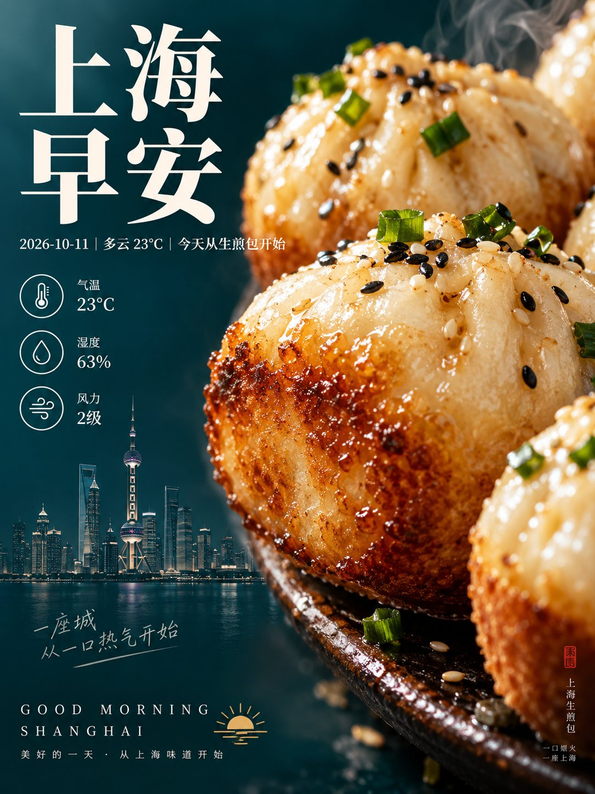
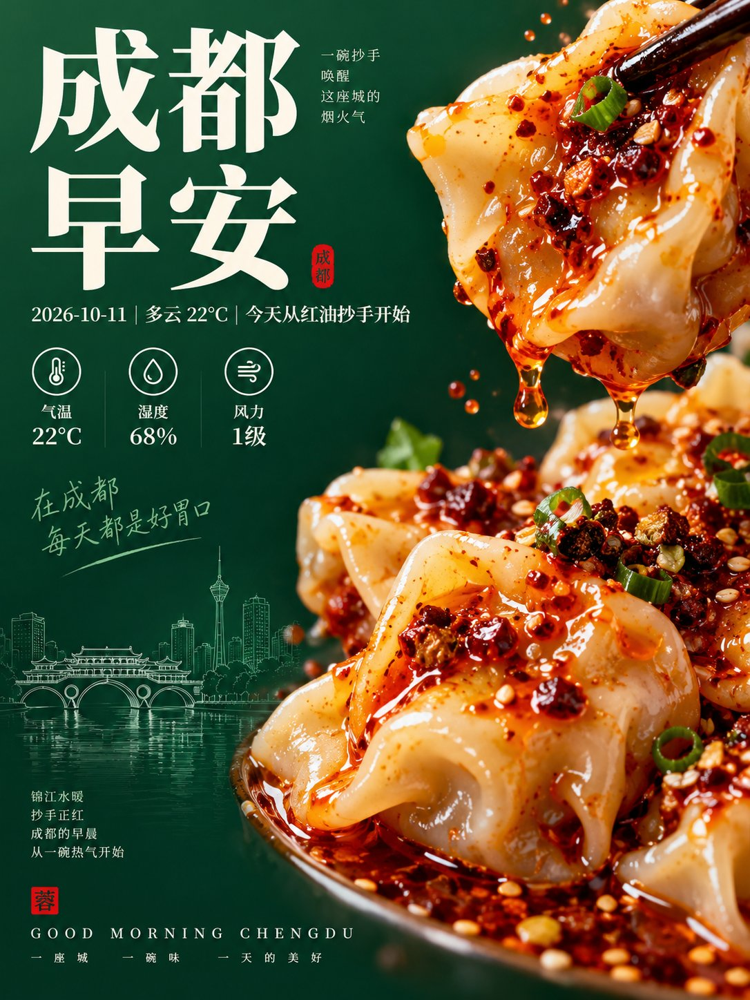
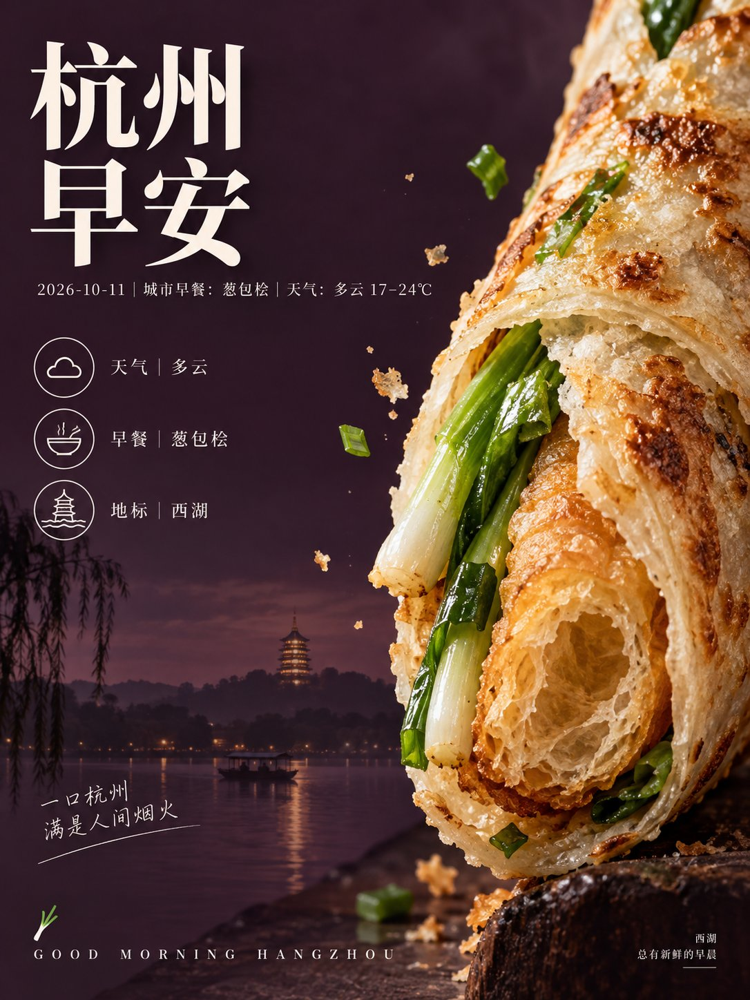
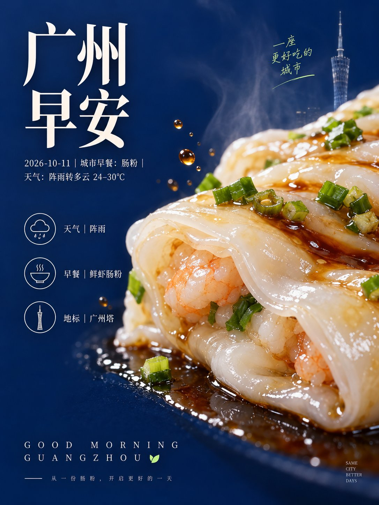

# GPT2 × 美食 × 产品 × 海报 × 美学提示词

- 日期：2026-10-11
- 作者：[@xiaoxiaodong](https://x.com/xiaoxiaodong)（小小东，原 @xiaoxiaodong01）
- 原帖：https://x.com/xiaoxiaodong/status/2109091557710426607
- Tweet ID：2109091557710426607
- 模型：GPT2（ChatGPT 图像生成）
- 说明：夏日广告感的早餐美食图文海报，巨大局部美食从右侧压入、左侧深色负空间配衬线大标题与线描图标；示例主题为 10 个城市的早安 + 天气 + 当地招牌早餐。

> 提示词出自原帖附带的 ChatGPT 分享链接：https://chatgpt.com/share/6acae3eb-d430-83ea-9d58-e05b1c45365f 。版权归原作者，此处仅作归档。

## 提示词

```
围绕具体主题内容生成一套清爽、直接、带夏日广告气息的图文海报：让主题对象以贴近镜头的巨大局部形体从右侧压入画面，主动裁切出画外延伸感，保留可辨认的切面、表皮或核心材质细节，把高密度的触感与少量主题派生的附着标记集中在这一侧；左侧留出深沉、安静、低干扰的连续色场作为大块负空间，形成不对称平衡，让大形体的鲜活质地与空白区域互相托举。主题派生的主色决定主体色相，背景采用与主体形成清晰冷暖或明暗对照的深色低明度场，文字与图标采用接近纸面或光泽高点的明亮中性色，保持主场、主体、辅助与点缀的面积角色、明度阶梯和高洁净度，不把颜色锁死为固定色票；光线从主体上方或侧前方柔和掠过，制造局部高光、湿润反射、细小阴影和边缘透光，背景则以轻微失焦和均匀暗部承接主体，避免装饰性光效。主标题置于左上至中上区域，使用两行大字号中文展示字，骨架偏高对比衬线，横细竖挺、内白清楚、字面略窄，行间紧密但保持呼吸，明亮字色带极轻的边缘柔化或浅层阴影，使文字像从暗色场中浮出，并在靠近主体边缘处形成图文张力；副标题紧随其下，以较小而仍清晰的中文说明补足语义。中左区域排列三组上下递进的圆形线描图标与短标签，图标线宽统一、圆环留白充足，像简洁的功能说明模块，与主标题左对齐；底部左侧加入疏朗追踪的全大写拉丁字母作为节奏收束，并配一个由主题派生的微型彩色符号，形成小尺度回声。整体保持真实近摄摄影的细节密度与干净印刷广告的清晰边缘，主体材质允许有自然颗粒、液滴、纤维、孔隙或细微不规则，但只在主题确实需要时派生，不添加泛化噪点、复古污渍、褐色滤镜或过度磨砂；文字、图标和主体边界之间维持清楚的层级与局部遮挡关系，最终读图路径由左上主标题，经副标题与图标模块，再被右侧巨大形体和底部字标回收，避免把海报做成平均铺满、孤立装饰或普通商品照片。

——————

主题：城市元素+早安问候+2026-10-11+天气 一共10个不同的城市，每个城市都是一个独立的美图 核心元素是当地早餐最出名的一个美食 画幅3:4 每个图片， 不同的配色逻辑、构图差异，一眼就是不同的色相
```

## 成品





