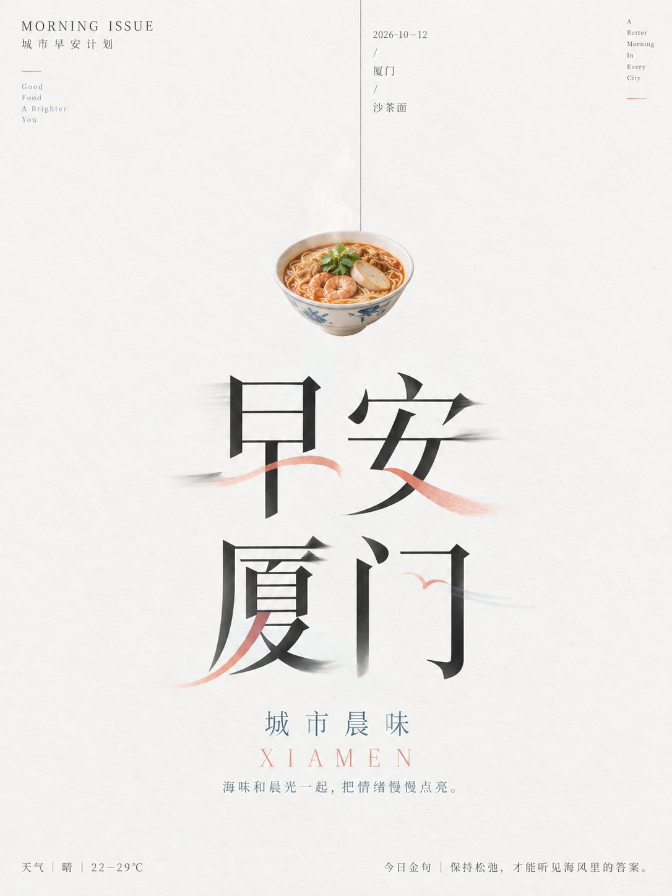
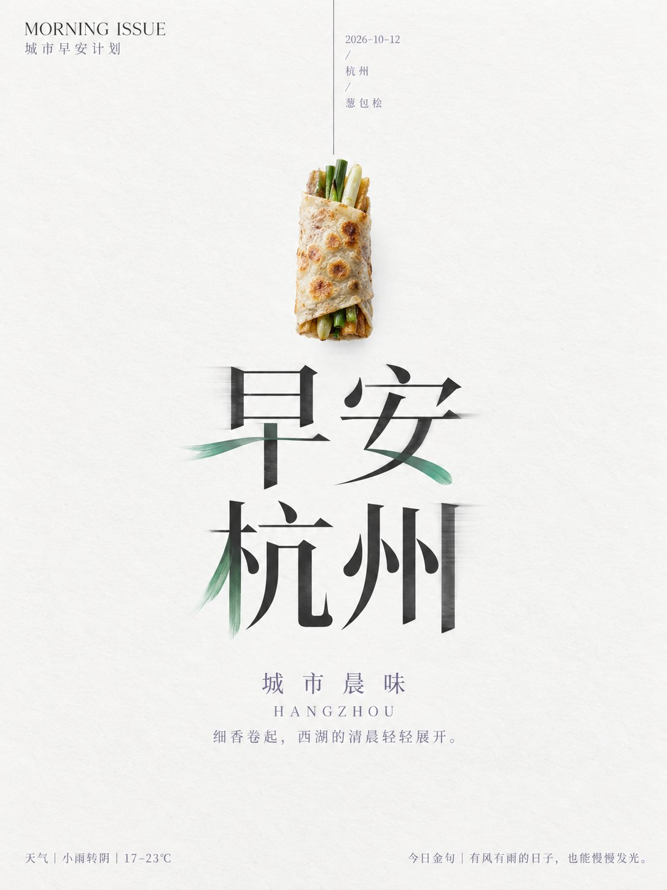
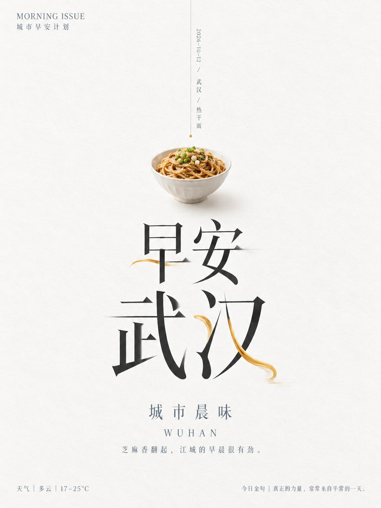

# GPT2 × 早安 × 简约 × 美学提示词

- 日期：2026-10-12
- 作者：[@xiaoxiaodong](https://x.com/xiaoxiaodong)（小小东，原 @xiaoxiaodong01）
- 原帖：https://x.com/xiaoxiaodong/status/2109433828406382655
- Tweet ID：2109433828406382655
- 模型：GPT2（ChatGPT 图像生成）
- 说明：极简东方编辑海报，近白大留白、细垂直线牵引小型主题象征物，下方两行高对比宋体巨型标题带受控错位虚影与少量彩色笔画替换；示例主题为 10 个城市的早安 + 金句 + 天气 + 当地招牌早餐。

> 提示词出自原帖附带的 ChatGPT 分享链接：https://chatgpt.com/share/6acc2286-7af8-83ea-8281-20bf4933dde7 （已略去其中的会员广告）。版权归原作者，此处仅作归档。

## 提示词

```
围绕任意主题对象展开极简东方编辑海报，以大面积高明度近白背景建立安静、清凉、克制的第一印象，让留白成为承托主题与文字的主要空间。构图由一条极细、低对比的垂直线从画面上缘向下牵引视线，线上邻接窄小的日期或主题注记，线末附近悬置一个由主题提炼的高精度象征物；象征物保持小尺度、正面、孤立、轮廓清楚，细节真实而不扩张成场景，与广阔空白形成强烈尺度反差。视觉重心落在中下部的两行超大中文标题，采用高对比宋体骨架，竖画挺拔、横画纤细、收笔锐利，字距疏朗而行间紧凑，形成稳定的方块群。让少数笔画发生受控的水平错位、柔焦拖影与半透明残像，清晰字形仍承担阅读，虚影只在局部向两侧滑出，制造蝉翼般轻颤的时间感；再从主题的形态和语义中提炼少量锐利、弧形或叶片感的彩色笔画，替换、穿过或续接个别偏旁，使字形与主题意象在同一轮廓内融合，彩色介入必须稀少且有明确落点。标题下方保留宽阔停顿，再居中安排一组较小的中文主题名、衬线英文名与细小短句，三者按尺寸递减并使用宽松字距，作为温和的收束。左上角放置小型品牌字标与中文副标，底部以左右分开的细小栏目、说明和联系文字压住边界，灰度降低、层级克制，不与中心竞争。色彩按主题派生角色而非固定色相：绝大面积保持明亮洁净的近白中性色，深炭黑承担大标题和主要结构，中灰用于日期与页脚；从主题核心情绪提取一种清透、较高饱和的活力色，仅注入改造笔画和极小视觉节点，再提取一种较温和的对照色用于标题下方的次级文字，维持低面积、高辨识度的色彩节奏。表面呈细腻哑光纸张质感，仅保留近看可见的极细纤维与轻微明度漂移，光线均匀漫射，边缘柔和，整体保持明亮、清洁、无厚重阴影。始终锁定细线中轴、小型具象焦点、巨型虚实字形和大面积留白之间的张力，使信息像被空气拉开；避免铺满装饰、扩大象征物、增加复杂环境或让拖影覆盖文字主体。

——————

主题：城市元素+早安问候+2026-10-12+今日金句++天气 一共10个不同的城市，每个城市都是一个独立的美图 文字上方元素是当地早餐最出名的一个美食 画幅3:4 每个图片， 不同的配色逻辑、构图差异，一眼就是不同的色相
```

## 成品





