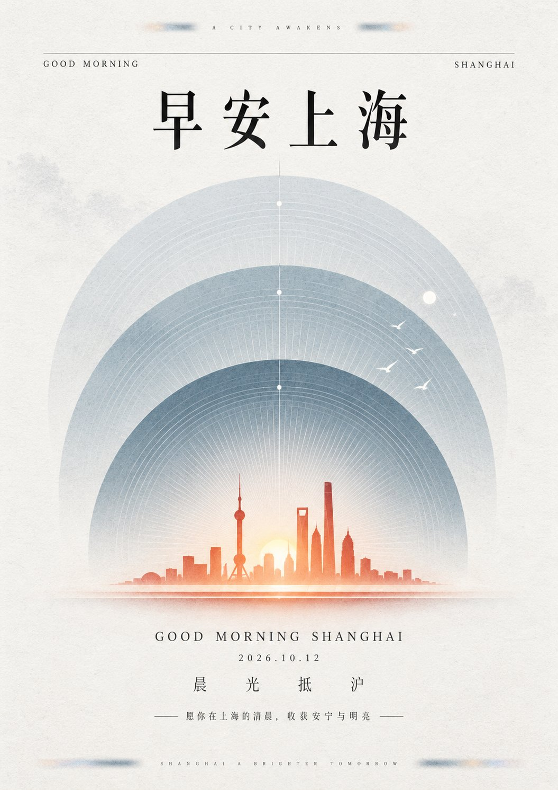

# GPT2 × 早安 × 素 × 美学提示词

- 日期：2026-10-13
- 作者：[@xiaoxiaodong](https://x.com/xiaoxiaodong)（小小东，原 @xiaoxiaodong01）
- 原帖：https://x.com/xiaoxiaodong/status/2109815827470205041
- Tweet ID：2109815827470205041
- 模型：GPT2（ChatGPT 图像生成）
- 说明：克制东方纪念感早安海报：中央轴线仪式秩序、三层同轴半圆拱幕、低矮高饱和主题符号悬浮切口，大面积近白留白；示例主题为早安上海。

> 提示词出自原帖附带的 ChatGPT 分享链接：https://chatgpt.com/share/6acd7fea-7c4c-83e9-9e08-f311764b8b42 （已略去其中的会员广告）。版权归原作者，此处仅作归档。

## 提示词

```
围绕任意主题对象组织克制、庄重且带东方纪念感的平面视觉，以严格的中央轴线建立自上而下的仪式性阅读节奏，让大面积明亮留白包围核心内容。上部先置一条极度虚化、略带色散的短横向识别痕迹，再用一根轻若发丝的横线连接两端微型信息，紧接一行居中的高对比中文标题；标题采用细横粗竖、尖锐收笔的宋体骨架，字距疏朗，黑色墨迹清晰但保留纸面吸收感。视觉中心由三层同轴半圆拱幕纵向错落并相互遮叠，每层以密集而均匀的同心弧线、极细放射纹和由实入虚的墨色晕变建立深邃的圆顶感；后层最轻最淡，前层逐级加深并增强轮廓，拱幕下部缓慢融入纸白，使重复几何既有纪念碑般稳定，又保持空气与透明度。在最前层下沿压入由主题提炼的低矮横向核心符号，将其几何化为左右舒展、端部轻微上挑的锐利剪影，以双层细台阶和一道窄白切口形成悬浮关系；符号的高纯度边缘向纸面散开一圈柔软辉光，与细密冷静的拱线形成唯一强烈焦点。少量由主题派生的白色微型符号沿前层右上方疏散抬升，以大小递减和不规则间距打破绝对对称，却不改变中央稳定。下方依次设置小号高对比西文标题、极小日期、宽字距中文短句与带细横线夹持的微型说明，字号逐层缩小，形成明确停顿；底边再以两段横向模糊墨痕和轻微色散呼应顶部，使精密中央结构被柔化的扫描痕迹收束。色相由未来主题的语义与情绪决定，但固定角色关系：近白纸色占绝对大面积，三层拱幕在同一支撑色家族内由低饱和浅色过渡到较深前景色，核心符号只用小面积高饱和对比色，文字保持深中性色，微型符号保留纸白；维持高明度、低噪声与克制色量，色彩像半透明印墨渗入纸纤维而非塑料光泽。基底为洁净的细纤维艺术纸，表面有均匀细颗粒、局部云雾状浅灰压痕和非常轻的扫描柔化，纹理主要停留在留白与淡色区域，深色线纹和标题仍须可辨；不添加均匀脏污、厚重褐化或多余装饰，必须保住三层圆拱的细线深度、低矮亮色符号的悬浮切口、上下模糊横痕与疏密分明的文字秩序。

——————
做成早安海报
主题：早安上海
```

## 成品


