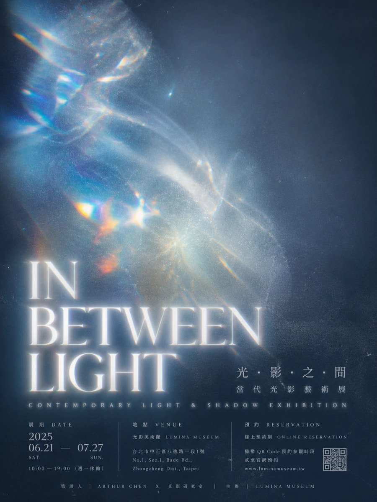
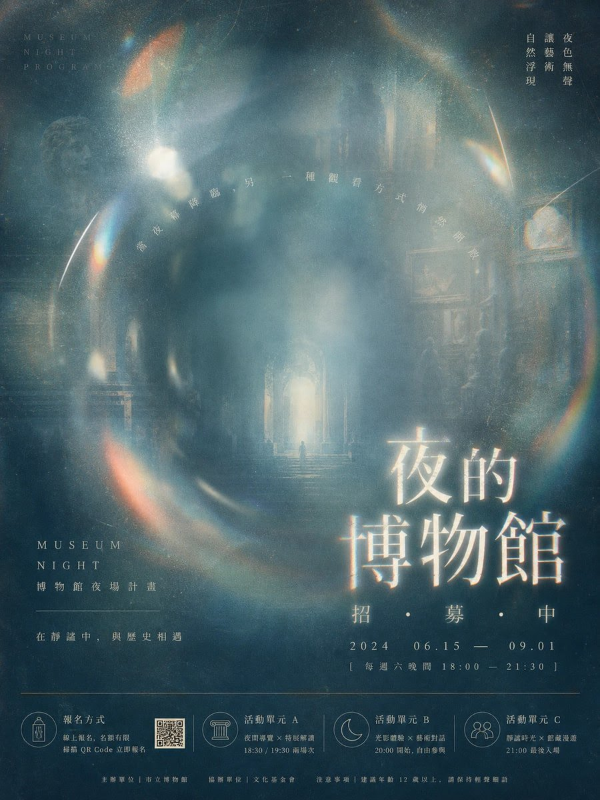
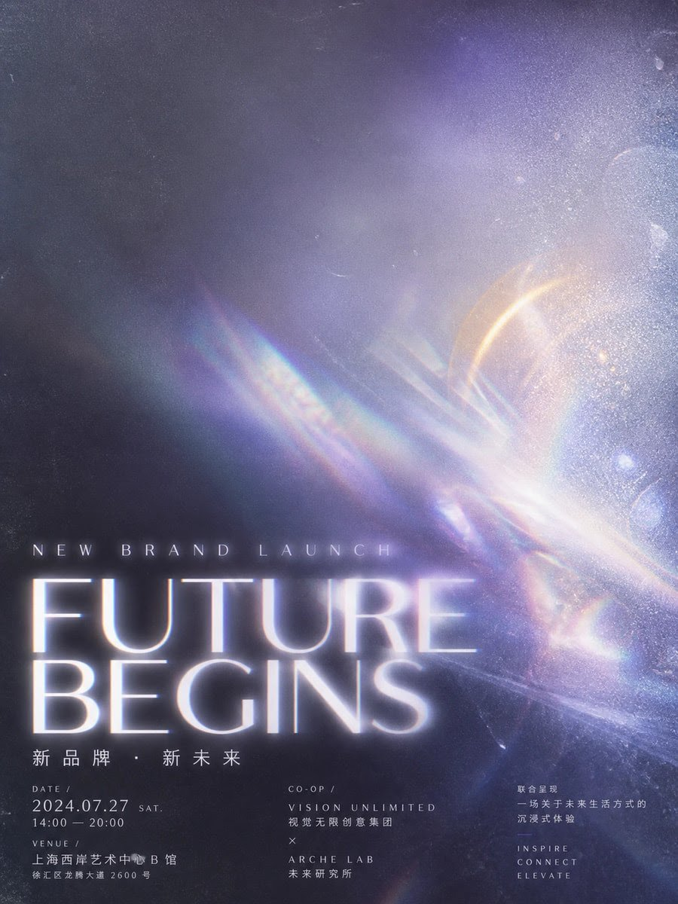
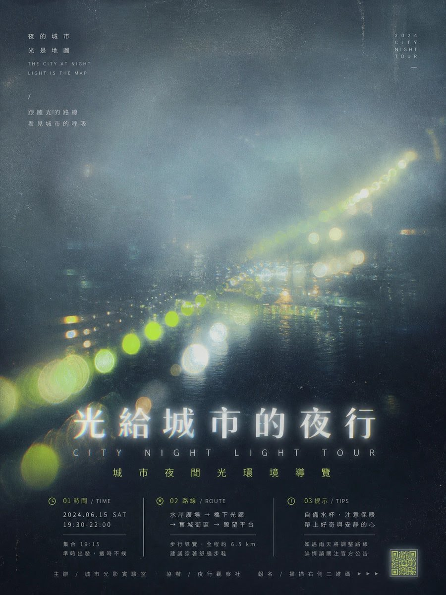

# 棱光迷雾 × 雾感海报 × 展览物料（完整汤底提示词）

- 日期：2026-10-19（原帖发布于 2026-10-18 23:09 北京时间）
- 作者：[@xiaoxiaodong](https://x.com/xiaoxiaodong)（小小东，原 @xiaoxiaodong01）
- 原帖：https://x.com/xiaoxiaodong/status/2111837195921408258
- Tweet ID：2111837195921408258
- 模型：原帖未注明（作者近期作品多为 GPT2 / ChatGPT 图像生成）
- 说明：冷蓝灰底、上虚下实的雾感展讯海报“汤底”——上半部失焦折射的彩虹光斑与色雾，下半部发光微糊带色散的白色标题与三栏密集展讯信息，可在后面自行追加主题与用途。

> 提示词全文见原帖正文（长文）。版权归原作者，此处仅作归档。

## 提示词

```
任何主题都先被压成一张冷蓝灰底的雾感宣传海报：上半部用失焦、折射、彩虹边缘和大片柔光把主视觉化成漂浮的光斑与半透明色雾，保留强烈光晕、溢光、纸面颗粒和轻微脏噪，不做锐利物体；下半部让白色标题像被雾托起一样高亮发光、边缘微糊并带色散，副标题用小号拉开字距的整齐字形压低到信息层，正文按三栏或并列信息块紧凑排版，形成上虚下实、视觉先被气氛抓住再落到密集展讯的节奏；整体用冷青、蓝灰、少量暖橙或金色光泄染出层次，保持印刷海报的平面感、轻微复古的展讯气质与底部信息带的秩序。禁用干净矢量、硬边摄影、卡片式分区、过度磨皮和彻底去噪，文字与光斑必须共享同一层雾化印刷质感。
```

用法：作者称这是“完整汤底提示词”，可在末尾自行补充主题、标题文案、展期地点等“应用佐料”。

## 成品





