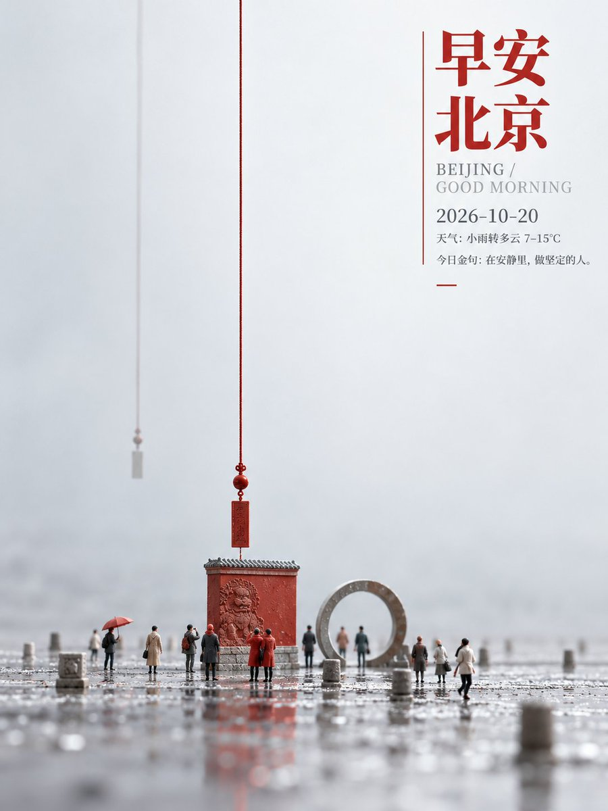

# GPT2 × 早安 × 线 × 坠 × 美学提示词

- 日期：2026-10-20
- 作者：[@xiaoxiaodong](https://x.com/xiaoxiaodong)（小小东，原 @xiaoxiaodong01）
- 原帖：https://x.com/xiaoxiaodong/status/2112345458433736964
- Tweet ID：2112345458433736964
- 模型：GPT2（ChatGPT 图像生成；提示词由 Opus 5.5 撰写）
- 说明：细长垂线贯穿画面、下方微缩人物形成尺度反差的上疏下聚早安海报；10 城 × 城市元素 × 今日金句 × 天气（3:4）。

> 提示词出自原帖附带的 ChatGPT 分享链接（已去除会员广告）。版权归原作者，此处仅作归档。

## 提示词

```
细长垂线以极大的尺度贯穿画面，微小人物聚集在下方，垂线与人物之间形成悬殊而安静的比例张力。遵循非对称版式与格式塔连续原则，在任何画幅中保持上部疏朗、下部聚重的纵向骨架；下方偏中的实体内容由右上紧凑文字块平衡，悬垂线条连接两区并引导视线由文字向下落到人物，再收束于底部。图像采用真实微缩场景的摄影式三维表现，文字则作为清晰的平面构造与场景分层并置，保持尺度反差和边界分明。文字层级由醒目的粗实主标题、轻细副标题与日期、细小短句组成，字形以紧凑几何骨架、简洁笔画和清楚的内白构成，粗细交替而节制；主标题与副标题靠拢成块，次级信息沿同一边缘向下排列。文字无论多少都守这个层级；文字不足时依主题补足次级小字。大面积浅色留白承担隔离与衬托，人物周围保留呼吸空隙，垂线之间的空处形成负形节奏；下方平整地面承接细节，使疏处与密处相互校准。图像物象密度集中在下半部，约占画面四成，上部大多留给文字与线条；人物尺度微小、前后错落，轻的悬线保持近乎垂直，地面水平铺展，有分量的个体姿态稳定端正，斜势只落在步态和少量延展线条上。画面以微缩摄影与三维合成复合：用真实尺度光照塑造人物和悬线的实体感，以浅景深分开前后层次，让背景平滑淡出，并在近处呈现细密连续的地面织理，整体如精细控制焦点的微距摄影。配色遵循低纯度邻近色关系，以高明度、薄而清透的底色为主，冷暖轻微交错；浓重色只集中在文字和少数小物件上，形成克制的深浅对照。色相随主题变化，明暗、厚薄、冷暖倾向与浓淡性格无论什么主题都保持这种性格，传达安静、清透、含蓄的情绪，像柔和光线下的数字微距合成。画面里只有下方微缩人物、贯穿其间的悬线与平整地面，其余是浅色平滑空处，不生出任何景物。整体气质轻柔克制；末尾追加的主题、准确文字、用途与画幅优先；上疏下聚、垂线引导、微缩尺度反差、清透低纯度配色保持不变。
——————
主题：城市元素+早安问候+2026-10-20+今日金句+天气
一共10个不同的城市，每个城市都是一个独立的美图
自由编排元素
画幅3:4
每个图片， 不同的配色逻辑、构图差异，一眼就是不同的色相
```

## 成品





