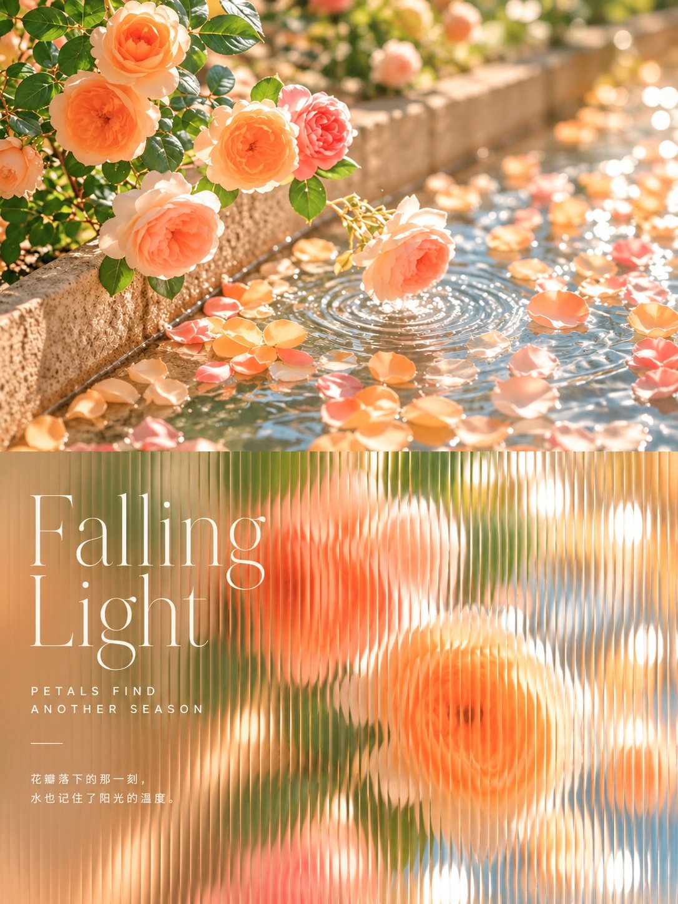
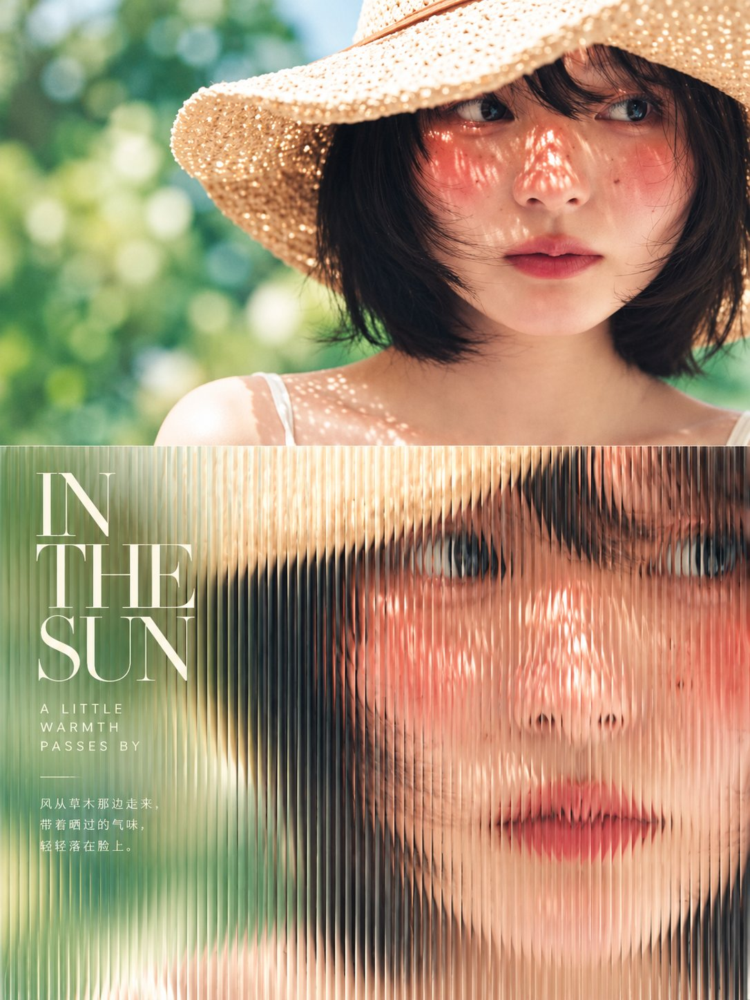
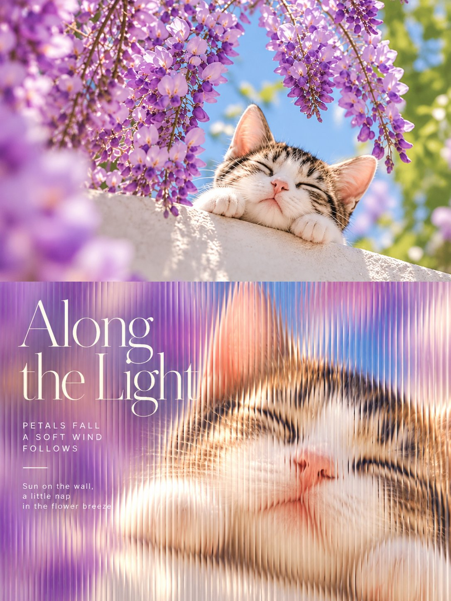
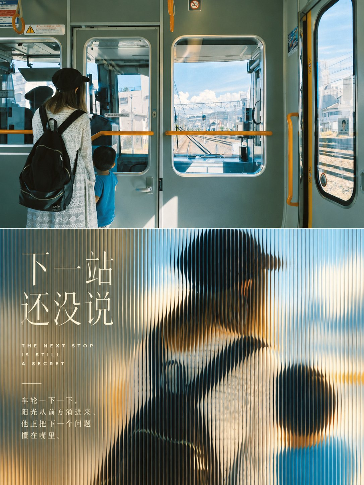

# GPT2 × 毛玻璃 × 透光 × 棱纹 × 美学提示词（棱纹玻璃特写封面）

- 日期：2026-10-22（原帖发布于 2026-10-22 01:04 北京时间）
- 作者：[@xiaoxiaodong](https://x.com/xiaoxiaodong)（小小东，原 @xiaoxiaodong01）
- 原帖：https://x.com/xiaoxiaodong/status/2112953137686523996
- Tweet ID：2112953137686523996
- 模型：GPT2（ChatGPT 图像生成；作者称用 Opus 5.5 驱动 ChatGPT 出图）
- 说明：上传照片→3:4 对折海报，上半保留原照，下半推近成特写并“隔着竖向细棱纹玻璃”拍摄的透光暖色杂志封面，左侧细衬线刊头标题。

> 提示词全文见原帖正文（长文）。作者注明灵感来自小红书“阿文AI实战笔记”。版权归原作者，此处仅作归档。

## 提示词

```
Turn each photo I upload into its own premium design poster: no multi-image collage, one output per photo. Use a 3:4 vertical format folded like a card into a top half and a bottom half of the same height, the fold falling exactly on the horizontal centre line of the frame; the fold itself is not drawn.

The top half keeps the original photo, preserving the subject's identity, structure, pose, real texture, natural light and original colour mood, with only a light refined grade so it reads like an art magazine, independent publication or exhibition image. To fit the frame, the surrounding background may be extended naturally, but the subject must never be stretched, distorted or altered; crop the photo as a full shot, leaving headroom above the subject so its top is never cut off. Add no text of any kind to the top half; all lettering belongs to the bottom half.

In the bottom half, extract only the most recognisable **subject, silhouette, structure, pose and narrative relationship** from the photo and rebuild it as a **Fluted-glass Close-up Cover**. Do not copy the whole photo; instead push in on the subject into a close-up that fills the picture, remove the clutter, and then look at it through a sheet of vertically fluted glass, so the viewer recognises at a glance how it corresponds to the photo above. **The whole bottom half must look like a photograph taken through a sheet of vertically fluted glass: the vertical ribs on the glass are extremely fine and dense, packed one against the next like finely ribbed fabric, covering the whole picture from left to right with no flat area anywhere; the image inside each fine rib is squeezed narrow and shifted a little, the subject's outline breaking into dense little vertical steps between ribs, a fine bright line along every rib edge; the subject is still recognisable at a glance**; this is the identity of the method, and without it the method does not exist.

The bottom half needs its own art direction. Even if the source photo is badly composed, cluttered, or has a small subject, rescue it into a finished work by **pushing in to a full-bleed close-up, removing the clutter, letting the background blur into large soft patches of colour, and laying a sheet of fluted glass over it all**; the most recognisable part of the subject fills most of the picture, like the portrait or still-life close-up on a magazine cover, the background reduced to a few blurred colours cut by the ribs into vertical bands of light. When the photo itself is a scene (a street, a corridor, a landscape, an interior), take only its single most representative unit or fragment and push in on it, drawing nothing else.

Form is built on **photographic imagery cut by vertical flutes**: the subject keeps the photo's real form and texture, cut evenly by the dense fine ribs, each rib very narrow, the image in neighbouring ribs shifted a little sideways, the edges of forms turning into a row of fine vertical serrations; no wide vertical strips, and no smearing of the image into stretched motion trails; the brightest areas flare into long thin highlights along the rib edges; the further from the subject, the softer the background. People, animals, buildings, objects, plants and landscapes all work this way, seen through the same sheet of fluted glass, close and large, with soft edges.

The material is **a soft-focus photograph seen through fluted glass**: the glass itself shows no frame, only the even vertical ribs and the refraction they cause; the image is soft and luminous, as if lit through by afternoon light, even the shadows clear; the whole is clean.

Composition uses **a close-up subject filling the picture + a blurred patch of colour on one side for the text**. The picture is full-bleed with no white margins; the subject sits towards one side and may be cropped by the frame at the sides and bottom, with a little space above its head, and nothing touches the central fold. The other side is a large blurred patch of colour holding the title and small text. Prefer the subject pushed in close and large over sitting small and far away in the middle.

Colour is drawn from the most emotive colours of the photo above and remixed into **a layer of luminous warm light**: the subject keeps its own colours from the photo, the whole lifted in brightness, warmth glowing through the shadows; the background colours blur into large soft patches; the brightest near-cream highlights flash in lines along the rib edges. Warmth follows the photo, avoiding greyish dullness, heavy black shadows and glaring saturation.

Text is only a minimal editorial touch, in any language, with no preset title. Distil one short title from this photo's subject, action, mood or metaphor, written as **a masthead-style title on a magazine cover**, completed the way a cover is: at the upper left the title on two lines in **large thin serif**, below it a group of two or three short lines in **widely spaced small capital sans-serif**, then a short thin rule, and at the bottom one more group of two or three small lines, with no issue number; the title never names the things in the photo but tells a small action happening in the photo or the state of one thing at this moment; the small lines a detail visible in the photo or the sound or warmth of this moment; never all-purpose words like Same, Brighter, Still, Slow days or Golden Hour, nor openings and slogans like Waiting for..., a better me, a softer me or a little brighter; the lettering sits on the blurred side and never covers the subject's face or most important part, its colour a near-white cream, the tone light and quiet; Chinese is always Simplified. The line must add something to the picture: say what the picture cannot show yet belongs only to this photo, such as the thought of the moment, the moment before or after, a sound, a smell or a small joke, so that without it the picture loses a layer. No moral or reflective sayings; reading out the names of what is drawn is repetition, and slogans that would fit any photo are empty; neither adds anything.

The whole piece reads like the cover of a lifestyle magazine: the full-bleed close-up, the image cut by vertical flutes, the luminous warm light, the blurred patches of colour and the thin serif masthead on the left together make it luminous, soft and a little dreamlike.

Avoid copying the full scene and template poster design; avoid wide, sparse ribs, an image smeared into stretched trails, flutes that are only vertical stripes laid over the photo, a subject cut so finely it cannot be recognised, white margins or a subject shrunk into a small patch, as well as an illustrated look, glass drawn with a frame and reflections, a greyish whole, and text covering the subject's face.
```

用法：作为“上传照片后使用”的提示词，每张照片单独输出一张海报。

## 成品





