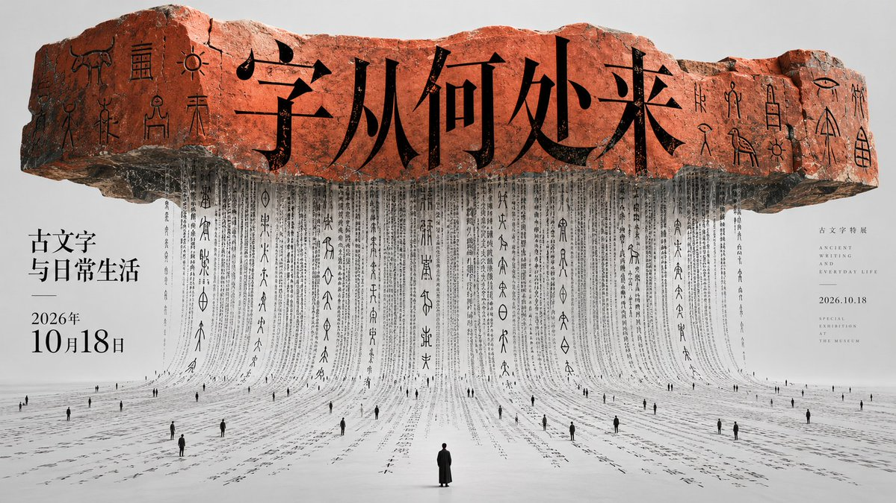
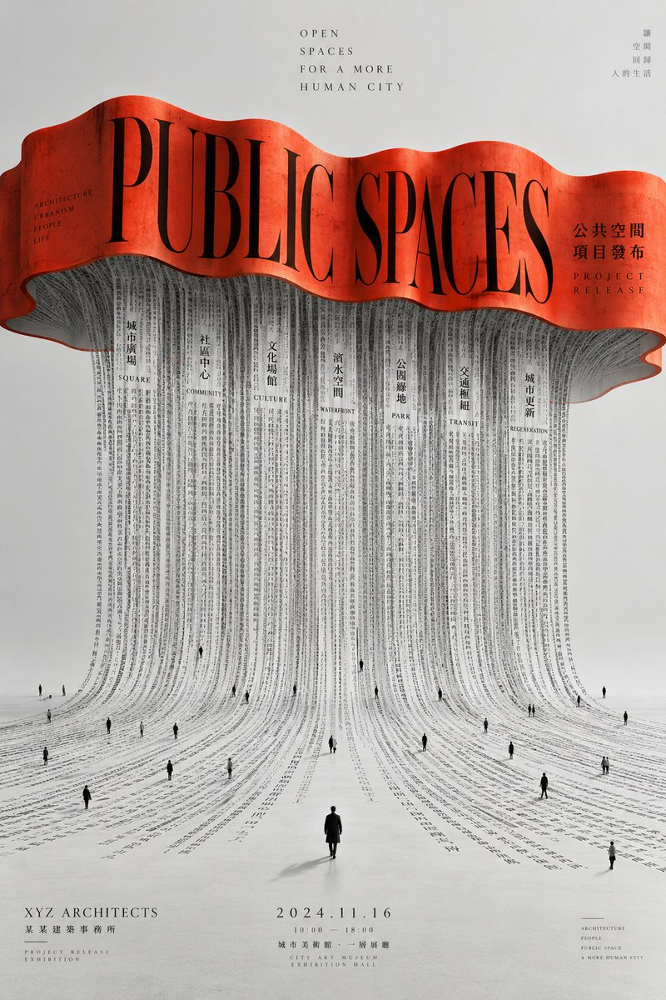
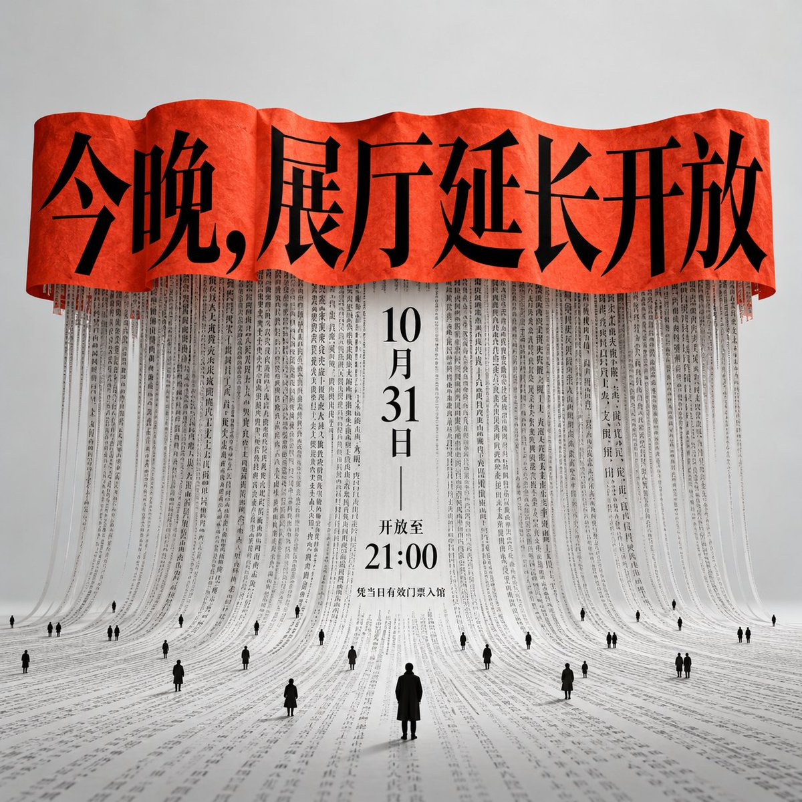
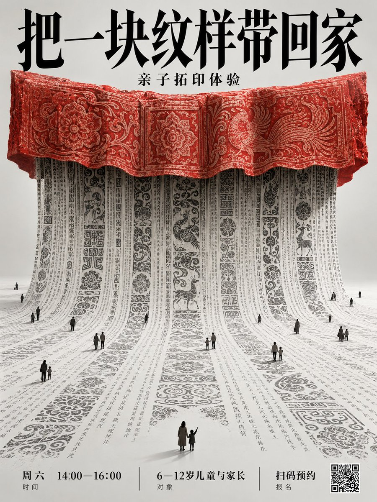

# 巨大横向字构件 × 垂落字帘 × 博物馆展讯海报

- 日期：2026-10-24（原帖发布于 2026-10-23 18:34 北京时间）
- 作者：[@xiaoxiaodong](https://x.com/xiaoxiaodong)（小小东，原 @xiaoxiaodong01）
- 原帖：https://x.com/xiaoxiaodong/status/2113579688388096077
- Tweet ID：2113579688388096077
- 模型：原帖未注明（作者近期作品多为 GPT2 / ChatGPT 图像生成）
- 说明：上重下疏的观念装置海报——顶部巨大横向文字构件，密集字列如帘幕垂落铺到地面，微小人形作尺度参照；博物馆古文字展「字从何处来」16:9 示例。

> 提示词全文见原帖正文（长文 note_tweet）。版权归原作者，此处仅作归档。

## 提示词

```
以巨大横向文字构件悬置在画面上部为第一视觉事件，构件横向伸展，边缘有柔和起伏，密集文字从其下方连续垂落，像一整面由字组成的帘幕并自然铺到下方平面，极小的深色人形作为尺度参照散落在文字流上，形成极端的大小反差。采用中轴稳定与垂直重力构成版式，上方保留宽阔呼吸区，中部用横向重块压住视觉中心，下方让细密纵线向外延展，任何画面尺寸都维持上重下疏、中央聚焦、底部展开的平衡。文字层与图像层互为图底：顶部大字负责第一眼识别，中央细密字流承担主体质感与动线，微小人形只作停顿和尺度标记；阅读从上方标题进入，沿垂直字流向下，最后停在下方中心的单个较大人形。文字无论多少都守这个层级；文字不足时依主题补足次级小字。标题使用修长高对比衬线结构，字腔收窄、笔画纤细而锐利；正文以密集竖向排列形成连续节拍，行距紧而清楚，局部字列随曲面轻微弯折。文字层像最后在电脑里平整叠上去的一层，纯黑实心、边缘锐利，是全画面唯一不受三维光影影响的元素。留白采用格式塔的图底分离与负空间呼吸：顶部大块空场衬托标题，中部字列之间保留细窄通气缝，下方让平整底面包围散落人形，空白本身成为尺度和静默。图像只保留中央这一处由主题提供的文字构件、垂落字幕与少量尺度人物，其余是洁净平整的浅灰底色，不生出任何景物。采用摄影与数字合成的复合手法：用三维摄影式光线塑造真实弧面、阴影、景深和边缘反射，用合成把文字精确贴合曲面并延展到平面，再以锐利排字覆盖标题与正文；整体像建筑摄影结合字体排印的空间装置。色彩遵循低饱和无彩底与单一高纯度暖色焦点的对比原理，整体中高明度、偏冷、偏薄、克制而安静，最浓烈的色彩只集中在上方横向构件，其余维持黑白灰关系；无论什么主题都保持这种明暗、厚薄、冷暖倾向与心理感受，像哑光摄影底片上叠加一条厚实而醒目的专色墨带。气质沉静、庄严、观念化，兼具东方书写秩序与当代装置感。末尾追加的主题、准确文字、用途与版面尺寸优先；上重下疏的骨架、中央垂落字流、极端尺度反差、洁净底色、锐利电脑排字与单一浓烈焦点保持不变。
——————
主题：博物馆古文字展开展海报
标题：「字从何处来」
副标题：「古文字与日常生活」
时间：「2026年10月18日」
横版 16:9
```

## 成品





