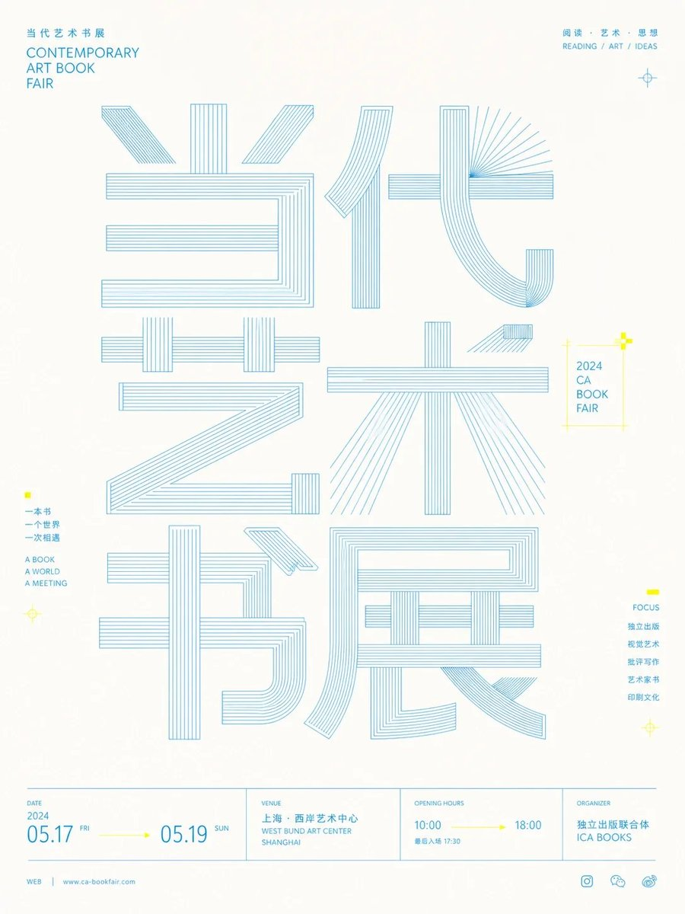
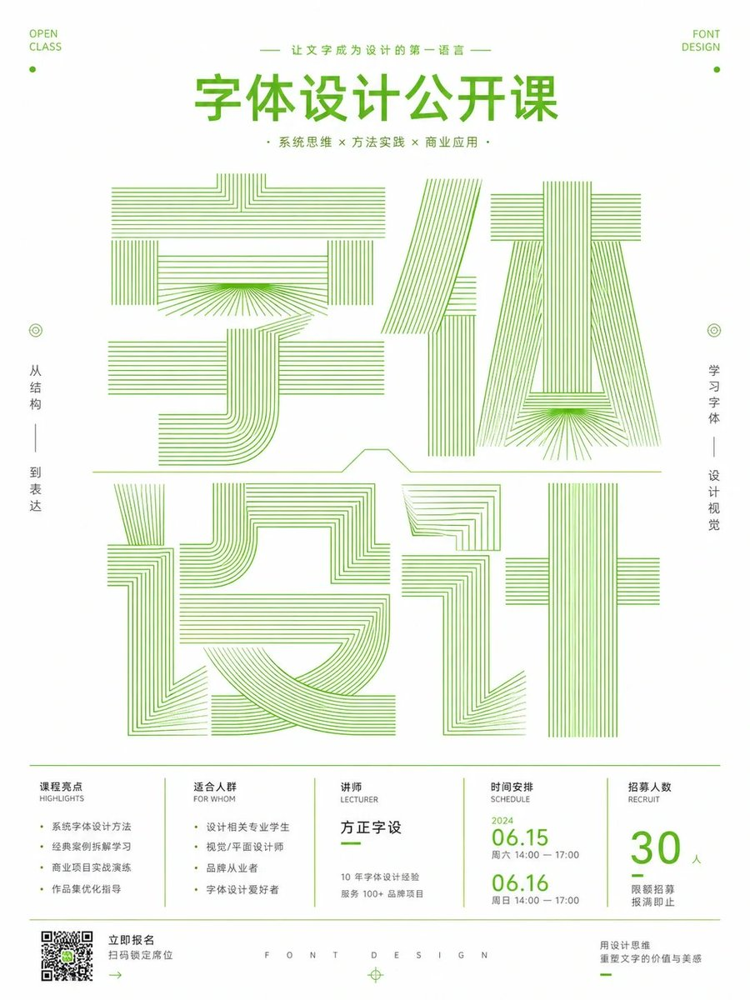

# GPT2 × 字体 × 线描 × 美学提示词

- 日期：2026-10-27（原帖发布于 2026-10-26 22:44 北京时间）
- 作者：[@xiaoxiaodong](https://x.com/xiaoxiaodong)（小小东，原 @xiaoxiaodong01）
- 原帖：https://x.com/xiaoxiaodong/status/2114729852725256201
- Tweet ID：2114729852725256201
- 模型：GPT2 / GPT-image2.5
- 说明：任意主题转译为超大尺度线描字形/符号主结构的信息型图像；细密平行线描塑造笔画，高明度留白与印刷网格秩序，出版物/展览视觉系统气质。

> 提示词全文见原帖正文（长文 note_tweet）。版权归原作者，此处仅作归档。

## 提示词

```
围绕任意主题内容生成一张明亮洁净的信息型图像：让主题被转译成超大尺度的字形或符号主结构，主结构占据画面中段并成为第一视觉，使用细密、平行、均匀的线描来塑造笔画厚度、转折和内部空间，部分笔画以开放轮廓、放射状线束、竖向密排线和横向层线形成机械般精确的节奏；字形之间可分层堆叠或跨行连接，底部以极细水平线建立秩序，上方和边缘放置少量小字号信息，使阅读路径从醒目的图形标题进入清晰的说明层。背景保持大面积高明度留白，边距通风，信息密度克制，所有文字和装饰线都要像印刷网格中的精密部件，边缘锐利、无厚重阴影、无复杂插画填充。色彩从主题自身的材质、文化信号与情绪中提取并映射到固定角色：背景承担明亮透明的基础场，主结构使用清晰冷静的结构色，局部笔画与小信息层使用少量主题派生强调色，保持大面积浅底、少量高饱和点缀、干净色阶和明确明度差，让整体呈现清透、轻快、精确的情绪；即使主题需要更深色，也必须保持色面干净、线条发光般清晰、留白充足。最终效果应像出版物或展览视觉系统的核心版面，依靠巨型线描字形、极细信息排版和高明度色彩秩序制造记忆点，而不是依靠具象场景或装饰性插画。
```

## 成品



