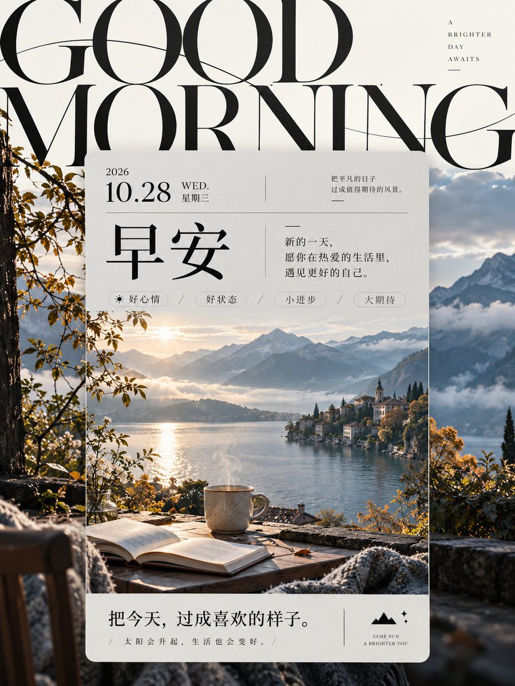

# GPT2 × 早安 × 超大衬线字 × 中央卡片日签

- 日期：2026-10-28（原帖发布于 2026-10-28 08:50 北京时间）
- 作者：[@xiaoxiaodong](https://x.com/xiaoxiaodong)（小小东，原 @xiaoxiaodong01）
- 原帖：https://x.com/xiaoxiaodong/status/2115244754183262500
- Tweet ID：2115244754183262500
- 模型：GPT2
- 说明：超大纤细高反差衬线字横跨上部，中央偏下浅灰信息卡片承载日签主视觉与编辑层级；暖白底、炭黑字、雾灰卡片的早安日签海报汤底（ChatGPT share 提取，已去掉会员广告）。

> 提示词全文来自原帖链接的 ChatGPT 分享。版权归原作者，此处仅作归档。

## 提示词

```
醒目的超大纤细高反差衬线字横跨画面上部，字形优雅舒展，局部越出边缘，先以黑色曲线建立张力，再引导视线落入中央偏下的浅灰信息卡片。卡片形成规整、平静的承载区：顶部以醒目的主题标题为核心，旁置细小说明文字，短横线与小段文字组成克制的编辑节奏；标题下方排列少量轻巧标签，主视觉占据卡片大部分面积，底部以大字收束主题，并配一行紧邻的短说明和简洁符号。卡片中的主题视觉具有丰富细节与清晰明暗层次，延伸至卡片外侧成为深色背景，与中央明亮内容形成强烈框景；主题元素由追加的主题提供。以暖白底色、炭黑字色、雾灰卡片和低饱和冷色主视觉构成清晰色阶，光线柔和，边缘平滑利落，表面洁净哑光。字体风格作为构造规则：优先保持字形辨识，运用显著粗细对比、流畅长曲线、精致衬线端点与开阔字腔；字距舒展，阅读方向明确，大小字层级鲜明。追加的主题、文字、用途和格式要求优先决定具体内容，保留超大字与中央卡片、细密编辑信息与沉浸式主视觉之间的关系。

——————
主题：早安日签海报 x 2026-10-28
文案自拟，要像是日签
比例3:4
```

## 成品

