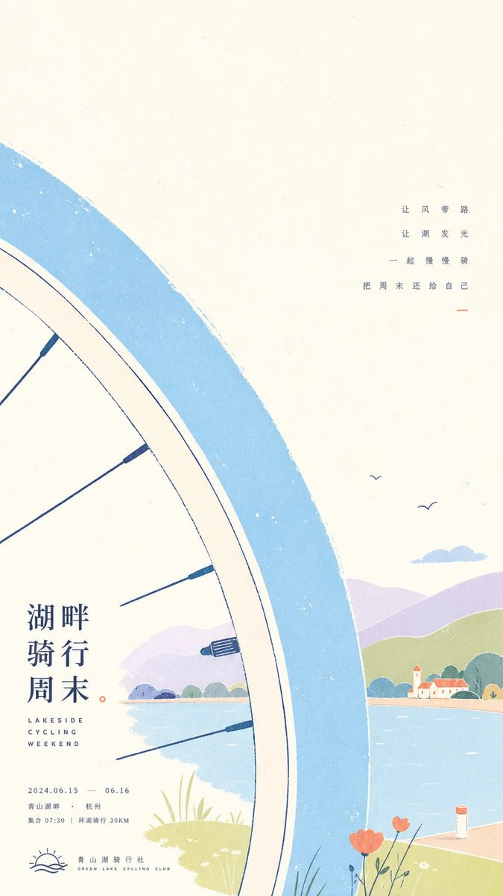
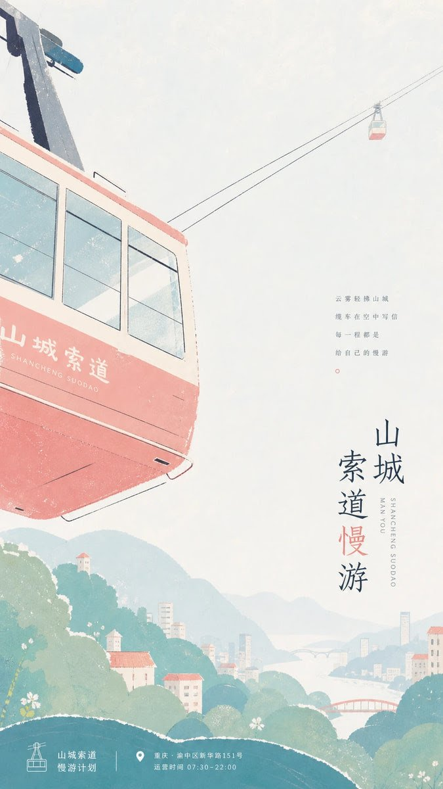
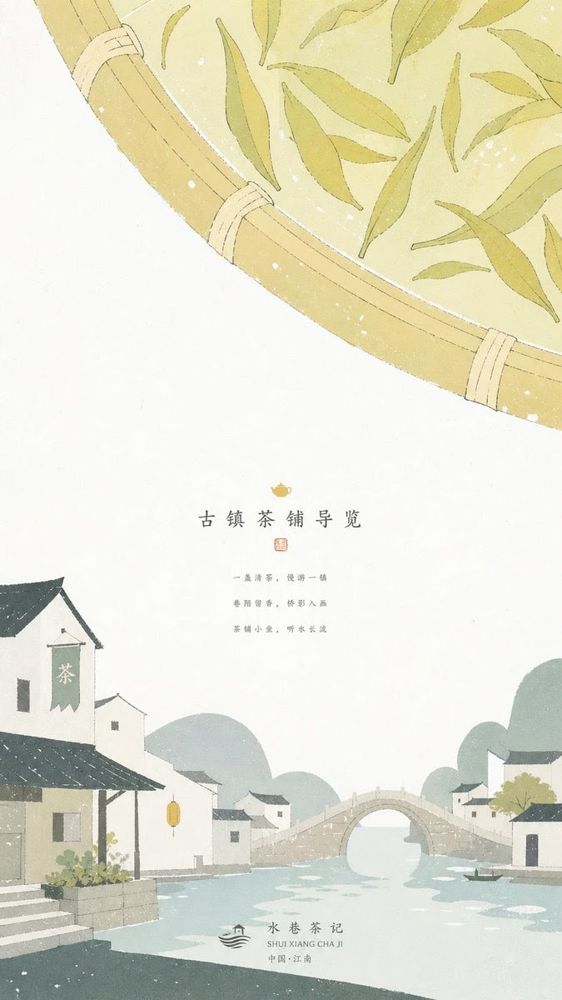

# GPT2 × 巨物掠景 × 清爽手绘 × 文旅海报 × 美学提示词

- 日期：2026-11-01（原帖发布于 2026-10-31 23:53 北京时间）
- 作者：[@xiaoxiaodong](https://x.com/xiaoxiaodong)（小小东，原 @xiaoxiaodong01）
- 原帖：https://x.com/xiaoxiaodong/status/2116559195818643500
- Tweet ID：2116559195818643500
- 模型：GPT2
- 说明：让主题中最具方向感的巨大形象以极近距离斜向掠过、只露裁切局部，配平涂手绘色块、扁平山丘远景、大片留白与轻声小字的明亮治愈系文旅宣传画汤底（原帖正文 note_tweet，作者称"佐料可自行添加"）。

> 提示词全文来自原帖正文。版权归原作者，此处仅作归档。

## 提示词

```
围绕任意主题对象生成明亮安静的手绘宣传画面，让主题中最具方向感的形象以极近距离从画面一侧斜向掠过，只露出被裁切的巨大局部，形成第一眼的尺度惊喜；它的轮廓要柔软、平涂、边缘略带手工毛糙，局部用少量细线补足结构，不追求真实体积，而像纸上用色块和线描拼出的轻快符号。背景用大面积洁净浅色场承托呼吸感，主题派生的远景或环境被压缩成几块圆钝山丘般的扁平色面，前后层以重叠、遮挡和大小差异建立深度，不使用复杂透视。画面保留大片空白水面式缓冲区，在空白中放置一小组细小正文，文字应像安静注释一样低声出现，行距宽、字重轻、颜色接近深墨，不抢走巨大掠过形象的动势；底部可安排简洁标识或署名锁定在环境色块上。配色由主题派生，但必须保持高明度、低污染、清洁通透的心情：浅冷色作为主场，柔和浅暖色作为近景主体，深色只承担远景重量和细线信息，少量明亮暖色作为视线停顿点，整体面积关系稀疏、开阔、不过度混色。表面呈轻微纸张印刷感，平涂区域有细碎漏白、颗粒、边缘抖动和少量未套准的手绘痕迹，这些瑕疵分散在色块内部和轮廓边，不形成脏污或怀旧褐调。保持天真、从容、地方旅行插画般的叙事距离，失败状态是主体变成完整写实物、背景塞满细节、文字过大喧宾夺主，或颜色沉暗浑浊。
```

## 成品




