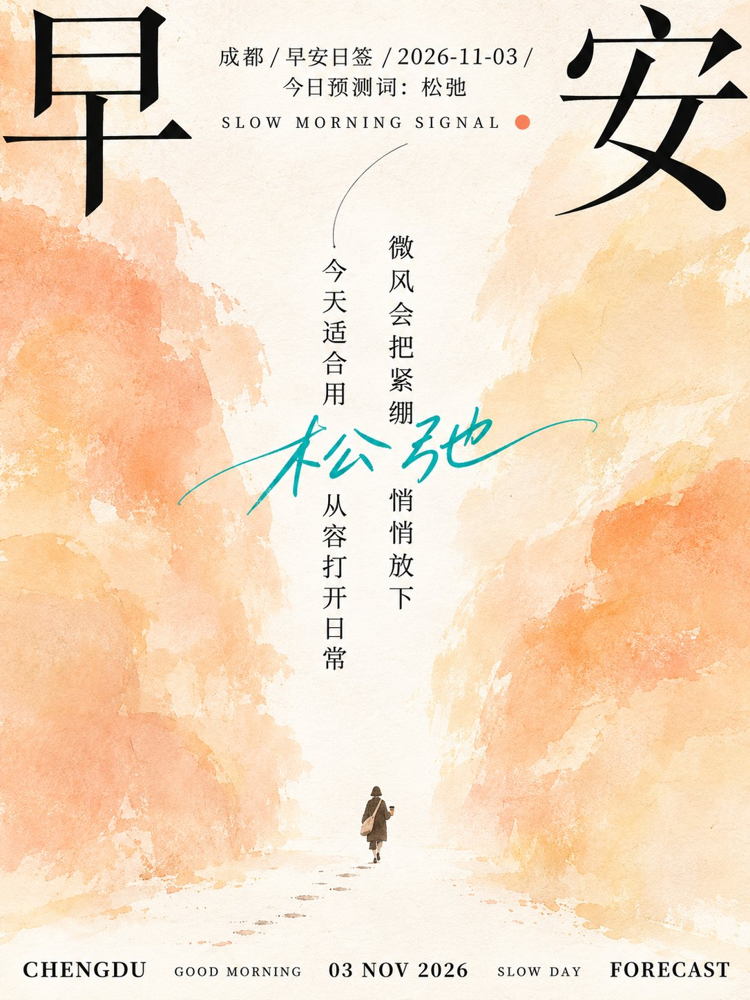
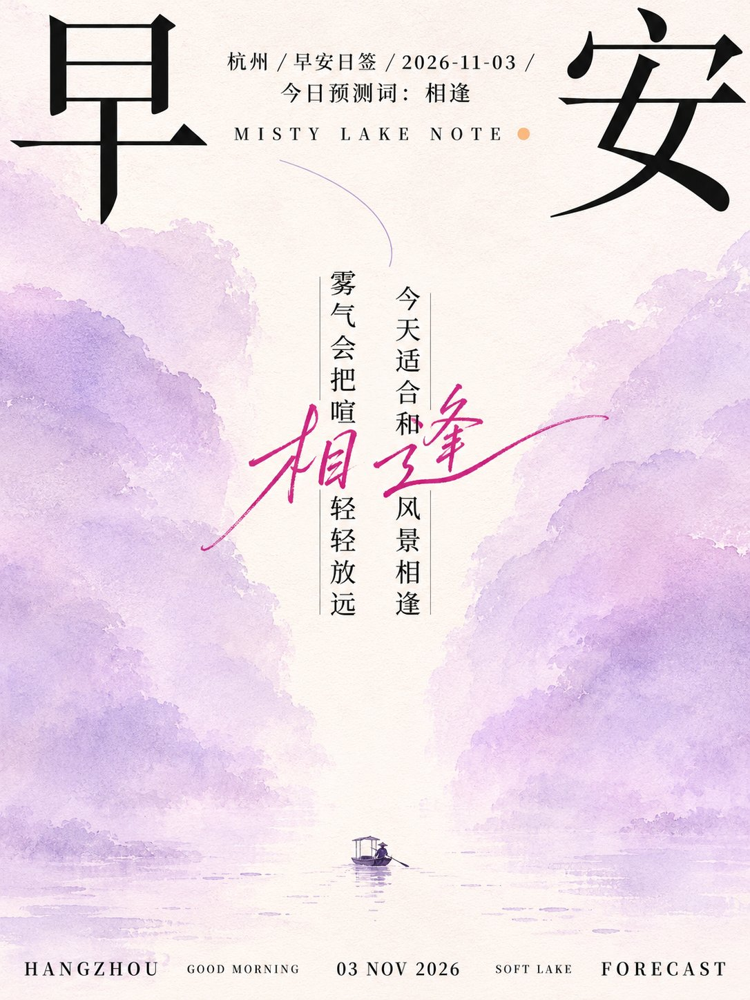

# GPT2 × 林间留白 × 清透静谧 × 节气海报 × 美学提示词

- 日期：2026-11-03（原帖发布于 2026-11-03 09:34 北京时间）
- 作者：[@xiaoxiaodong](https://x.com/xiaoxiaodong)（小小东，原 @xiaoxiaodong01）
- 原帖：https://x.com/xiaoxiaodong/status/2117430278771859591
- Tweet ID：2117430278771859591
- 模型：GPT2
- 说明：两侧高耸有机色块夹出中央明亮留白通道、底部微型焦点与超大宋体汉字分置边缘的清透静谧节气/早安日签海报汤底（ChatGPT share 提取，已去掉会员广告与不可见字符）。

> 提示词全文来自原帖链接的 ChatGPT 分享。版权归原作者，此处仅作归档。

## 提示词

```
围绕任意主题内容展开，把主题最具象征性的形态压缩为两片高耸、宽阔、从画面边缘继续向外延伸的有机色块；两侧色块以不完全对称的体量夹出一条狭长而明亮的中央留白通道，边界像干刷与水彩在吸水纸上反复覆盖，轮廓有轻微渗化、缺口和高低错落，使留白本身成为通向远处的光与阅读路径。通道下方放置一个极小的主题人物、物件或符号，以简练剪影、少量色面和细短肢体刻画，朝向留白深处；地面仅用稀疏碎点、短划与微小痕迹暗示距离，借巨大环境与微小焦点的悬殊尺度制造安静、孤独又带希望的诗意。上方左右各取主题标题中的一个关键汉字，以超大黑色高对比宋体结构贴近边缘分置，笔画清瘦、锐利、留出宽阔呼吸；其间安排一组小号中文说明与疏排英文衬线副题，并以一枚极小暖色圆点建立节奏。中央放置两列窄长的竖排中文主题句，字距克制、黑色清晰，一条纤细弧线从上方引向文字；再让一段主题派生的高饱和手写体短词以流动长笔势横穿竖排文字，形成理性印刷字与感性手迹的轻微冲突。底边把主题信息拆成数个间隔宽松的英文大写衬线模块，大小两级交替，靠近下缘形成稳固但不沉重的横向基线。色彩由主题情绪派生：主导色占据约七成，保持高明度、低至中等饱和与偏清凉的空气感；中央纸白占约四分之一，带微暖纤维底色；黑色只承担文字、微型焦点和少量痕迹；高饱和点色控制在极小面积，从主导色的邻近色或情绪互补色中提取，用于手写体与单点提示。整体明亮、洁净、雾感轻薄，不做厚重阴影或复杂光效；保留纸纤维、粉化颜料颗粒、局部褪淡和极少量墨屑，纹理集中在色块与地面，中央通道大部分保持干净。必须守住两侧巨幅色块、中央白色通道、底部微小焦点与跨越竖排文字的手写笔势之间的联动，避免填满留白、写实堆景或把文字排成常规整齐网格。

——————
主题：早安日签海报 x 2026-11-03 x 一个预测词汇
文案和主体你自拟文案逻辑的设计
小清新配色
比例3:4
注意：5张独立生图，一图一城，一图一色，每张3:4。逐张生成，禁止拼版及拼版裁切。每张都是截然不同的色相配色逻辑
```

## 成品





