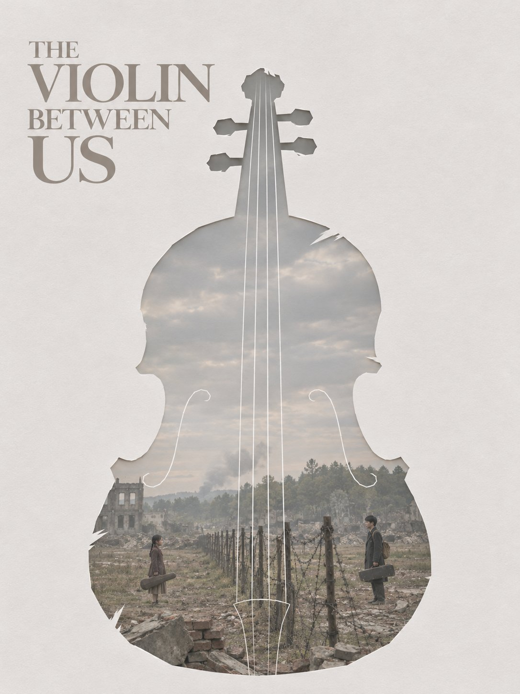
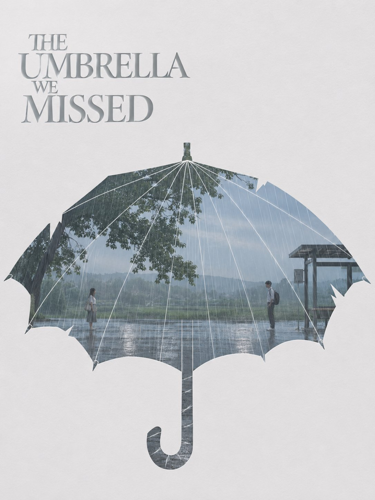
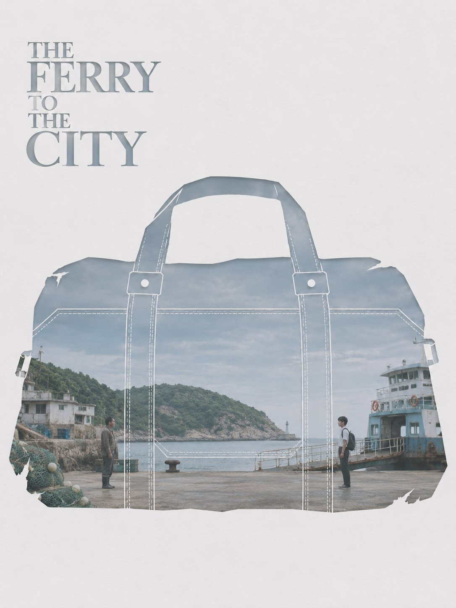
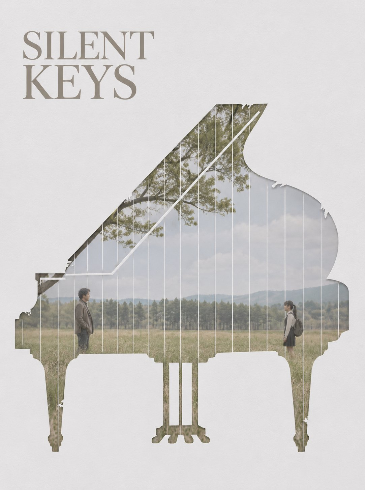

# GPT2 × 物件剪成剧照窗 × 克制双关 × 剧情电影海报

- 日期：2026-11-05（原帖发布于 2026-11-04 21:37 北京时间）
- 作者：[@xiaoxiaodong](https://x.com/xiaoxiaodong)（小小东，原 @xiaoxiaodong01）
- 原帖：https://x.com/xiaoxiaodong/status/2117974572171739265
- Tweet ID：2117974572171739265
- 模型：GPT2
- 说明：建筑从白墙长出又融化回去的极简建筑主视觉汤底——写实屋顶、主题色平涂斜拖、白色浮雕碎块沿对角线消散，右侧一小方色块单字点题。

> 提示词全文来自原帖正文。版权归原作者，此处仅作归档。

## 提示词

```
A minimal architectural key visual whose first blow is a real building growing out of a white wall and melting back into it: the upper part of the theme's landmark building is whole and realistic, roofs, eaves, balustrades, doors and windows rendered in clear detail like a precise architectural photograph; from its base downward, its most characteristic wall turns into one flat block of colour that runs out diagonally along the building's perspective, its edge breaking apart as it goes into fragments of every size and flying specks, like paint thrown onto a wall and slowly spreading; the side of the building the colour does not carry away dissolves into thick white relief, clumps of raised white build-up scattering along the same diagonal like clouds, or like plaster blown apart by wind, finally fading into the flat white wall. Realistic building, flat colour and white relief meet one after another along a single diagonal, and that passage from solid to void is the picture's suspense. The whole image unfolds along a diagonal from upper right to lower left, the building set toward the upper right and seen from a slightly raised angle, the colour dragging toward the lower-left corner and dispersing there, with wide clean white left at the lower right and upper left. The theme decides the colour: the flat block takes the native colour of the building's most characteristic wall or material, purified to saturated yet steady, the only colour in the picture; the roofs and shadows of the building are the deepest note, close to ink; everything else is white at different values, the relief revealed only by small soft shadows cast by gentle side light. When the building's material changes, the block of colour switches wholesale to another hue, holding only the relationship of a single colour, near-ink shadows and wide white. Light falls obliquely from the upper left, shadows short and light. At the right edge stands one small square block of colour holding a single white character that names the theme, with a long thin arrow line in the same colour hanging beneath it and pointing at the building, and no other text at all; when the theme supplies words, that character is the single most essential one taken from them, with any Chinese always in simplified characters. The whole is quiet and generous with empty space, like a relief work on a wall, letting a building appear on the wall and vanish into it again.
```

## 成品




