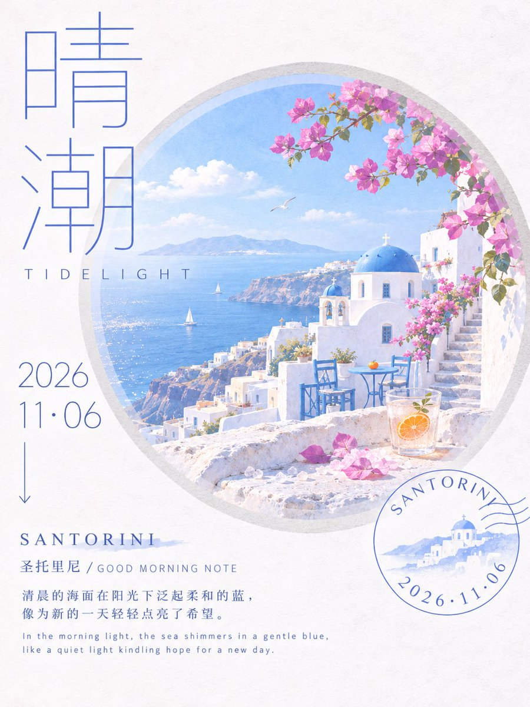
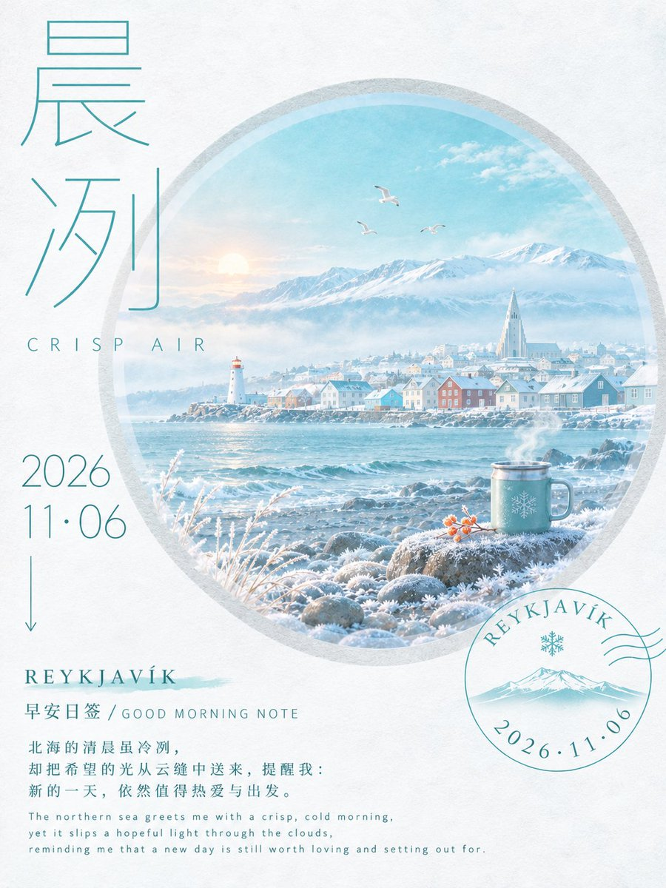
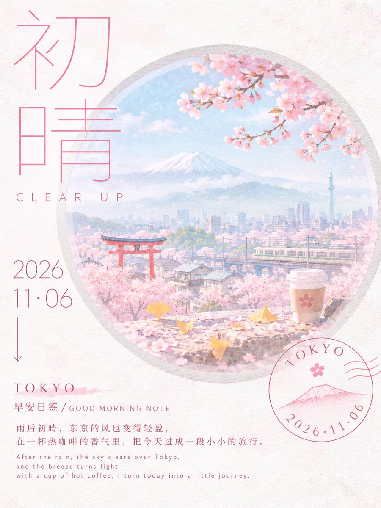
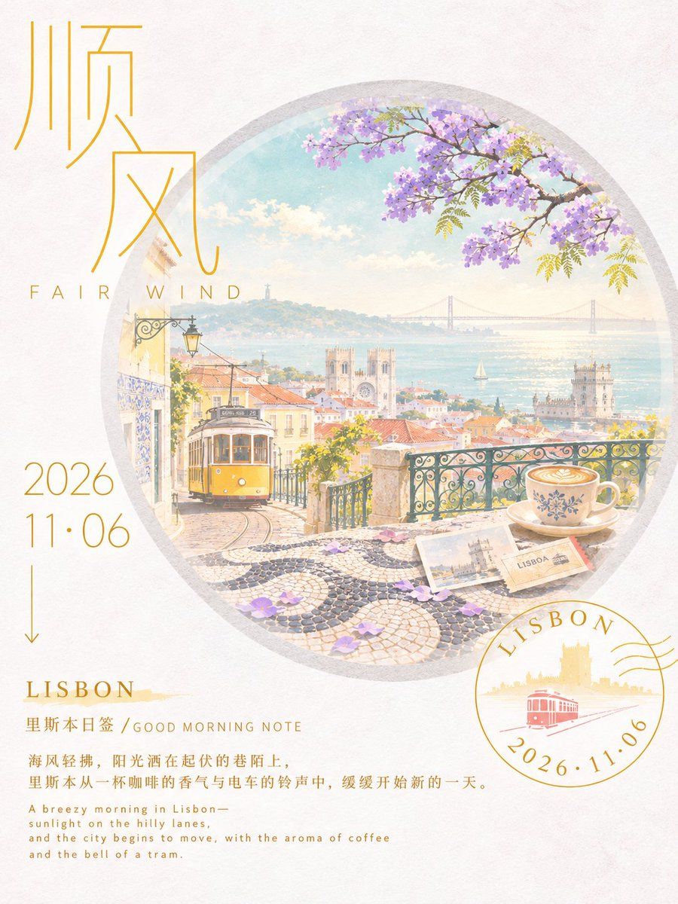

# GPT2 × 早安 × 圆窗层景 × 清亮纸感 × 旅行海报

- 日期：2026-11-06（原帖发布于 2026-11-06 10:21 北京时间）
- 作者：[@xiaoxiaodong](https://x.com/xiaoxiaodong)（小小东，原 @xiaoxiaodong01）
- 原帖：https://x.com/xiaoxiaodong/status/2118529277251694626
- Tweet ID：2118529277251694626
- 模型：GPT2
- 说明：偏右大圆窗作观看入口的明亮洁净旅行记忆式视觉汤底——前中后三层景深、左侧细线大标题与时间线、右下弧形圆章，纸白粉雾配色。提示词取自原帖 ChatGPT 分享链接。

> 提示词全文来自原帖分享的 ChatGPT 对话。版权归原作者，此处仅作归档。

## 提示词

```
围绕任意主题对象生成一套明亮洁净的旅行记忆式视觉：画面以偏右的大圆窗作为主要观看入口，圆窗有厚实浅灰外环和柔和半透明内缘，像从纸面凿开的安静窗口；主题内容在圆窗内被拆成前中后三层，最前层可用密集纹理或小颗粒形成大面积铺展，中层放置低矮的主题符号和小型叙事物，远层用柔化轮廓、浅雾过渡和水平延展的山形或环境剪影制造深度。左上放置极大字距的主题短标题，笔画纤细、几何、近似单线，分行堆叠，部分字块越过圆窗边缘但不遮断主体；左侧中段用年份或阶段数字配一条细长竖线与箭头，底部保留小号中英混排说明，形成从大标题到时间线再到注释的慢阅读路径。右下加入细线圆形印章，部分压在圆窗和纸面之间，弧形文字沿圆周转动，成为轻微失衡的收尾。色彩由主题派生：背景保持高明度低饱和纸白，圆窗内用清透冷色作远景与空气，柔和暖色作大面积情绪铺底，浅绿色或同等鲜活的生命色作山脊和过渡带，小面积高饱和暖色只用于叙事焦点；整体必须明亮、粉雾、干净，避免厚重阴影。材质像轻度数码拼贴叠加纸面印刷，背景有细微纤维、扫描噪点和淡淡磨损，图形边缘略软、局部有粉笔或蜡笔般颗粒，但圆窗结构、细线和文字仍保持清晰。保持大留白、圆窗包裹、左侧文字压迫与右下圆章越界之间的平衡，失去圆窗观看感或把颜色压暗都会破坏这个设计。 —————— 主题：早安日签海报 x 2026-11-06 x 一个预测词汇 文案和主体你自拟文案逻辑的设计 小清新配色 比例3:4 注意： 「10张独立生图，一图一城，一图一色，每张3:4。逐张生成，禁止拼版及拼版裁切。每张都是截然不同的色相配色逻辑
```

## 成品





