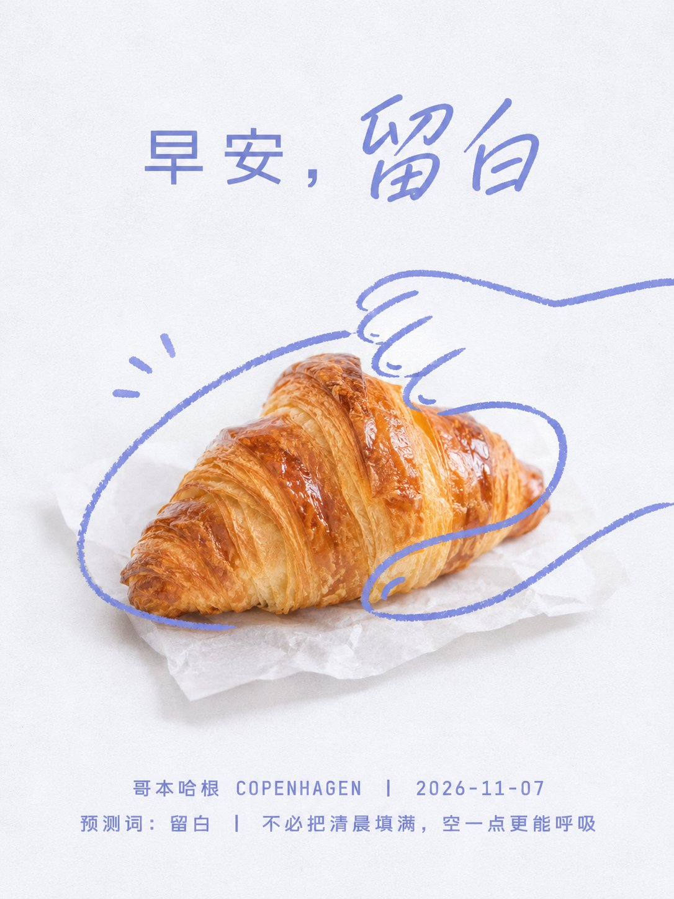
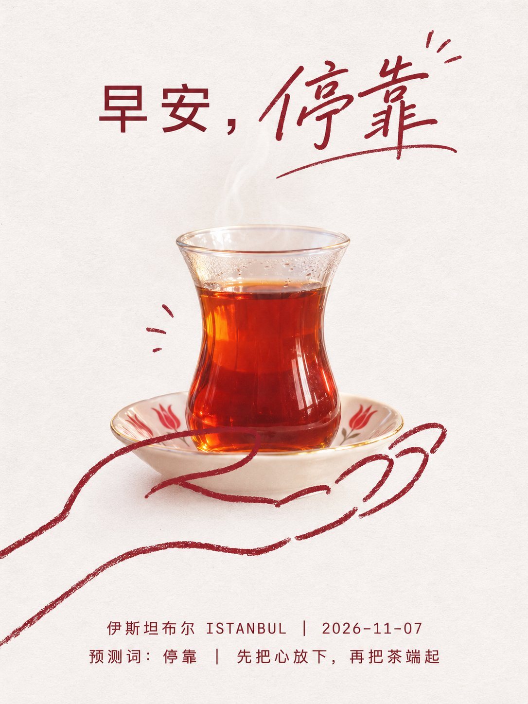
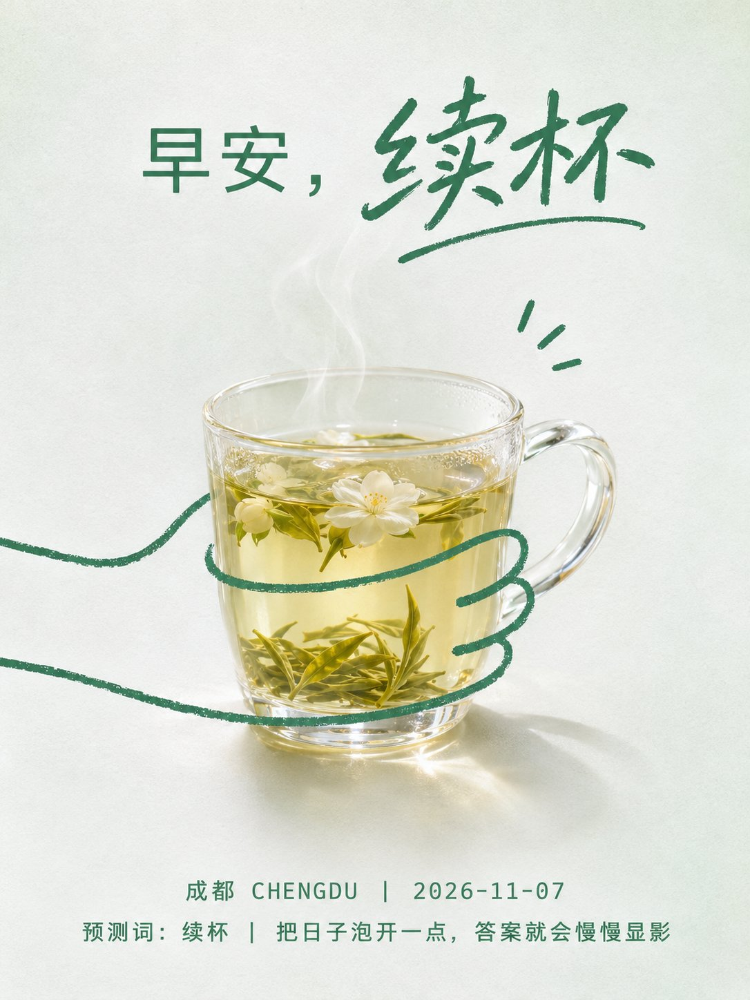
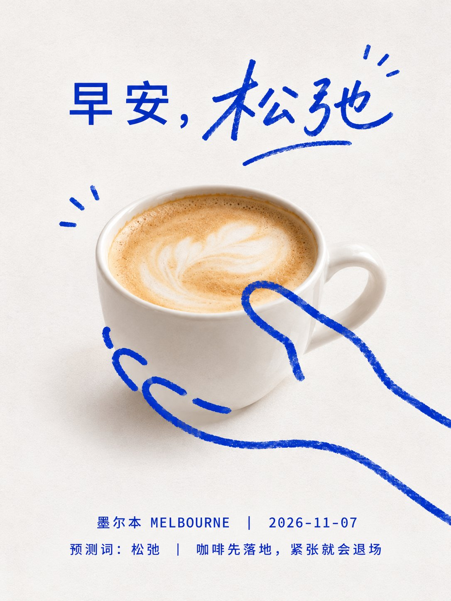

# GPT2 × 早安 × 极简留白 × 手绘线介入 × 轻广告海报

- 日期：2026-11-08（原帖发布于 2026-11-07 11:53 北京时间）
- 作者：[@xiaoxiaodong](https://x.com/xiaoxiaodong)（小小东，原 @xiaoxiaodong01）
- 原帖：https://x.com/xiaoxiaodong/status/2118914815079112949
- Tweet ID：2118914815079112949
- 模型：GPT2
- 说明：明亮洁净的极简轻广告汤底——近白纸感背景上，主题静物居中悬停，一条单色手绘粗线以「被握住、被圈住或被轻触」的松弛手势压过主体并延伸进留白，摄影与涂鸦轻微错位；手绘线与文字共用冷静强调色，顶部短促口号（关键词手写），底部两行等宽地点/日期/预测词。

> 提示词全文来自原帖分享的 ChatGPT 对话。版权归原作者，此处仅作归档。广告信息已剔除。

## 提示词

```
围绕任意主题对象生成明亮洁净的轻广告海报：大面积近白背景占据主导，背景保留轻微纸感颗粒、柔和扫描噪点和低对比阴影，不添加复杂场景；主题对象以真实摄影或高仿真实物质感居中悬停，体量紧凑、边缘清晰，顶部留出充足呼吸空间，底部留给小号信息排版。最关键的视觉动作是一条主题派生的单色手绘线从对象一侧伸入并覆盖在对象表面，以连续、松弛、略不稳的粗线勾出“被握住、被圈住或被轻触”的手势关系；线条不追求解剖准确，靠几段长弧线、断开的短指节和局部重叠建立亲近感，必须同时压在主体前景并延伸到背景空白里，形成摄影与涂鸦之间的轻微错位。色彩按主题派生：背景保持高明度低饱和的洁净白域，主体使用主题材料的温暖或自然中间调并允许局部半透明、凝结、泡沫、玻璃、纸面、金属或柔软表面的真实光泽；手绘线与文字共用一个冷静、清晰、偏深的主题强调色，面积很小但对比明确。上方放一行短促口号，使用等宽或机械感无衬线为基础，中间可让一个关键词变成流畅手写体，字距松、重量轻，像随口标记而不是品牌宣言；底部用两行小号等宽信息排列，居中、低密度、带分隔符节奏，只承担场景说明和时间地点感，不抢主体。整体保持静物摄影的真实光照、极简留白、蓝图式涂鸦覆盖和轻微纸面印刷感，失败症状是线条变成精致插画、背景变脏、文字过重、主体过满或主题对象失去被手绘线轻轻介入的关系。

——————

主题：早安日签海报  x 2026-11-07  x 一个预测词汇

核心文字：你拟定的流行的哲理小众警局

文案和主体你自拟文案逻辑的设计

小清新配色

比例9:16

注意：
「10张独立生图，一图一城，一图一色，每张3:4。逐张生成，禁止拼版及拼版裁切。每张都是截然不同的色相配色逻辑
```

## 成品





