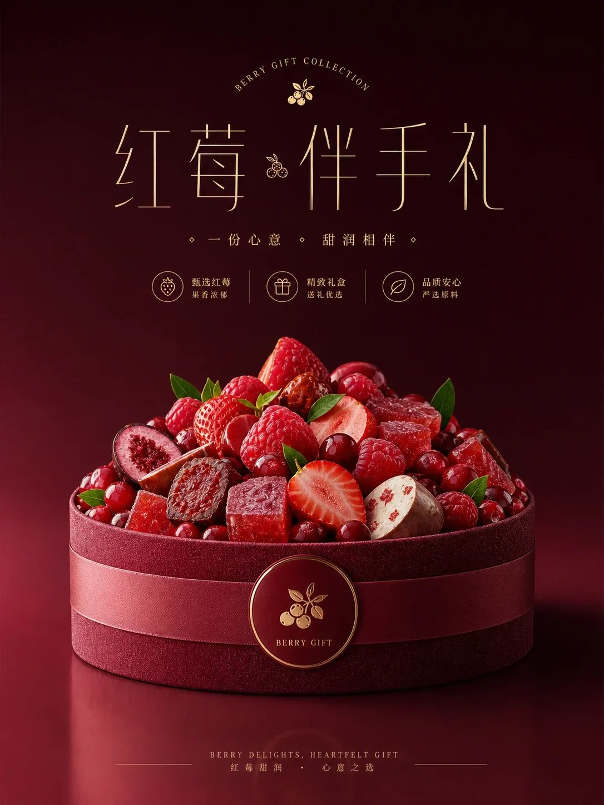
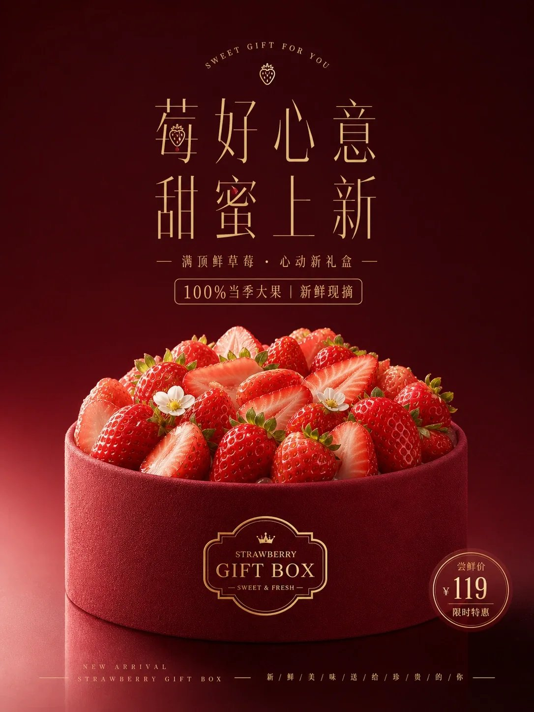

# GPT2 × 鲜果满顶 × 浓红甜雅 × 电商产品海报 × 美学提示词

- 日期：2026-11-09（原帖发布于 2026-11-08 23:13 北京时间）
- 作者：[@xiaoxiaodong](https://x.com/xiaoxiaodong)（小小东，原 @xiaoxiaodong01）
- 原帖：https://x.com/xiaoxiaodong/status/2119448198091768033
- Tweet ID：2119448198091768033
- 模型：GPT2
- 说明：电商/商品海报汤底——深色饱和主题色空场托起礼盒式中轴陈列，低矮圆润的主体顶面密集插满鲜亮小元素形成丰盛堆顶，配细长高对比烫金感标题与低声量双语小字。

> 提示词全文来自原帖正文。版权归原作者，此处仅作归档。

## 提示词

```
围绕任意主题对象生成商品海报视觉，整体保持礼盒式中轴陈列：上方留出深而干净的主题色空场，中上部放精细标题锁定，画面下半部让主题对象成为低矮圆润的承载体，顶面被主题派生的鲜亮小元素密集插入、半露、重叠和切开，形成丰盛堆顶，外圈保留连续厚实的环形边缘与细密绒面或主题材质纹理，底部用极小副标题收束。色彩由主题推导，但遵循深背景、亮主体、暖浅金文字、少量高亮点缀的角色关系：背景占最大视觉重量，纯净饱和且由上到下有细微明度漂移；主体与背景同属一个情绪色系但更明亮、更有材质颗粒；顶部附着物保持湿润高光、清晰边缘和可触摸的切面，少量浅色块制造甜润间隔。光线从左前方柔和压下，主体正面清楚、右侧和底部阴影更厚，台面有低反射和轻微倒影，空间不堆杂物，只用色场托住产品。标题使用细长高对比笔画，字距宽松，横竖线条像金属箔或烫金印刷浮在深色上，局部笔画可被主题小图标或圆点替换，但不破坏阅读；顶部弧形小字和中心小符号制造礼品感，底部双语式细字与左右细线装饰保持低声量。保持干净广告摄影质感，边缘锐利、纹理清楚、没有纸张做旧和杂乱背景，失败症状是主体不够丰盛、字太粗、背景变脏或颜色关系散开。
```

## 成品



