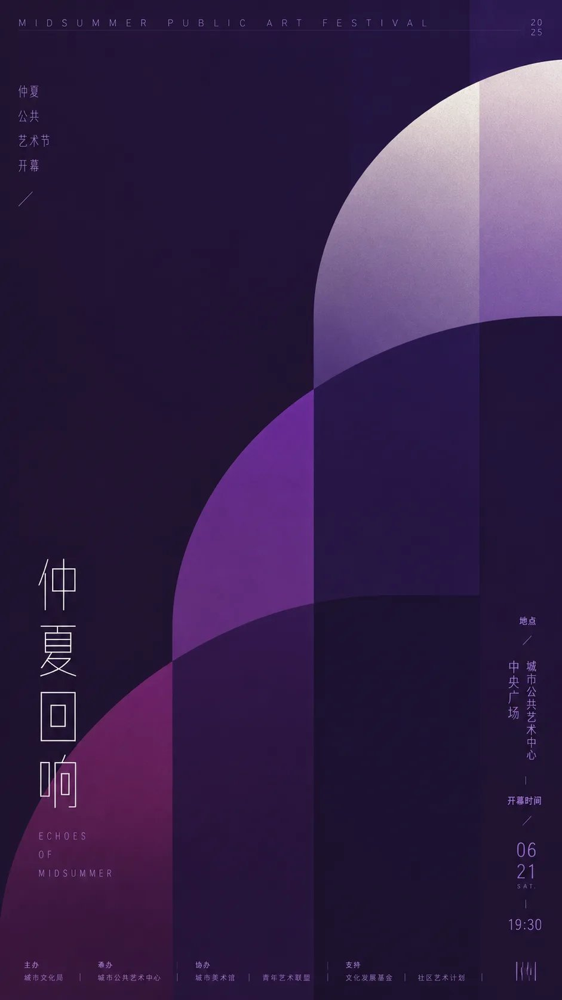
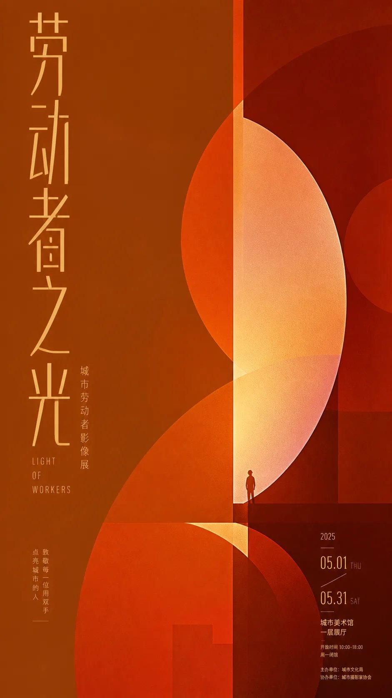
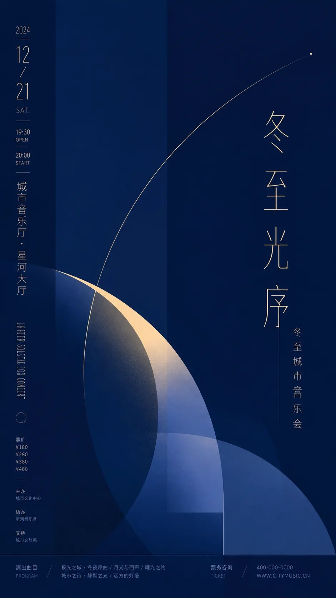
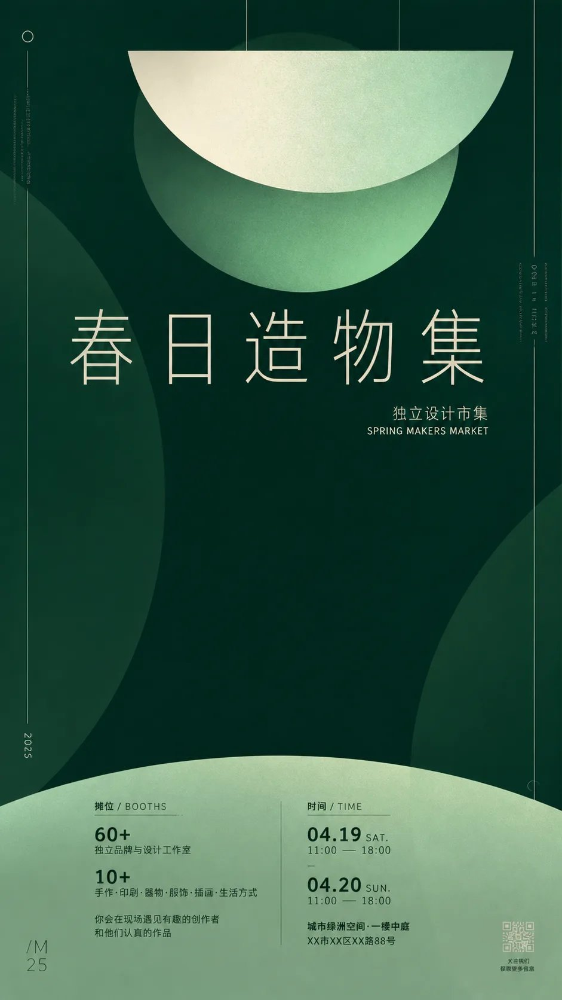

# GPT2 × 半日叠圆 × 秩序 × 节庆海报 × 提示词

- 日期：2026-11-19（原帖发布于 2026-11-18 17:00 北京时间）
- 作者：[@xiaoxiaodong](https://x.com/xiaoxiaodong)（小小东，原 @xiaoxiaodong01）
- 原帖：https://x.com/xiaoxiaodong/status/2122978280970002744
- Tweet ID：2122978280970002744
- 模型：GPT2
- 说明：节庆海报汤底——深浅红块铺满画面，巨大的圆、半圆与被裁切弧面相互遮挡，像一枚垂直切开的发光圆盘嵌入厚重红幕；竖排细长印刷字与克制留白构成偏置秩序。

> 提示词全文来自原帖正文。版权归原作者，此处仅作归档。

## 提示词

```
第一眼以深浅红色块铺满画面，巨大的圆、半圆与被裁切的弧面相互遮挡，像一枚被垂直切开的发光圆盘嵌入厚重红幕之中；主题形象被抽象为几何天体或建筑投影，只保留圆弧、直边、压暗阴影和局部柔光的关系，不写实堆砌。画面以大面积暗红作底，叠加酒红、猩红、砖红的平面块，少量奶黄色到淡粉紫的柔和渐变只出现在关键半圆或底部弧面，形成克制的节庆光感。版式保持强烈留白与偏置构图：主要文字成窄列竖排，字距舒展，靠近几何重心但不居中；辅助信息压低、缩小，沿边缘或底部形成细密信息带。字体机制为瘦长、硬朗、低装饰的现代印刷骨架，笔画均匀，端点干净，字腔开阔，纵向节奏稳定，标记与数字也服从细线、紧排、低对比的秩序。所有元素像广告印刷品一样平整、无厚重质感，边界清晰但色块之间有轻微压暗、套印感和透明叠色，保留商业物料的克制、规整与少量机械误差，不加入华丽纹样、立体渲染、烟雾、金属、过度光效或插画化人物。
```

## 成品





