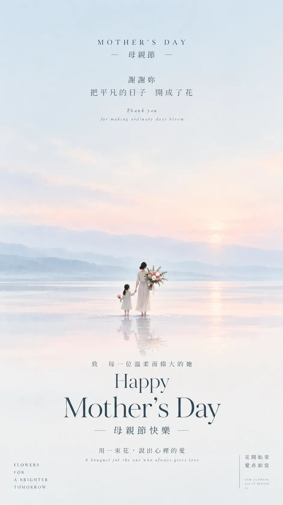
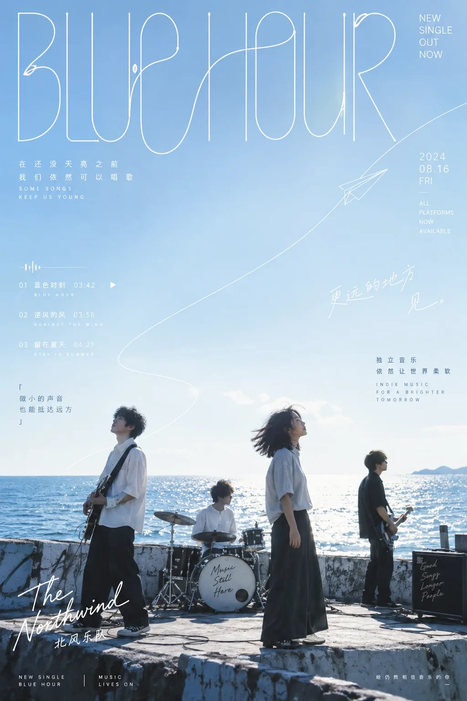
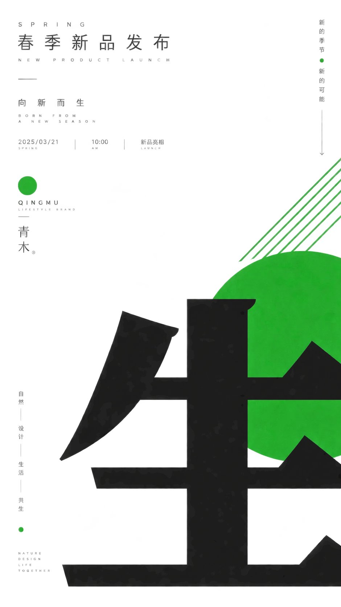
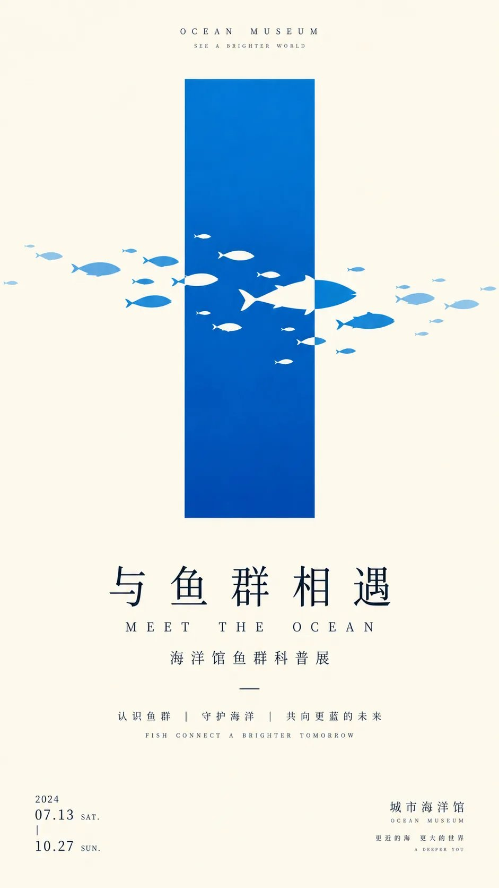

# 极端留白 × 截断巨字 × 春季新品海报 × 提示词

- 日期：2026-11-21（原帖发布于 2026-11-20 20:57 北京时间）
- 作者：[@xiaoxiaodong](https://x.com/xiaoxiaodong)（小小东，原 @xiaoxiaodong01）
- 原帖：https://x.com/xiaoxiaodong/status/2123762573837504541
- Tweet ID：2123762573837504541
- 说明：原帖给出图三完整提示词——以极端留白中的巨大截断字形作为第一视觉事件，示例为纸白、浓黑、翠绿点缀的春季新品发布海报（巨大「生」字）。原帖附 4 张成品。原帖未标明模型。

> 提示词全文来自原帖正文（note_tweet）。版权归原作者 [@xiaoxiaodong](https://x.com/xiaoxiaodong)，此处仅作归档。

## 提示词

```
以极端留白中的巨大截断字形作为第一视觉事件：主体文字或主题符号被放大到超出画面边界，只露出粗黑结构的局部，让字形像建筑构件一样压住画面一侧；另一侧保持宽阔洁白空气，放置少量细窄竖排信息、微型标识和短句，形成大体量与小信息的悬殊对照。主色只用纸白、浓黑和高纯朱红，红色以实心圆、半圆或条纹日轮形介入，既遮挡又托举黑色主体，部分斜向平行线从圆形边缘伸出，制造印刷海报的节奏。字体机制强调粗细强烈分裂：主字为厚重、硬边、几何化的黑色笔画，转角略钝但轮廓坚决，细字为高瘦、克制、拉开字距的排版，允许横排与竖排并置，读向成为构图轴线。所有元素像被精确排版在平面纸张上，没有透视空间和装饰阴影，边缘干净，黑色压实，红色平涂，灰字极轻；保留少量错位、裁切、遮挡和负空间中的孤立小圆点，让主题在新内容中仍呈现冷静、现代、东方印刷感的品牌识别海报。

——————
做成春季新品发布海报，以纸白、浓黑和高纯翠绿维持单一强点缀的色彩语法；巨大“生”字从右下越界上升，翠绿半圆卡在字腹与边缘之间，左上留出近乎空白的呼吸区，细小发布信息横向分层排列并以短竖线导向主体；标题采用右下超尺度裁切，副标题左上齐头对齐，品牌标识独立悬停于中段。画幅为竖版 9:16。
```

## 成品





