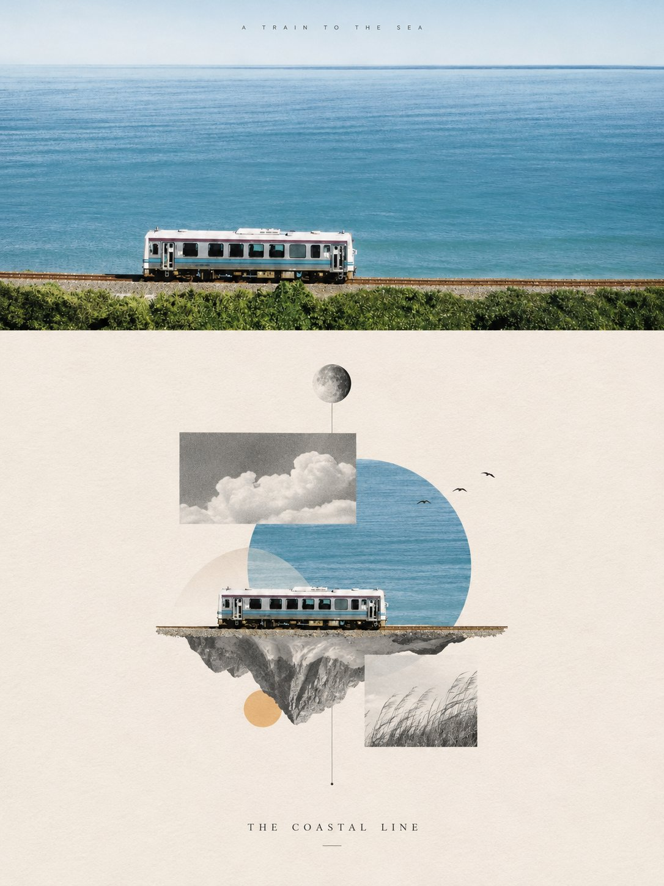
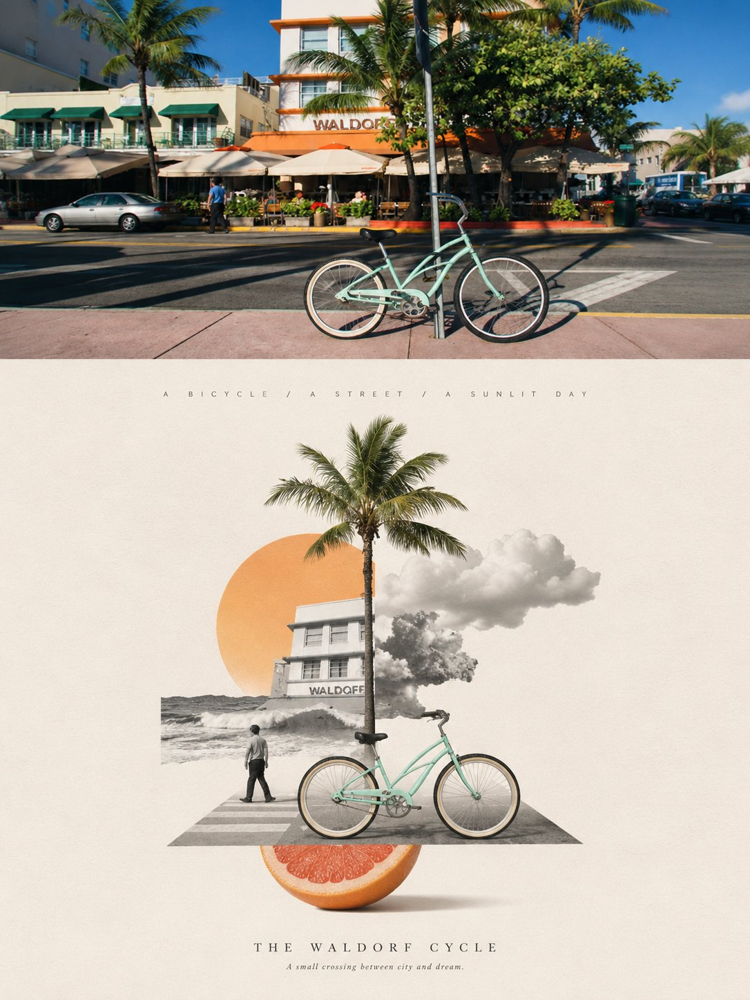

# GPT2 × 极简超现实拼贴 × 技巧 × 提示词 × 美学

- 日期：2026-11-22（原帖发布于 2026-11-21 23:06 北京时间）
- 作者：[@xiaoxiaodong](https://x.com/xiaoxiaodong)（小小东，原 @xiaoxiaodong01）
- 原帖：https://x.com/xiaoxiaodong/status/2124157540091175127
- Tweet ID：2124157540091175127
- 模型：GPT2
- 说明：原帖给出完整提示词——将照片做成 3:4 竖版上下双联海报，上半保留真实摄影，下半以暖白纸底做极简超现实拼贴。原帖附 2 张成品。

> 提示词全文来自原帖正文（note_tweet）。版权归原作者 [@xiaoxiaodong](https://x.com/xiaoxiaodong)，此处仅作归档。

## 提示词

```
将照片创作成3:4竖版上下双联海报：上半保持真实摄影风貌，下半以暖白纸底呈现极简超现实拼贴。提炼照片中的核心主体与场景意象，通过异质元素嫁接、尺度错位与黑白彩色对置，构成一幅诗意视觉隐喻。采用摄影蒙太奇、精准剪裁、克制色彩和细腻纸张肌理；主体居中纵向排列，四周保留大面积呼吸留白，上方搭配极细英文微字，下方点缀小型衬线标题，形成静谧、疏离的当代观念艺术与瑞士极简编辑设计。
```

## 成品



