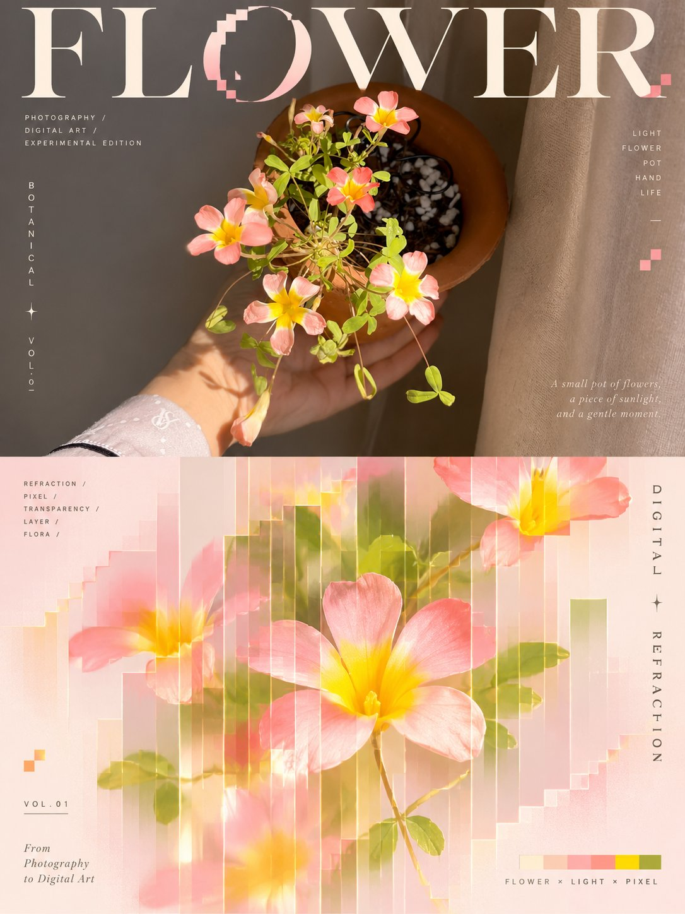
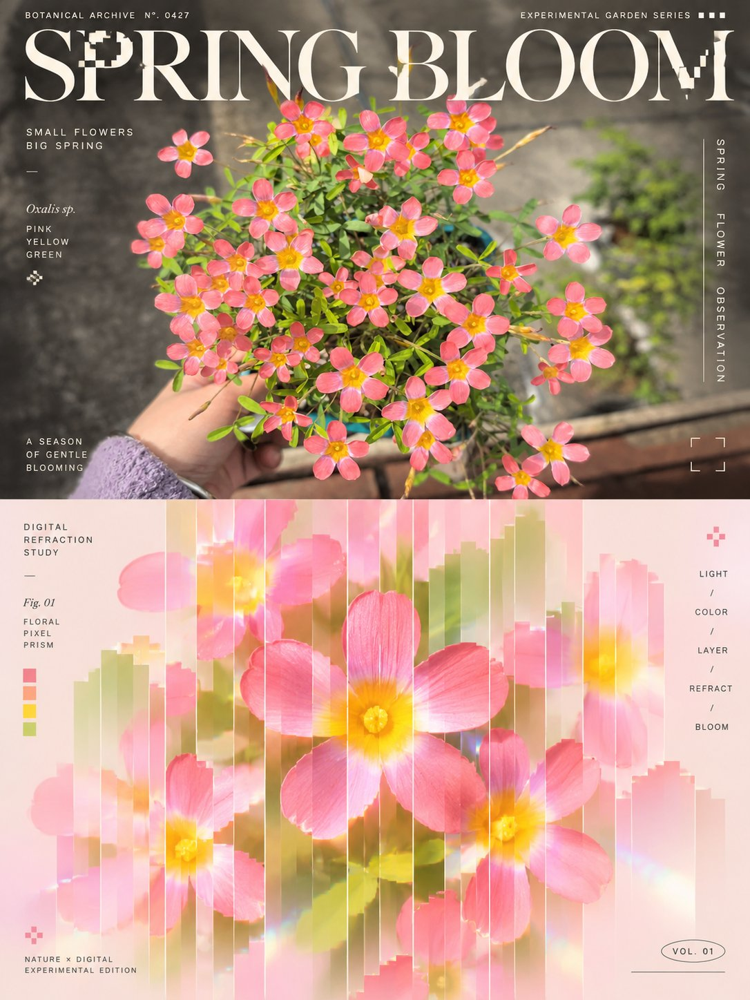

# GPT2 × 转绘 × 数字折射艺术 × 上下双联海报 × 提示词

- 日期：2026-11-27（原帖发布于 2026-11-27 01:05 北京时间）
- 作者：[@xiaoxiaodong](https://x.com/xiaoxiaodong)（小小东，原 @xiaoxiaodong01）
- 原帖：https://x.com/xiaoxiaodong/status/2125999282805449073
- Tweet ID：2125999282805449073
- 模型：GPT2
- 说明：将输入照片做成 3:4 竖版上下双联海报——上半保持真实摄影风貌，下半以浅色底呈现数字折射艺术（纵向半透明栅格、阶梯像素边缘与色层叠透）；主题不限花卉，可自由换图。

> 提示词全文来自原帖正文。版权归原作者 [@xiaoxiaodong](https://x.com/xiaoxiaodong)，此处仅作归档。原帖注明最后一段构图约束也可删掉。

## 提示词

```
将照片创作成3:4竖版上下双联海报：上半保持真实摄影风貌，下半以浅色底呈现数字折射艺术。提炼照片中的核心主体，转译为纵向半透明栅格，通过长短错落、阶梯像素边缘与色层叠透形成虚实交融的视觉焦点。依据原图色彩建立主色渐层、邻近色过渡与局部对比色点睛，保持通透光感。主体放大居中、局部溢出裁切，顶部横贯超大高反差衬线英文标题，嵌入像素化字形，四周搭配无衬线微字与侧边竖排，形成复古优雅与数字先锋交融的实验性编辑设计。

整体画布严格沿水平中线划分为上下两个等宽等高的独立画面，各占画布总高度的50%，上下高度比固定为1:1，此比例为不可变更的硬性构图约束，优先于任何主体尺度、图文排版及艺术表现需求。
```

## 成品



